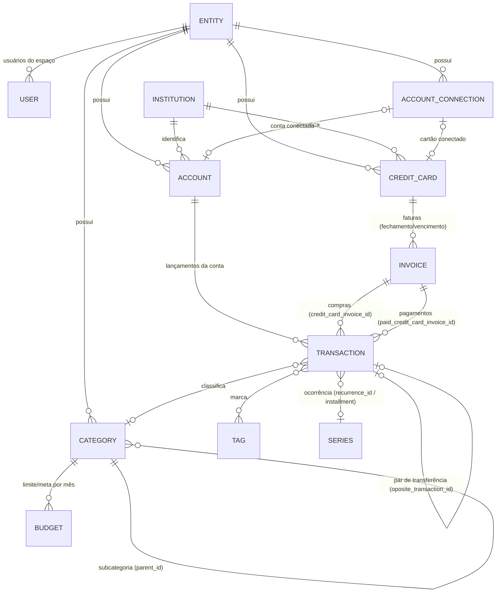

# Organizze — mapa de funcionalidades, regras de negócio e dores (fontes públicas)

> Data de referência: **26/10/2026**. Preços e planos valem "em 26/10/2026".
> Objetivo: servir de base para (a) decidir a paridade do MVP e (b) achar lacunas para diferenciação. Na seção 5 e na seção 6 está o que mais importa para o futuro `CONTEXT.md`.

## Como ler este documento (método e limitações)

- **Fontes primárias usadas:** site `organizze.com.br` (home, `/planos`, `/agentes`, landing pages, termos, privacidade), central de ajuda oficial (Zendesk em `ajuda.organizze.com.br`, 340 artigos no sitemap), portal de desenvolvedores (`developers.organizze.com.br`, com a especificação OpenAPI embutida), repositórios oficiais no GitHub (`organizze/agent-tools`, `organizze/api-doc`), App Store, Google Play e o blog oficial.
- **Bloqueios encontrados:** a central de ajuda e o Reclame Aqui respondem HTTP 403 (Cloudflare) para leitura automatizada. Contornos usados, nesta ordem:
  1. o **sitemap da central** (`/hc/sitemap.xml`) é acessível e dá a lista completa de títulos/URLs com data de modificação;
  2. o **conteúdo** dos artigos foi lido em **snapshots do Wayback Machine** (a data do snapshot de cada artigo está na tabela da seção 10). 193 artigos atuais + 18 artigos já removidos foram lidos;
  3. para os **18 artigos mais novos que nunca foram arquivados** (investimentos, faturas conectadas, lançamentos futuros em contas conectadas etc.), usei o título e **trechos de resultados de busca** que apontam para a mesma página — sinalizado como **(via trecho de busca)**.
- Muitos artigos foram editados depois do snapshot lido (coluna "lastmod" da seção 10). Quando há indício de que a regra mudou, isso está dito no texto.
- Nada foi feito logado, nenhuma chamada foi feita à API do Organizze e nenhum binário foi baixado. A especificação OpenAPI foi lida na página pública de documentação e no GitHub.
- **Convenções:** "Todos" na coluna Plano = os três planos pagos (Manual, Conectado, Conectado Plus), porque os planos conectados incluem "tudo do Plano Manual" ([planos](https://www.organizze.com.br/planos/)). Marcadores: **(não verificado)**, **(inferência)** = conclusão minha a partir de campos/exemplos, **(via trecho de busca)**, **(snapshot AAAA-MM)** = versão arquivada que pode estar desatualizada.
- Links do tipo `ajuda.organizze.com.br/hc/pt-br/articles/<ID>` são a URL canônica do artigo (o Zendesk redireciona para o slug). A tabela da seção 10 liga cada ID ao snapshot efetivamente lido.

---

## 1. Resumo

O Organizze é um gerenciador de finanças pessoais brasileiro (Organizze Tecnologia Ltda., Criciúma/SC, operando desde 2009) disponível na web, em iOS/iPadOS e em Android. O núcleo do produto é o **controle manual**: contas, cartões de crédito com faturas derivadas de dia de fechamento e de vencimento, lançamentos com status pago/pendente, séries fixas e parceladas, categorias com um nível de subcategoria, tags, limites de gastos mensais por categoria, metas de receita, e relatórios que misturam **regime de caixa** (entradas x saídas, fluxo de caixa) e **regime de competência** (categorias, tags, limites). Desde o fim de 2024 há uma camada paga de **Conexão Bancária via Open Finance** (PF no plano Conectado, PF+PJ no Conectado Plus) que importa transações de contas e cartões com regras próprias (lançamentos importados com valor imutável, "marcadores especiais" para não contar transferências e pagamentos de fatura duas vezes, faturas conectadas). Em 2026 vieram o **conector MCP** para ChatGPT/Claude/Manus (todos os planos), **API REST v2 documentada em OpenAPI**, **CLI open source** e a área **Meus Investimentos** alimentada por Open Finance. **Não há plano gratuito** — só 7 dias de teste do Plano Manual — e os preços acabaram de subir (entre 03/10 e 26/10/2026). O modelo de dados é simples: o lançamento tem **uma única data** e um booleano `paid`, valores em **centavos com sinal** (negativo = despesa), transferências são **pares de lançamentos ligados**, e séries fixas/parceladas viram ocorrências materializadas. As dores públicas mais frequentes são preço/ausência de plano grátis, falhas e limites da conexão bancária (parcelas de cartão, planejamento futuro em contas conectadas), cobrança/cancelamento e suporte; as notas nas lojas, porém, seguem altas (4,6).

**Fatos-chave**

| Item | Valor | Fonte |
|---|---|---|
| Empresa | Organizze Tecnologia Ltda., CNPJ 35.381.093/0001-26, Criciúma/SC; operação desde maio de 2009 | [termos](https://www.organizze.com.br/termos-de-uso/), [quem somos](https://www.organizze.com.br/quem-somos/) |
| Plataformas | Web (navegador); iOS/iPadOS 15+ (o app de iPad também roda em Mac com Apple Silicon e no Apple Vision); Android | [App Store](https://apps.apple.com/br/app/organizze-finan%C3%A7as-pessoais/id677699286), [ajuda: app](https://ajuda.organizze.com.br/hc/pt-br/articles/6105658318227) |
| Planos (em 26/10/2026) | Manual R$ 39/mês ou 12x R$ 29,90 (anual); Conectado R$ 49/mês ou 12x R$ 39,90; Conectado Plus R$ 79/mês ou 12x R$ 69,90 | [planos](https://www.organizze.com.br/planos/) |
| Teste grátis | 7 dias do Plano Manual, sem cartão | [planos](https://www.organizze.com.br/planos/), [termos 2.1/3.5](https://www.organizze.com.br/termos-de-uso/) |
| Plano gratuito | Não existe ("produto pago") | [termos 2.1](https://www.organizze.com.br/termos-de-uso/) |
| App Store | 4,6 ★, 46 mil avaliações, nº 161 em Finanças, versão 7.4.41 (18/10/2026) | [App Store](https://apps.apple.com/br/app/organizze-finan%C3%A7as-pessoais/id677699286) |
| Google Play | 4,6 ★, 57,1 mil avaliações, "1 mi+" downloads, selo "Escolha dos editores", atualizado em 16/10/2026 | [Google Play](https://play.google.com/store/apps/details?id=com.organizze.android&hl=pt_BR&gl=BR) |
| Downloads (autodeclarado) | "mais de 6 milhões" somando as lojas | [quem somos](https://www.organizze.com.br/quem-somos/) |
| Reclame Aqui | Reputação "Ótima", nota 8,8/10; 54 reclamações de 01/03 a 31/08/2026, 100% respondidas, 90,9% resolvidas | [snapshot RA 23/09/2026](https://web.archive.org/web/20260923164739/https://www.reclameaqui.com.br/empresa/organizze/) |
| Desenvolvedores | API REST v2 (Basic auth com chave de API), OpenAPI 3.0, conector MCP remoto com 60 ferramentas (OAuth), CLI e Agent Skill open source (MIT) | [developers](https://developers.organizze.com.br/), [agent-tools](https://github.com/organizze/agent-tools) |
| Central de ajuda | 340 artigos, 6 categorias (Web, iOS, Android, Assinaturas, Conexão Bancária, Recursos IA) | [sitemap da central](https://ajuda.organizze.com.br/hc/sitemap.xml) |

---

## 2. Planos e preços (em 26/10/2026)

| Plano | Preço mensal | Preço anual | O que libera / limites | Fonte |
|---|---|---|---|---|
| **Plano Manual** | R$ 39/mês | "12x de R$ 29,90 cobrado anualmente" (= R$ 358,80, conta minha); na App Store o anual aparece como R$ 359,90 | Sem conexão bancária. Controle manual de contas e cartões; categorias e subcategorias; "limite de gastos ilimitados"; alerta de contas a pagar; relatórios. Único plano com teste grátis (7 dias). | [planos](https://www.organizze.com.br/planos/), [App Store (compras no app)](https://apps.apple.com/br/app/organizze-finan%C3%A7as-pessoais/id677699286) |
| **Plano Conectado** ("Mais popular") | R$ 49/mês | 12x R$ 39,90 (= R$ 478,80) | Tudo do Manual + **até 3 contas/cartões conectados**; importação em lote; **1 atualização automática por dia + 2 atualizações extras (manuais) por dia**; **só contas Pessoa Física**. | [planos](https://www.organizze.com.br/planos/), [app-de-finanças](https://www.organizze.com.br/app-de-financas/) |
| **Plano Conectado Plus** | R$ 79/mês | 12x R$ 69,90 (= R$ 838,80) | Tudo do Conectado + **até 10 contas/cartões conectados**; **4 atualizações extras por dia**; contas **PF e PJ**. | [planos](https://www.organizze.com.br/planos/) |

**Observações sobre planos**

- **Sem custo adicional em todos os planos:** conexão com assistentes de IA via MCP ([agentes](https://www.organizze.com.br/agentes)). A **API REST** exige conta com "licença ativa" ([developers](https://developers.organizze.com.br/)).
- **Teste:** 7 dias do Plano Manual, sem cartão ([planos](https://www.organizze.com.br/planos/), [termos 3.5](https://www.organizze.com.br/termos-de-uso/)). Em 2025 a página de planos marcava o Conectado explicitamente como "Sem teste grátis" ([snapshot planos 30/07/2025](https://web.archive.org/web/20250730022030/https://www.organizze.com.br/planos/)); a página atual só exibe o selo de teste no Manual.
- **Reajuste recente:** de jul/2025 até o snapshot de 03/10/2026 a página mostrava Manual R$ 35/mês ou R$ 199,90/ano (ou 12x R$ 19,90), Conectado R$ 45/mês ou R$ 399,90/ano (ou 12x R$ 39,90), Conectado Plus R$ 69/mês ou R$ 599,90/ano (ou 12x R$ 59,90) ([snapshot 30/07/2025](https://web.archive.org/web/20250730022030/https://www.organizze.com.br/planos/), [snapshot 03/10/2026](https://web.archive.org/web/20261003194441/https://www.organizze.com.br/planos/)). O aumento para 39/49/79 aconteceu, portanto, entre 03/10 e 26/10/2026. No modelo antigo o anual parcelado em 12x saía mais caro que o anual à vista (12 × 19,90 = 238,80 contra 199,90).
- **Preço por plataforma:** os termos dizem que valores podem variar por sazonalidade, promoção e plataforma ([termos 3.4](https://www.organizze.com.br/termos-de-uso/)). A App Store lista "Plano Mensal Manual" R$ 39,00, "Plano Mensal Conectado" R$ 49,00, "Plano Mensal Conectado Plus" R$ 79,00 e "Anual" R$ 359,90 ([App Store](https://apps.apple.com/br/app/organizze-finan%C3%A7as-pessoais/id677699286)).
- **Landing desatualizada:** a página "gestão financeira empresarial" ainda anuncia "R$ 15,90/mês" ([landing empresarial](https://www.organizze.com.br/gestao-financeira-empresarial/)) — inconsistente com `/planos`.
- **Formas de pagamento:** cartão (Visa, Mastercard, Diners, Elo, Amex, Aura) — mensal em 1x, anual em até 12x só na web; boleto só no anual e só na web; também via App Store/Google Play ([ajuda: formas de pagamento, snapshot 2025-09](https://ajuda.organizze.com.br/hc/pt-br/articles/5661276183699)). PIX aparece em uma reclamação de set/2026 ([RA](https://web.archive.org/web/20260923164739/https://www.reclameaqui.com.br/empresa/organizze/)) **(não verificado)**.
- **Renovação** automática ao fim de cada ciclo; a central diz que é "sem aviso prévio" ([ajuda: renovar](https://ajuda.organizze.com.br/hc/pt-br/articles/5661490006035), [termos 3.3](https://www.organizze.com.br/termos-de-uso/)). Assinatura por boleto exige renovar manualmente na web.
- **Cancelamento e reembolso:** pode cancelar a renovação a qualquer momento; reembolso integral se o pedido for feito em até 7 dias — os termos contam "a partir do início da utilização da licença", o site diz "após a compra" e a ajuda diz "após o pagamento". Depois de 7 dias o cancelamento só impede a próxima cobrança e o acesso segue até o fim do ciclo. Compras feitas na App Store/Google Play são canceladas e reembolsadas pela loja ([termos 3.6–3.9](https://www.organizze.com.br/termos-de-uso/), [ajuda: cancelamento web](https://ajuda.organizze.com.br/hc/pt-br/articles/5661755918355), [ajuda: iOS](https://ajuda.organizze.com.br/hc/pt-br/articles/6023063795987), [ajuda: Android](https://ajuda.organizze.com.br/hc/pt-br/articles/6023144188563)).
- **Assinatura por espaço:** cada "conta-perfil" (espaço) do mesmo login precisa de assinatura própria ([termos 3.2](https://www.organizze.com.br/termos-de-uso/), [ajuda: novo espaço](https://ajuda.organizze.com.br/hc/pt-br/articles/6677959868435)).
- **Parcerias:** membros do Wellhub/Gympass (a partir do plano Starter) ativam o Plano Manual ([ajuda: Wellhub](https://ajuda.organizze.com.br/hc/pt-br/articles/31602316449939)); assinantes Serasa Premium ganham o Plano Manual e 20% de desconto nos planos conectados — e ativar esse benefício migra a conta para o Manual gratuito mesmo que outro plano esteja ativo ([ajuda: Serasa](https://ajuda.organizze.com.br/hc/pt-br/articles/44440446838675)).
- **Histórico de planos:** até 2021 havia versões "Free" e "Premium" ([ajuda 2021, removido](https://web.archive.org/web/20210622125715/https://ajuda.organizze.com.br/hc/pt-br/articles/360054282534-Qual-a-diferen%C3%A7a-entre-as-vers%C3%B5es-do-Organizze-)); em 2021–22 o plano único custava R$ 18/mês, R$ 72/semestre ou R$ 96/ano, com teste de 34 dias ([ajuda "Planos", removido](https://web.archive.org/web/20220527022019/https://ajuda.organizze.com.br/hc/pt-br/articles/360023976753-Planos), [trial 34 dias](https://web.archive.org/web/20220121142827/https://ajuda.organizze.com.br/hc/pt-br/articles/360056077213-Ativando-o-trial-de-34-dias)). "A partir de 2024" o quadro passou a ser Manual/Conectado/Conectado Plus; o plano único e as **licenças vitalícias ("Lifetime")** foram convertidos em Plano Manual, ou seja, sem conexão bancária ([termos 3.1.1](https://www.organizze.com.br/termos-de-uso/)).
- **Consequências de deixar de pagar:** conexões bancárias podem ser removidas quando a licença está vencida há mais de 30 dias ([termos 6.3](https://www.organizze.com.br/termos-de-uso/)); a central diz que lançamentos, contas e cartões ligados a conexões são apagados após 30 dias de inatividade ([ajuda: cancelamento](https://ajuda.organizze.com.br/hc/pt-br/articles/5661755918355)) — os termos dizem que dados manuais e histórico não são afetados (conflito entre as duas fontes). Contas sem assinatura e sem login por 3 meses são apagadas ([termos 6.1](https://www.organizze.com.br/termos-de-uso/)).

---

## 3. Plataformas e conta

| Aspecto | O que encontrei | Fonte |
|---|---|---|
| Web | App no navegador (login em `auth.organizze.com.br`). Requisitos declarados: Windows ou Mac com versões recentes de Chrome, Firefox ou Safari. Várias funções são **só web**: importação OFX/conciliação, importação de planilha, exportação de lançamentos, conversor de moedas, "Atividades", criação de novo espaço, metas de receitas (só há artigos web). | [termos 2.4](https://www.organizze.com.br/termos-de-uso/), artigos citados na seção 4 |
| iOS / iPadOS | "Organizze - Finanças pessoais"; requer iOS/iPadOS 15+; o app de iPad roda em Mac com chip M1+ e no visionOS; 83,2 MB. A ajuda ainda cita iOS 11.2+ (desatualizada). Usuários pedem versão otimizada para iPad e app para Apple Watch. | [App Store](https://apps.apple.com/br/app/organizze-finan%C3%A7as-pessoais/id677699286), [ajuda: instalar iOS](https://ajuda.organizze.com.br/hc/pt-br/articles/360024363373), [avaliações](https://apps.apple.com/br/app/organizze-finan%C3%A7as-pessoais/id677699286?see-all=reviews) |
| Android | "Organizze: Controle Financeiro"; a ajuda cita Android 5.0+ (os termos citam 4.1+, desatualizado). Exclusivo Android: importação de transações a partir de notificações/SMS do banco. | [Google Play](https://play.google.com/store/apps/details?id=com.organizze.android&hl=pt_BR&gl=BR), [ajuda: instalar Android](https://ajuda.organizze.com.br/hc/pt-br/articles/360036292093), [ajuda: SMS](https://ajuda.organizze.com.br/hc/pt-br/articles/6373504617363) |
| Outros | Sem app para Apple Watch, Wear OS ou desktop nativo encontrados; um único widget no iOS segundo usuário **(não verificado)**. | [avaliação 09/01/2026](https://apps.apple.com/br/app/organizze-finan%C3%A7as-pessoais/id677699286?see-all=reviews) |
| Offline | Os apps aceitam lançamentos sem internet e sincronizam depois. | [FAQ landing familiar](https://www.organizze.com.br/controle-financeiro-familiar/), [App Store 7.4.26](https://apps.apple.com/br/app/organizze-finan%C3%A7as-pessoais/id677699286) |
| Login | E-mail + senha, Google ("Gmail") e Facebook; no iOS também Apple. Senha recuperável por e-mail; troca de e-mail de acesso só pelos apps ou pelo suporte. | [ajuda: começando (web)](https://ajuda.organizze.com.br/hc/pt-br/articles/7225843037715), [ajuda: começando (iOS)](https://ajuda.organizze.com.br/hc/pt-br/articles/360044894533), [ajuda: trocar e-mail](https://ajuda.organizze.com.br/hc/pt-br/articles/6349178836883) |
| 2FA | Nenhuma menção em site, termos, central ou lojas **(não verificado; provável ausência)**. Um usuário relata que trocar senha/e-mail não desconecta aparelhos antigos. | [avaliação 10/02/2026](https://apps.apple.com/br/app/organizze-finan%C3%A7as-pessoais/id677699286?see-all=reviews) |
| Biometria / bloqueio | Opção de exigir o desbloqueio do próprio aparelho (Face ID, digital, padrão ou código) ao abrir o app; só aparece se o celular tiver bloqueio configurado. | [ajuda: bloqueio iOS](https://ajuda.organizze.com.br/hc/pt-br/articles/8577153121555), [ajuda: Android](https://ajuda.organizze.com.br/hc/pt-br/articles/10335295554579), [App Store 7.4.26](https://apps.apple.com/br/app/organizze-finan%C3%A7as-pessoais/id677699286) |
| Privacidade na tela | Ícone de olho oculta o saldo geral; cada conta pode "não somar no saldo geral". | [ajuda: saldo geral](https://ajuda.organizze.com.br/hc/pt-br/articles/6106193353235), [ajuda: esconder saldo](https://ajuda.organizze.com.br/hc/pt-br/articles/8577720419091) |
| Segurança declarada | Dados na AWS com backup diário e redundância geográfica (backup não é oferecido para desfazer ações do usuário); dados pessoais criptografados; não vende dados; no Open Finance a autorização acontece no banco e o Organizze não guarda credenciais bancárias. | [ajuda: é seguro?](https://ajuda.organizze.com.br/hc/pt-br/articles/6105737763603), [privacidade](https://www.organizze.com.br/politicas-de-privacidade/) |
| Rótulos de privacidade das lojas | App Store: dados vinculados = conteúdo do usuário e suporte; não vinculados = informação financeira, localização precisa, contato, identificadores, diagnóstico. Google Play: não compartilha com terceiros, coleta localização/dados pessoais/IDs, criptografa em trânsito, permite pedir exclusão. | [App Store](https://apps.apple.com/br/app/organizze-finan%C3%A7as-pessoais/id677699286), [Google Play](https://play.google.com/store/apps/details?id=com.organizze.android&hl=pt_BR&gl=BR) |
| Exportação de dados | Lançamentos em planilha (uma conta/cartão por vez, com período); fatura em CSV; impressão/PDF de lançamentos, fatura e relatórios; API REST para quem tem licença ativa. Não achei "exportar tudo" de uma vez **(não verificado)**. Usuário relata perder acesso ao próprio histórico quando o plano é inativado. | [ajuda: exportar](https://ajuda.organizze.com.br/hc/pt-br/articles/5994285582611), [ajuda: fatura CSV](https://ajuda.organizze.com.br/hc/pt-br/articles/45176389554451), [avaliação 17/04/2026](https://apps.apple.com/br/app/organizze-finan%C3%A7as-pessoais/id677699286?see-all=reviews) |
| Exclusão de conta | Na web (Configurações > Preferências > Excluir conta, com confirmação e motivo) e nos apps; irreversível; exige cancelar a assinatura antes. Pedido LGPD por e-mail (suporte@organizze.com.br). | [ajuda: excluir (web)](https://ajuda.organizze.com.br/hc/pt-br/articles/360023793554), [ajuda: excluir (iOS)](https://ajuda.organizze.com.br/hc/pt-br/articles/10336124181011), [privacidade](https://www.organizze.com.br/politicas-de-privacidade/) |
| "Começar do zero" | "Limpar movimentações" apaga todos os lançamentos do espaço e mantém contas, cartões e categorias; pede senha; sem recuperação. | [ajuda: limpar](https://ajuda.organizze.com.br/hc/pt-br/articles/6492821405715), [ajuda: retomar uso](https://ajuda.organizze.com.br/hc/pt-br/articles/15705344876435) |
| Vários espaços | Um login pode ter vários "contas-perfil"/espaços, com dados e assinatura independentes; criação só na web; troca de espaço na web e nos apps. | [ajuda: novo espaço](https://ajuda.organizze.com.br/hc/pt-br/articles/6677959868435), [ajuda: alternar](https://ajuda.organizze.com.br/hc/pt-br/articles/360023802734) |
| Idioma e moeda | Desde 2024, só português e só real (R$). | [ajuda: idioma](https://ajuda.organizze.com.br/hc/pt-br/articles/7232261148691), [ajuda: moeda](https://ajuda.organizze.com.br/hc/pt-br/articles/7231816732691) |
| Anúncios | Sem anúncios dentro do app; não oferece produtos de parceiros. | [home](https://www.organizze.com.br/), [quem somos](https://www.organizze.com.br/quem-somos/) |

### 3.1 Linha do tempo recente (o que mudou e quando)

| Quando | Mudança | Fonte |
|---|---|---|
| set/2023 | Web: saldo geral passa a ficar junto do card de contas; card de cartões soma faturas em aberto; "não somar no saldo geral" para todo tipo de conta; ordenar contas/cartões arrastando; ajuste de saldo na web. | [aj: novidades web set/23 (removido)](https://web.archive.org/web/20240621094330/https://ajuda.organizze.com.br/hc/pt-br/articles/20350897650451-Atualiza%C3%A7%C3%B5es-Organizze-web-set-23) |
| 2024 | Novo quadro de planos (Manual, Conectado, Conectado Plus); vitalícios viram Manual; só real e só português. | [termos 3.1.1](https://www.organizze.com.br/termos-de-uso/), [aj: moeda](https://ajuda.organizze.com.br/hc/pt-br/articles/7231816732691) |
| jul/2024 | Apps 7.2.00: redesenho de perfil, contas, cartões, categorias, tags, lançamentos atrasados e tela de importação (Android). | [aj: melhorias 7.2.00 (removido)](https://web.archive.org/web/20250118083417/https://ajuda.organizze.com.br/hc/pt-br/articles/31654424283411-Melhorias-vers%C3%A3o-7-2-00-Android) |
| out–nov/2024 | Conexão Bancária no ar (artigos já arquivados em 02/11/2024; post do blog em 30/10/2024). | [Wayback CDX](https://web.archive.org/cdx/search/cdx?url=ajuda.organizze.com.br/hc/pt-br/articles/34236885176467*), [blog](https://www.organizze.com.br/blog/educacao-financeira/conexao-bancaria/) |
| ago–set/2025 | Marcador especial para importados (ago); parceria Serasa Premium (set); exportação de fatura em CSV (out). | [aj: marcador especial](https://ajuda.organizze.com.br/hc/pt-br/articles/42157927350547), [aj: Serasa](https://ajuda.organizze.com.br/hc/pt-br/articles/44440446838675), [aj: fatura CSV](https://ajuda.organizze.com.br/hc/pt-br/articles/45176389554451) |
| dez/2025 | Botão "+" sai da tela inicial dos apps (reclamações). | [avaliações dez/2025](https://apps.apple.com/br/app/organizze-finan%C3%A7as-pessoais/id677699286?see-all=reviews) |
| abr–jun/2026 | Conexão com C6 Bank; ajustes no fluxo de conexão, nos lançamentos offline e no desbloqueio por biometria. | [App Store 7.4.17–7.4.26](https://apps.apple.com/br/app/organizze-finan%C3%A7as-pessoais/id677699286) |
| jun–jul/2026 | API REST v2 com OpenAPI, CLI e Agent Skill publicados; conector MCP remoto para ChatGPT/Claude/Manus (artigo de ajuda de 27/07/2026). | [STATUS.md](https://github.com/organizze/agent-tools/blob/main/STATUS.md), [aj: assistentes de IA](https://ajuda.organizze.com.br/hc/pt-br/articles/53424370501523) |
| jul–ago/2026 | Seleção/edição/exclusão em massa; saldo diário nos apps; card de novidades; novo visual de faturas e orçamentos. | [App Store 7.4.27–7.4.30](https://apps.apple.com/br/app/organizze-finan%C3%A7as-pessoais/id677699286) |
| set/2026 | Edição de parcela conectada aplicável às seguintes; novos ícones de categoria; **Meus Investimentos**; ajustes em saldos e metas. | [App Store 7.4.32–7.4.38](https://apps.apple.com/br/app/organizze-finan%C3%A7as-pessoais/id677699286) |
| out/2026 | Reajuste de preços para R$ 39 / 49 / 79 por mês (entre 03/10 e 26/10). | [snapshot 03/10/2026](https://web.archive.org/web/20261003194441/https://www.organizze.com.br/planos/), [planos](https://www.organizze.com.br/planos/) |

---

## 4. Mapa de funcionalidades por módulo

Legenda da coluna Plano: **Todos** = Manual, Conectado e Conectado Plus. **Conectados** = Conectado e Conectado Plus. "App" = iOS e Android; "web" = navegador.

### 4.1 Contas (bancárias e carteira)

| Funcionalidade | Como funciona (em nossas palavras) | Plano | Fonte |
|---|---|---|---|
| Cadastro de conta manual | Cria conta com nome, ícone e opção de somar ou não no saldo geral; nos apps já pede o saldo atual. O modelo de dados tem tipo da conta (`checking`, `savings`, `other`) e instituição, mas a tela web atual não destaca o tipo. | Todos | [aj: adicionar conta (web)](https://ajuda.organizze.com.br/hc/pt-br/articles/7617407464211), [aj: adicionar conta (iOS)](https://ajuda.organizze.com.br/hc/pt-br/articles/6157779429395), [API Account](https://developers.organizze.com.br/#tag/Accounts) |
| Conta inicial padrão | Todo cadastro novo já nasce com uma "Conta inicial", que o usuário edita para virar sua conta real. | Todos | [aj: começando (web)](https://ajuda.organizze.com.br/hc/pt-br/articles/7225843037715) |
| Saldo inicial / ajuste de saldo | Nos apps o saldo é informado na criação/edição da conta. Na web, "Ajustar saldo" recebe o saldo real e gera um lançamento de ajuste com a diferença, na data de hoje. | Todos | [aj: retomar uso](https://ajuda.organizze.com.br/hc/pt-br/articles/15705344876435), [aj: novidades web set/23 (removido)](https://web.archive.org/web/20240621094330/https://ajuda.organizze.com.br/hc/pt-br/articles/20350897650451-Atualiza%C3%A7%C3%B5es-Organizze-web-set-23) |
| Não somar no saldo geral | A conta continua nos lançamentos e relatórios, mas fica fora do saldo geral da tela inicial. | Todos | [aj: adicionar conta (web)](https://ajuda.organizze.com.br/hc/pt-br/articles/7617407464211), [aj: esconder saldo (iOS)](https://ajuda.organizze.com.br/hc/pt-br/articles/8577720419091) |
| Editar conta | Altera nome, ícone e opções. | Todos | [aj: editar conta](https://ajuda.organizze.com.br/hc/pt-br/articles/10779502203923) |
| Arquivar / desarquivar | Tira a conta das listas ativas; só é permitido com saldo zero. | Todos | [aj: arquivar conta](https://ajuda.organizze.com.br/hc/pt-br/articles/10780054531219) |
| Excluir conta | Só depois de arquivar; apaga todos os lançamentos da conta sem possibilidade de recuperação. | Todos | [aj: excluir conta](https://ajuda.organizze.com.br/hc/pt-br/articles/10779826471443) |
| Ordenação personalizada | Arrastar cards para definir a ordem de contas e cartões (reflete na tela inicial). | Todos | [aj: novidades web set/23 (removido)](https://web.archive.org/web/20240621094330/https://ajuda.organizze.com.br/hc/pt-br/articles/20350897650451-Atualiza%C3%A7%C3%B5es-Organizze-web-set-23) |
| Painel "Minhas contas" | Lista contas ativas com saldo de cada uma e o saldo geral; clicar abre os lançamentos já filtrados pela conta. | Todos | [aj: minhas contas](https://ajuda.organizze.com.br/hc/pt-br/articles/6106272876563), [aj: saldo das contas (iOS)](https://ajuda.organizze.com.br/hc/pt-br/articles/360036124454) |
| Conta padrão | Flag `default` em conta (provável conta pré-selecionada nos formulários **(inferência)**). | Todos | [API Account](https://developers.organizze.com.br/#tag/Accounts) |
| Contas conectadas | Contas criadas pela Conexão Bancária; regras próprias na seção 4.13. | Conectados | [aj: conexão bancária](https://ajuda.organizze.com.br/hc/pt-br/articles/34229891699475) |

### 4.2 Lançamentos (receitas, despesas, status, anexos, observações, tags)

| Funcionalidade | Como funciona (em nossas palavras) | Plano | Fonte |
|---|---|---|---|
| Lançar despesa | Formulário com descrição, valor, data (de vencimento), conta ou cartão, categoria, repetição, observação, anexos e tags. | Todos | [aj: despesa](https://ajuda.organizze.com.br/hc/pt-br/articles/5662695438739) |
| Lançar receita | Mesmo formulário, para entradas (salário etc.). | Todos | [aj: receita](https://ajuda.organizze.com.br/hc/pt-br/articles/5662752085523) |
| "Salvar e adicionar outra" | Grava e reabre o formulário para lançar em sequência (web). | Todos | [aj: despesa](https://ajuda.organizze.com.br/hc/pt-br/articles/5662695438739) |
| Status pago / não pago | Cada lançamento tem um ícone de "mãozinha" que alterna entre pago/recebido e pendente. O status define o que entra no saldo (seção 6). | Todos | [aj: status (web)](https://ajuda.organizze.com.br/hc/pt-br/articles/5884725104531), [aj: status (iOS)](https://ajuda.organizze.com.br/hc/pt-br/articles/360036183914) |
| Anexos | Vários arquivos por lançamento (comprovantes, cupons); app tem pré-visualização de anexos. | Todos | [aj: despesa](https://ajuda.organizze.com.br/hc/pt-br/articles/5662695438739), [App Store 7.4.39](https://apps.apple.com/br/app/organizze-finan%C3%A7as-pessoais/id677699286) |
| Observações | Texto livre por lançamento (forma de pagamento, juros etc.). | Todos | [aj: despesa](https://ajuda.organizze.com.br/hc/pt-br/articles/5662695438739) |
| Tags | Várias por lançamento; criadas na hora (separadas por vírgula/Enter) ou numa tela própria. | Todos | [aj: tags](https://ajuda.organizze.com.br/hc/pt-br/articles/6675798949267) |
| Editar | Edição completa ou rápida (trocar categoria e descrição direto na lista). | Todos | [aj: editar (web)](https://ajuda.organizze.com.br/hc/pt-br/articles/5882498323347), [aj: editar (Android)](https://ajuda.organizze.com.br/hc/pt-br/articles/6492357081619) |
| Copiar / duplicar | Abre um novo lançamento pré-preenchido a partir de outro. | Todos | [aj: copiar (web)](https://ajuda.organizze.com.br/hc/pt-br/articles/5882611123603), [aj: duplicar (Android)](https://ajuda.organizze.com.br/hc/pt-br/articles/360044629893) |
| Excluir | Exclui; em séries pergunta o escopo (seção 4.3). | Todos | [aj: excluir (web)](https://ajuda.organizze.com.br/hc/pt-br/articles/5882680546963) |
| Detalhes do lançamento | Janela com todas as informações do item. | Todos | [aj: detalhes](https://ajuda.organizze.com.br/hc/pt-br/articles/5884716086675) |
| Calculadora | Calculadora embutida no campo de valor (apps) e calculadora avulsa na web. | Todos | [aj: calculadora (iOS)](https://ajuda.organizze.com.br/hc/pt-br/articles/18845497806227), [aj: calculadora (web)](https://ajuda.organizze.com.br/hc/pt-br/articles/360035129553) |
| Seleção e edição em massa | Selecionar vários lançamentos para editar ou excluir de uma vez (apps, jul/2026). | Todos | [App Store 7.4.27 e 7.4.28](https://apps.apple.com/br/app/organizze-finan%C3%A7as-pessoais/id677699286) |
| Sugestões ao digitar descrição | Preferência dos apps (artigo de ago/2026) — provável autocompletar com descrições anteriores **(inferência; conteúdo não lido)**. | Todos | [aj: sugestões (iOS)](https://ajuda.organizze.com.br/hc/pt-br/articles/54965096374675) |
| Lançamentos atrasados | Tela/alerta de pendentes vencidos nos apps. | Todos | [aj: melhorias 7.2.00 (removido)](https://web.archive.org/web/20250118082044/https://ajuda.organizze.com.br/hc/pt-br/articles/31654180219667-Melhorias-vers%C3%A3o-7-2-00-iOS) |
| Imprimir lançamentos | Gera PDF da lista filtrada (web). | Todos | [aj: imprimir](https://ajuda.organizze.com.br/hc/pt-br/articles/5885350597011) |
| Atividades | Histórico das ações do usuário sobre lançamentos nos últimos 90 dias (web). | Todos | [aj: atividades](https://ajuda.organizze.com.br/hc/pt-br/articles/6676240557459) |
| Limpar movimentações | Apaga todos os lançamentos do espaço, mantendo cadastros. | Todos | [aj: limpar](https://ajuda.organizze.com.br/hc/pt-br/articles/6492821405715) |

### 4.3 Recorrência e parcelamento

| Funcionalidade | Como funciona (em nossas palavras) | Plano | Fonte |
|---|---|---|---|
| Lançamento fixo | "Repetir" > fixo: série sem data de término; o sistema gera os próximos lançamentos automaticamente. Vale para receita, despesa e transferência. | Todos | [aj: fixo (web)](https://ajuda.organizze.com.br/hc/pt-br/articles/5662979086355), [aj: fixo (iOS)](https://ajuda.organizze.com.br/hc/pt-br/articles/6491806893587) |
| Periodicidades | App: diária, semanal, mensal, bimestral, trimestral, semestral e anual. API legada: `monthly`, `yearly`, `weekly`, `biweekly`, `bimonthly`, `trimonthly`. | Todos | [aj: fixo (iOS)](https://ajuda.organizze.com.br/hc/pt-br/articles/6491806893587), [api-doc](https://github.com/organizze/api-doc#cria-uma-movimenta%C3%A7%C3%A3o-recorrente-fixa) |
| Lançamento parcelado | Informa-se o **valor total** e o número de parcelas; o sistema divide e cria uma ocorrência por período; a sobra de divisão não exata vai para a 1ª parcela. Vale para receita, despesa e transferência. | Todos | [aj: parcelado (web)](https://ajuda.organizze.com.br/hc/pt-br/articles/5663076876691), [aj: parcelado (iOS)](https://ajuda.organizze.com.br/hc/pt-br/articles/6491899300371) |
| Editar série | Ao editar item fixo ou parcelado, o app pergunta: "somente este" ou "este e os próximos". | Todos | [aj: editar (iOS)](https://ajuda.organizze.com.br/hc/pt-br/articles/6491392170387), [aj: editar (Android)](https://ajuda.organizze.com.br/hc/pt-br/articles/6492357081619) |
| Excluir série | Mesmas duas opções: "apenas este" ou "este e os próximos". | Todos | [aj: excluir (web)](https://ajuda.organizze.com.br/hc/pt-br/articles/5882680546963), [aj: excluir (iOS)](https://ajuda.organizze.com.br/hc/pt-br/articles/6491520769427) |
| Escopo "todas" (só API) | A API aceita `update_future` (este e próximos) e `update_all` (todas, inclusive passadas); a doc avisa que "todas" pode mudar saldos já realizados. | Todos (API) | [API updateTransaction](https://developers.organizze.com.br/#tag/Transactions/operation/updateTransaction), [api-doc](https://github.com/organizze/api-doc#atualizar-uma-movimenta%C3%A7%C3%A3o) |
| Ocorrências da série | Endpoint lista as ocorrências de uma transação recorrente. | Todos (API) | [API listOccurrences](https://developers.organizze.com.br/#tag/Transactions/operation/listOccurrences) |
| Parcela de compra conectada | Editar uma parcela importada pode ser aplicado às parcelas seguintes (set/2026). | Conectados | [App Store 7.4.32](https://apps.apple.com/br/app/organizze-finan%C3%A7as-pessoais/id677699286) |
| Filtro por fixos / parcelados | Filtro de tipo inclui lançamentos fixos e parcelados (iOS). | Todos | [aj: filtrar (iOS)](https://ajuda.organizze.com.br/hc/pt-br/articles/6493507974035) |

### 4.4 Transferências

| Funcionalidade | Como funciona (em nossas palavras) | Plano | Fonte |
|---|---|---|---|
| Transferência entre contas | Escolhe conta de origem e de destino, valor e data. | Todos | [aj: transferência (web)](https://ajuda.organizze.com.br/hc/pt-br/articles/5662802680595), [aj: transferência (iOS)](https://ajuda.organizze.com.br/hc/pt-br/articles/6490932326035) |
| Descrição automática | Se a descrição ficar vazia, o sistema usa os nomes das contas envolvidas. | Todos | [aj: transferência (web)](https://ajuda.organizze.com.br/hc/pt-br/articles/5662802680595) |
| Transferência fixa ou parcelada | Aceita "Repetir" como os demais lançamentos. | Todos | [aj: transferência (web)](https://ajuda.organizze.com.br/hc/pt-br/articles/5662802680595) |
| Tags, observações, anexos | Iguais aos de receita/despesa. | Todos | [aj: transferência (web)](https://ajuda.organizze.com.br/hc/pt-br/articles/5662802680595) |
| Saque | Modelado como transferência da conta bancária para uma conta tipo "carteira". | Todos | [aj: transferência (iOS)](https://ajuda.organizze.com.br/hc/pt-br/articles/6490932326035) |
| Par de lançamentos | Uma transferência gera dois lançamentos (saída e entrada) ligados por `oposite_transaction_id`/`oposite_account_id`. | Todos | [api-doc: transfers](https://github.com/organizze/api-doc#transfers), [API Transaction](https://developers.organizze.com.br/#tag/Transfers) |
| Só entre contas | Pela API, cartão de crédito não pode ser origem nem destino. | Todos | [api-doc: criar transferência](https://github.com/organizze/api-doc#criar-uma-transfer%C3%AAncia) |
| Efeito em relatórios | Fica fora dos relatórios de categorias e de tags; entra no de entradas x saídas. | Todos | [aj: rel. categorias](https://ajuda.organizze.com.br/hc/pt-br/articles/5995449250067), [aj: rel. despesas x receitas](https://ajuda.organizze.com.br/hc/pt-br/articles/5995388908307) |
| Transferências entre contas conectadas | Chegam do banco como uma receita e uma despesa soltas; o usuário marca com o marcador "Transferência pessoal" para tirá-las dos totais. | Conectados | [aj: marcador especial](https://ajuda.organizze.com.br/hc/pt-br/articles/42157927350547) |

### 4.5 Cartões de crédito e faturas

| Funcionalidade | Como funciona (em nossas palavras) | Plano | Fonte |
|---|---|---|---|
| Cadastrar cartão manual | Ícone, nome, limite, dia de fechamento, dia de vencimento e conta de pagamento padrão (a bandeira é um campo do modelo). | Todos | [aj: adicionar cartão (web)](https://ajuda.organizze.com.br/hc/pt-br/articles/6159569013907), [aj: adicionar cartão (iOS)](https://ajuda.organizze.com.br/hc/pt-br/articles/6349753069203) |
| Manual ou conectado | No Android, ao criar cartão escolhe-se entre manual e conectado. | Todos / Conectados | [aj: adicionar cartão (Android)](https://ajuda.organizze.com.br/hc/pt-br/articles/6371441399443) |
| Editar / arquivar / excluir cartão | Excluir exige arquivar antes e apaga todos os lançamentos do cartão. | Todos | [aj: editar](https://ajuda.organizze.com.br/hc/pt-br/articles/6159633692051), [aj: arquivar](https://ajuda.organizze.com.br/hc/pt-br/articles/6159810501139), [aj: excluir](https://ajuda.organizze.com.br/hc/pt-br/articles/6159668810131) |
| Compra no cartão | Lança-se com a **data da compra**; o sistema coloca na fatura correspondente. | Todos | [aj: lançamento no cartão](https://ajuda.organizze.com.br/hc/pt-br/articles/5994594652051) |
| Ver fatura | Fatura atual detalhada; lista de faturas do ano por cartão; clicar no mês abre os itens. | Todos | [aj: visualizar fatura](https://ajuda.organizze.com.br/hc/pt-br/articles/5994900045843) |
| Fatura no fluxo de caixa | No modo fluxo de caixa a fatura aparece como uma única despesa ("Fatura <mês> de <ano>", mês do vencimento); os gastos individuais não mexem no saldo do dia. | Todos | [aj: lançamento no cartão](https://ajuda.organizze.com.br/hc/pt-br/articles/5994594652051), [aj: ver fatura (iOS)](https://ajuda.organizze.com.br/hc/pt-br/articles/360036691293) |
| Pagar fatura | Botão "Pagar" dentro da fatura, ou marcar como pago o lançamento de pagamento no fluxo de caixa. | Todos | [aj: pagar fatura](https://ajuda.organizze.com.br/hc/pt-br/articles/5994915878803) |
| Conta de pagamento | A conta escolhida no cadastro do cartão é a padrão para pagar a fatura; pode ser trocada na hora do pagamento. | Todos | [aj: adicionar cartão (iOS)](https://ajuda.organizze.com.br/hc/pt-br/articles/6349753069203) |
| Mover para outra fatura | Envia um lançamento para a fatura anterior ou para a próxima. | Todos | [aj: enviar p/ outra fatura](https://ajuda.organizze.com.br/hc/pt-br/articles/5994743066259) |
| Duplicar / editar / excluir item da fatura | Ações por lançamento dentro da tela da fatura. | Todos | [aj: duplicar](https://ajuda.organizze.com.br/hc/pt-br/articles/5994613903763), [aj: editar](https://ajuda.organizze.com.br/hc/pt-br/articles/5994626298643), [aj: excluir](https://ajuda.organizze.com.br/hc/pt-br/articles/5994659295507) |
| Filtrar e buscar na fatura | Filtro por tipo, categorias e tags; busca por texto. | Todos | [aj: filtrar](https://ajuda.organizze.com.br/hc/pt-br/articles/5994776666003), [aj: buscar (título)](https://ajuda.organizze.com.br/hc/pt-br/articles/5994780657555) |
| Imprimir fatura | PDF da fatura. | Todos | [aj: imprimir fatura](https://ajuda.organizze.com.br/hc/pt-br/articles/5994806310163) |
| Exportar fatura | Planilha CSV da fatura (out/2025). | Todos | [aj: exportar fatura](https://ajuda.organizze.com.br/hc/pt-br/articles/45176389554451) |
| Painel de cartões | Mostra limite disponível, total da fatura atual e soma de todas as faturas em aberto. | Todos | [aj: cartão (visão geral)](https://ajuda.organizze.com.br/hc/pt-br/articles/6106327026195), [aj: novidades set/23 (removido)](https://web.archive.org/web/20240621094330/https://ajuda.organizze.com.br/hc/pt-br/articles/20350897650451-Atualiza%C3%A7%C3%B5es-Organizze-web-set-23) |
| Mudar dias de fechamento/vencimento | Na API, `update_invoices_since` define a partir de qual data as faturas são recalculadas. | Todos | [api-doc: atualizar cartão](https://github.com/organizze/api-doc#atualizar-um-cart%C3%A3o-de-cr%C3%A9dito) |
| Faturas conectadas: mover e ignorar | Em cartão conectado, item na fatura errada pode ser movido para a anterior/próxima; item inválido (duplicado, movimento interno do banco) pode ser "ignorado" sem afetar a fatura. | Conectados | [aj: faturas conectadas](https://ajuda.organizze.com.br/hc/pt-br/articles/49964437896979) **(via trecho de busca)** |
| Faturas futuras conectadas | Pelo Open Finance só vêm faturas atuais e passadas; faturas de meses futuros só chegam de Nubank, Itaú e Mercado Pago. | Conectados | [aj: conexão bancária](https://ajuda.organizze.com.br/hc/pt-br/articles/34229891699475) **(via trecho de busca)** |

### 4.6 Categorias, subcategorias e tags

| Funcionalidade | Como funciona (em nossas palavras) | Plano | Fonte |
|---|---|---|---|
| Categorias de despesa e de receita | Listas separadas; nome, cor e ícone. | Todos | [aj: adicionar categoria (web)](https://ajuda.organizze.com.br/hc/pt-br/articles/6669001377811), [aj: (iOS)](https://ajuda.organizze.com.br/hc/pt-br/articles/7565125964307) |
| Categorias padrão | O cadastro já vem com categorias do sistema (flag `default` no modelo). | Todos | [aj: começando (web)](https://ajuda.organizze.com.br/hc/pt-br/articles/7225843037715), [API Category](https://developers.organizze.com.br/#tag/Categories) |
| Subcategorias | Um nível abaixo da categoria (campo `parent_id`). | Todos | [aj: subcategoria](https://ajuda.organizze.com.br/hc/pt-br/articles/6669202671507), [API Category](https://developers.organizze.com.br/#tag/Categories) |
| Editar / arquivar / desarquivar | Edita nome, cor e ícone; arquivar tira de uso sem apagar. | Todos | [aj: editar](https://ajuda.organizze.com.br/hc/pt-br/articles/6669034020371), [aj: arquivar](https://ajuda.organizze.com.br/hc/pt-br/articles/6669054465939) |
| Excluir categoria | Só depois de arquivar; obriga escolher a categoria que herda os lançamentos; categoria com subcategorias só sai depois de excluir as filhas. | Todos | [aj: excluir categoria](https://ajuda.organizze.com.br/hc/pt-br/articles/6669082738067), [API deleteCategory](https://developers.organizze.com.br/#tag/Categories/operation/deleteCategory) |
| Paleta de cores | Grade fixa de cores hexadecimais disponível via API. | Todos | [API listCategoryColors](https://developers.organizze.com.br/#tag/Categories/operation/listCategoryColors) |
| Essencial x não essencial | Campo `essential` na categoria; alimentava o "Equilíbrio financeiro" (gastos essenciais até 50% e não essenciais até 30% da renda), recurso só dos apps cujos artigos saíram da central — status atual **(não verificado)**. | Todos | [API Category](https://developers.organizze.com.br/#tag/Categories), [aj: equilíbrio (removido)](https://web.archive.org/web/20251015020455/https://ajuda.organizze.com.br/hc/pt-br/articles/1500003202622-iOS-Equil%C3%ADbrio-financeiro) |
| Ícones de categoria | Novos ícones adicionados em set/2026. | Todos | [App Store 7.4.32](https://apps.apple.com/br/app/organizze-finan%C3%A7as-pessoais/id677699286) |
| Tags | Criar, editar e excluir; excluir remove a tag de todos os lançamentos. A ajuda sugere tags com nome de pessoa para quem divide o login. | Todos | [aj: tags](https://ajuda.organizze.com.br/hc/pt-br/articles/6675798949267), [aj: excluir tag](https://ajuda.organizze.com.br/hc/pt-br/articles/6675862949267) |
| Categorização automática (IA) | Anunciada no site ("automatize categorizações"); o conector MCP tem a ferramenta `suggest_categories`. Não há artigo de ajuda sobre isso no app **(não verificado)**. | (não verificado) | [home](https://www.organizze.com.br/), [SKILL.md](https://github.com/organizze/agent-tools/blob/main/skill/SKILL.md) |

### 4.7 Limites de gastos (orçamento), metas de receitas e objetivos

| Funcionalidade | Como funciona (em nossas palavras) | Plano | Fonte |
|---|---|---|---|
| Limite de gastos por categoria | Valor mensal por categoria e/ou subcategoria; cada limite é independente. | Todos ("ilimitados") | [aj: limite (web)](https://ajuda.organizze.com.br/hc/pt-br/articles/6021967699091), [aj: limite (Android)](https://ajuda.organizze.com.br/hc/pt-br/articles/360036176634), [planos](https://www.organizze.com.br/planos/) |
| Copiar do mês anterior | Se o mês não tem limites, oferece copiar os últimos definidos ou criar do zero. | Todos | [aj: adicionar limite](https://ajuda.organizze.com.br/hc/pt-br/articles/6022052982163) |
| Barra de status | Cinza (nada gasto), verde (a partir de 1%), amarelo (80%), vermelho (100% ou mais). | Todos | [aj: barra de status](https://ajuda.organizze.com.br/hc/pt-br/articles/6022126177299) |
| Previsão no gráfico | Opção de incluir lançamentos ainda não pagos para ver se o mês vai estourar. | Todos | [aj: limite (web)](https://ajuda.organizze.com.br/hc/pt-br/articles/6021967699091) |
| Excluir limite | Não há "excluir": zera-se o valor. | Todos | [aj: excluir limite](https://ajuda.organizze.com.br/hc/pt-br/articles/6022106802707) |
| Card na visão geral | Mostra limites do mês e quanto já foi gasto em cada categoria. | Todos | [aj: limite (visão geral)](https://ajuda.organizze.com.br/hc/pt-br/articles/6106399440147) |
| Alertas de limite | Alertas de limite de gastos por e-mail/navegador/push. | Todos | [aj: alertas (web)](https://ajuda.organizze.com.br/hc/pt-br/articles/6676091772947) |
| Metas de receitas | Meta mensal de entrada por categoria/subcategoria (só há artigos para web); copiar do mês anterior; só se define o mês atual. | Todos | [aj: meta de receita](https://ajuda.organizze.com.br/hc/pt-br/articles/6676558343059) |
| Barra das metas | Cinza (zero), amarelo (80%), verde (100%); opção de mostrar previsão. | Todos | [aj: barra das metas](https://ajuda.organizze.com.br/hc/pt-br/articles/6676727441683), [aj: previsão no gráfico](https://ajuda.organizze.com.br/hc/pt-br/articles/6676622826131) |
| Orçamentos via API | Somente leitura: mês atual, ano, ou mês específico. | Todos (API) | [API Budgets](https://developers.organizze.com.br/#tag/Budgets) |
| **Objetivos / metas de poupança** | **Não encontrado** em site, central, API ou lojas; pedido recorrente nas avaliações. | — | [avaliações](https://apps.apple.com/br/app/organizze-finan%C3%A7as-pessoais/id677699286?see-all=reviews) |
| **Limite de gastos global (total do mês)** | **Não encontrado**; pedido em avaliação. | — | [avaliação 03/02/2026](https://apps.apple.com/br/app/organizze-finan%C3%A7as-pessoais/id677699286?see-all=reviews) |

### 4.8 Relatórios e gráficos

| Funcionalidade | Como funciona (em nossas palavras) | Plano | Fonte |
|---|---|---|---|
| Despesas x receitas | Regime de caixa; inclui receitas, despesas e transferências; agrupamento diário, semanal, mensal ou acumulado (períodos > 12 meses só mensal/acumulado); opção de incluir não pagos; mostra resultado e saldo final do período. | Todos | [aj: despesas x receitas](https://ajuda.organizze.com.br/hc/pt-br/articles/5995388908307) |
| Categorias | Regime de competência (cartão no mês da compra); ignora transferências; gráfico de pizza (acumulado) e de linha (semanal); filtros por categoria, conta/cartão e status. | Todos | [aj: rel. categorias](https://ajuda.organizze.com.br/hc/pt-br/articles/5995449250067), [aj: caixa x competência](https://ajuda.organizze.com.br/hc/pt-br/articles/21189251246099) |
| Contas | Como o de despesas x receitas, mas para uma conta só; regime de caixa; dia/semana/mês. | Todos | [aj: rel. contas](https://ajuda.organizze.com.br/hc/pt-br/articles/5995510639891) |
| Tags | Regime de competência; ignora transferências; clicar na tag lista os lançamentos. | Todos | [aj: rel. tags](https://ajuda.organizze.com.br/hc/pt-br/articles/5995567028499), [aj: rel. tags (iOS, título)](https://ajuda.organizze.com.br/hc/pt-br/articles/48777397767443) |
| Imprimir / baixar PDF | Todos os relatórios; no de categorias, com ou sem a lista de lançamentos. | Todos | [aj: imprimir](https://ajuda.organizze.com.br/hc/pt-br/articles/5995586439443), [aj: baixar](https://ajuda.organizze.com.br/hc/pt-br/articles/5995634193555) |
| Filtros no app | Períodos rápidos (hoje, mês atual, este ano, últimos 7/15/30 dias, personalizado), filtro por conta, considerar não pagos; tocar numa barra abre o detalhamento. | Todos | [aj: filtros (iOS)](https://ajuda.organizze.com.br/hc/pt-br/articles/7564295407891), [aj: despesas x receitas (iOS)](https://ajuda.organizze.com.br/hc/pt-br/articles/7562579324691) |
| Maiores gastos do mês | Gráfico por categoria na tela inicial (web), com atalho para o relatório. | Todos | [aj: maiores gastos](https://ajuda.organizze.com.br/hc/pt-br/articles/6106642894611) |
| Receita e despesa mensal | Totais do mês no topo da visão geral. | Todos | [aj: receita e despesa mensal](https://ajuda.organizze.com.br/hc/pt-br/articles/20654957159955) |
| Relatórios "novos" no app | Avaliações de fev/2026 citam relatórios refeitos e filtro de várias contas (mas o balanço segue com uma conta por vez) **(não verificado em fonte oficial)**. | Todos | [avaliações 02 e 10/02/2026](https://apps.apple.com/br/app/organizze-finan%C3%A7as-pessoais/id677699286?see-all=reviews) |
| Relatório por categoria via IA/API | Ferramenta `get_categories_report` e `get_monthly_overview` no MCP. | Todos | [SKILL.md](https://github.com/organizze/agent-tools/blob/main/skill/SKILL.md) |

### 4.9 Visão geral, fluxo de caixa e saldo previsto

| Funcionalidade | Como funciona (em nossas palavras) | Plano | Fonte |
|---|---|---|---|
| Saldo geral | Soma de tudo que está marcado como pago/recebido em todas as contas que "somam no saldo geral" — inclusive itens com data futura já marcados como pagos. | Todos | [aj: saldo geral](https://ajuda.organizze.com.br/hc/pt-br/articles/6106193353235), [aj: cálculo do saldo geral](https://ajuda.organizze.com.br/hc/pt-br/articles/5987666967059) |
| Saldo x previsão (tela de lançamentos) | "Saldo" = o realizado até hoje; "previsão" = quanto haverá no fim do período considerando também o não pago (fórmula na seção 6). | Todos | [aj: cálculo dos saldos](https://ajuda.organizze.com.br/hc/pt-br/articles/360024039593), [aj: previsão](https://ajuda.organizze.com.br/hc/pt-br/articles/5987519236243) |
| Saldo diário | Mostra o saldo ao fim de cada dia na lista (preferência na web; nos apps desde jul/2026). | Todos | [aj: saldo diário (web)](https://ajuda.organizze.com.br/hc/pt-br/articles/5987590139027), [App Store 7.4.28](https://apps.apple.com/br/app/organizze-finan%C3%A7as-pessoais/id677699286) |
| Modo "Fluxo de caixa" | Só o que mexe no saldo: faturas e pagamentos de fatura no lugar dos gastos de cartão; rodapé com saldo e previsão. É o modo padrão. | Todos | [aj: modo de visualização](https://ajuda.organizze.com.br/hc/pt-br/articles/5883106567315) |
| Modo "Todos os lançamentos" | Lista também os gastos de cartão pela data da compra (competência), sem faturas/pagamentos; rodapé só com soma simples. | Todos | [aj: modo de visualização](https://ajuda.organizze.com.br/hc/pt-br/articles/5883106567315) |
| Contas a pagar e a receber | Card com o que falta pagar no resto do mês e no próximo, e receitas em aberto. | Todos | [aj: contas a pagar/receber](https://ajuda.organizze.com.br/hc/pt-br/articles/6106498502419) |
| Cards personalizáveis | Mover, minimizar ou desabilitar cards da tela inicial. | Todos | [aj: cards (web)](https://ajuda.organizze.com.br/hc/pt-br/articles/6106910677523), [aj: cards (iOS)](https://ajuda.organizze.com.br/hc/pt-br/articles/360036637513) |
| Acesso rápido | Botões de despesa, receita, transferência e importação na tela inicial (web). Nos apps, o botão "+" saiu da tela inicial em dez/2025, o que gerou reclamações. | Todos | [aj: acesso rápido](https://ajuda.organizze.com.br/hc/pt-br/articles/6106385456147), [avaliações dez/2025](https://apps.apple.com/br/app/organizze-finan%C3%A7as-pessoais/id677699286?see-all=reviews) |
| Barra de período | Navega mês a mês ou escolhe período personalizado. | Todos | [aj: barra de período](https://ajuda.organizze.com.br/hc/pt-br/articles/5885398477459) |
| Período de navegação padrão | Preferência: diário, semanal ou mensal. | Todos | [aj: período de navegação](https://ajuda.organizze.com.br/hc/pt-br/articles/7231759380755) |
| Previsões em contas conectadas | Hoje é possível criar lançamentos futuros manuais em contas/cartões conectados e depois conciliar com o importado (antes era proibido). | Conectados | [aj: conexão bancária](https://ajuda.organizze.com.br/hc/pt-br/articles/34229891699475) **(via trecho de busca)**, [aj: lançamentos futuros previstos (título)](https://ajuda.organizze.com.br/hc/pt-br/articles/55219456237459) |
| Saldos agregados via API | Totais e série por período (diário, semanal, mensal, anual), realizados e previstos. | Todos (API) | [API getBalances](https://developers.organizze.com.br/#tag/Balances/operation/getBalances) |

### 4.10 Alertas e notificações

| Funcionalidade | Como funciona (em nossas palavras) | Plano | Fonte |
|---|---|---|---|
| Alertas por e-mail | Escolhe-se em quais dias da semana recebê-los. | Todos | [aj: alertas (web)](https://ajuda.organizze.com.br/hc/pt-br/articles/6676091772947) |
| Notificações do navegador | Avisos no computador mesmo com o Organizze fechado. | Todos | [aj: alertas (web)](https://ajuda.organizze.com.br/hc/pt-br/articles/6676091772947), [aj: começando (web)](https://ajuda.organizze.com.br/hc/pt-br/articles/7225843037715) |
| Push nos apps | Chave única de "Alertas e Notificações" nas configurações. | Todos | [aj: alertas (iOS)](https://ajuda.organizze.com.br/hc/pt-br/articles/8151296075283) |
| O que é alertado | Contas a pagar, contas a receber, limites de gastos e metas de receita. | Todos | [aj: alertas (web)](https://ajuda.organizze.com.br/hc/pt-br/articles/6676091772947) |
| Central de notificações | Sino no app com contas atrasadas, novidades, promoções e avisos de manutenção; marcar como lida/excluir. | Todos | [aj: central (iOS)](https://ajuda.organizze.com.br/hc/pt-br/articles/360036639153) |
| Lembretes de engajamento | Lembretes semanais para registrar gastos. Usuário reclama de notificação dizendo que não há pendências. | Todos | [aj: retomar uso](https://ajuda.organizze.com.br/hc/pt-br/articles/15705344876435), [avaliação 03/08/2025](https://apps.apple.com/br/app/organizze-finan%C3%A7as-pessoais/id677699286?see-all=reviews) |
| Card de novidades | Card no app anunciando recursos novos (jul/2026). | Todos | [App Store 7.4.27](https://apps.apple.com/br/app/organizze-finan%C3%A7as-pessoais/id677699286) |

### 4.11 Importação e exportação

| Funcionalidade | Como funciona (em nossas palavras) | Plano | Fonte |
|---|---|---|---|
| Importar OFX | Para conta ou cartão; leva à tela de conciliação, onde se escolhe o que entra e se ajustam os itens (só web). | Todos | [aj: OFX](https://ajuda.organizze.com.br/hc/pt-br/articles/5994104693395) |
| Conciliação bancária | Casa itens do extrato com lançamentos existentes (sugestão automática por similaridade, "conciliar com" manual, adicionar e conciliar, adicionar em lote, descombinar, ver "candidatos" sem par, mostrar/ocultar conciliados, ícone de conciliado). | Todos | [aj: conciliação](https://ajuda.organizze.com.br/hc/pt-br/articles/5994220061203) |
| Importar planilha | Arquivo XLS no formato de uma planilha-modelo baixável; permite ajustar descrição e categoria antes de importar (web). | Todos | [aj: planilha](https://ajuda.organizze.com.br/hc/pt-br/articles/5994105941139) |
| Importação por SMS/notificação | Só Android: lê a notificação ou SMS do banco/cartão e abre um lançamento quase preenchido (usuário escolhe débito ou crédito); depende de permissões e de o padrão de mensagem do banco não mudar. | Todos (Android) | [aj: SMS](https://ajuda.organizze.com.br/hc/pt-br/articles/6373504617363), [aj: SMS não funciona](https://ajuda.organizze.com.br/hc/pt-br/articles/360049302233) |
| Exportar lançamentos | Planilha por conta ou cartão e período; uma conta/cartão por vez (web). | Todos | [aj: exportar](https://ajuda.organizze.com.br/hc/pt-br/articles/5994285582611) |
| Exportar fatura | CSV da fatura. | Todos | [aj: fatura CSV](https://ajuda.organizze.com.br/hc/pt-br/articles/45176389554451) |
| PDF / impressão | Lançamentos, faturas e relatórios. | Todos | [aj: imprimir lançamentos](https://ajuda.organizze.com.br/hc/pt-br/articles/5885350597011), [aj: baixar relatórios](https://ajuda.organizze.com.br/hc/pt-br/articles/5995634193555) |
| Importação via Open Finance | Ver seção 4.13. | Conectados | [aj: conexão bancária](https://ajuda.organizze.com.br/hc/pt-br/articles/34229891699475) |

### 4.12 Investimentos

| Funcionalidade | Como funciona (em nossas palavras) | Plano | Fonte |
|---|---|---|---|
| Meus Investimentos | Área nova (set/2026) com patrimônio, ativos e extratos, montada a partir dos dados de investimento que as instituições conectadas enviam pelo Open Finance; mostra divisão por tipo de investimento e por instituição. O Organizze se declara não-corretora. | Provavelmente Conectados (depende de Open Finance) **(não verificado)** | [App Store 7.4.35](https://apps.apple.com/br/app/organizze-finan%C3%A7as-pessoais/id677699286), [blog 01/10/2026](https://www.organizze.com.br/blog/investimento/acompanhar-carteira-de-investimentos/), [aj: como funciona (título)](https://ajuda.organizze.com.br/hc/pt-br/articles/54856799434131) |
| Investimentos ausentes | Há artigo explicando por que investimentos podem não aparecer (conteúdo não lido). Até 2025 a central dizia que a conexão não importava investimentos. | — | [aj: não aparecem (título)](https://ajuda.organizze.com.br/hc/pt-br/articles/54857293420307), [aj: conexão bancária (snapshot 2025-08)](https://ajuda.organizze.com.br/hc/pt-br/articles/34229891699475) |
| Contas poupança/investimento manuais | Existem como tipo de conta (`savings`), mas o saldo entra no fluxo de caixa como qualquer conta; usuária pede separar. | Todos | [API Account](https://developers.organizze.com.br/#tag/Accounts), [Google Play (avaliação 30/03/2024)](https://play.google.com/store/apps/details?id=com.organizze.android&hl=pt_BR&gl=BR) |

### 4.13 Conexão bancária / Open Finance

| Funcionalidade | Como funciona (em nossas palavras) | Plano | Fonte |
|---|---|---|---|
| Conectar banco | Informa nome e CPF (PF) ou nome, CPF e CNPJ (PJ), escolhe o banco, define o período de compartilhamento e confirma no ambiente do banco (QR code/app do banco). | Conectados | [aj: primeira conexão](https://ajuda.organizze.com.br/hc/pt-br/articles/40336994632211), [aj: Nubank](https://ajuda.organizze.com.br/hc/pt-br/articles/34237881633811) |
| Bancos suportados | Nubank, Itaú, Banco do Brasil, Bradesco, Santander, Caixa, Sicredi, Mercado Pago, XP, Sicoob, BTG, PicPay, Unicred, Inter (logos na home) e C6 (abr/2026). | Conectados | [aj: bancos](https://ajuda.organizze.com.br/hc/pt-br/articles/34237078723091), [home](https://www.organizze.com.br/), [App Store 7.4.17+](https://apps.apple.com/br/app/organizze-finan%C3%A7as-pessoais/id677699286) |
| PF x PJ e quantidade | Conectado: até 3 contas/cartões, só PF. Plus: até 10, PF e PJ. | Conectados | [planos](https://www.organizze.com.br/planos/) |
| Histórico inicial | Traz até 90 dias de histórico na conexão. | Conectados | [home](https://www.organizze.com.br/), [app-de-finanças](https://www.organizze.com.br/app-de-financas/) |
| Frequência de atualização | Busca automática 1x/dia + "buscar novas transações" sob demanda: +2/dia (Conectado), +4/dia (Plus). O banco pode levar até 48 h para enviar dados. Fontes divergem (a central em 2025 falava "a cada 6 horas"; a home fala em "até 6 vezes por dia"). | Conectados | [planos](https://www.organizze.com.br/planos/), [aj: buscar novas transações](https://ajuda.organizze.com.br/hc/pt-br/articles/47028882431891) **(via trecho de busca)**, [aj: importar (snapshot 2025-08)](https://ajuda.organizze.com.br/hc/pt-br/articles/34240500093587) |
| Importação com confirmação | Transações novas aparecem como aviso no card do banco; o usuário abre "Ver carteiras" e confirma "Importar lançamentos". | Conectados | [aj: importar](https://ajuda.organizze.com.br/hc/pt-br/articles/34240500093587) |
| Edição de importados | Pode mudar descrição, categoria, tags, observações e anexos; valor e tipo não mudam. Versão atual do artigo: data ajustável em até 5 dias para mais ou para menos, e exclusão permitida como "duplicado" ou "inexistente". | Conectados | [aj: editar/excluir importados](https://ajuda.organizze.com.br/hc/pt-br/articles/34239960325395) (snapshot 2025-06 + versão atual **via trecho de busca**) |
| Marcador especial | Em lançamento importado: "pagamento de fatura", "transferência pessoal" ou "desconsiderar no relatório"; efeitos na seção 6. | Conectados | [aj: marcador especial](https://ajuda.organizze.com.br/hc/pt-br/articles/42157927350547) |
| Faturas conectadas | Mover item entre faturas e ignorar item (ver 4.5). | Conectados | [aj: faturas conectadas](https://ajuda.organizze.com.br/hc/pt-br/articles/49964437896979) **(via trecho de busca)** |
| Lançamentos manuais em conta conectada | Antes proibido; hoje permitido para prever contas futuras, com conciliação para evitar duplicidade. | Conectados | [aj: conexão bancária](https://ajuda.organizze.com.br/hc/pt-br/articles/34229891699475) (snapshot 2025-08 x **trecho de busca** atual) |
| Excluir conexão | Apaga tudo o que veio dela (lançamentos, contas e cartões); para só encerrar o compartilhamento e manter o histórico, revoga-se no app do banco. | Conectados | [aj: encerrar compartilhamento](https://ajuda.organizze.com.br/hc/pt-br/articles/34240218970515), [aj: excluir conexão](https://ajuda.organizze.com.br/hc/pt-br/articles/37726837943187) |
| Conectar conta de outra pessoa | Possível com os dados e o consentimento do titular. | Conectados | [aj: conexão bancária](https://ajuda.organizze.com.br/hc/pt-br/articles/34229891699475) |
| Agregador | A central e o blog citam a Belvo; o modelo da API usa campos `pluggy_account_id`/`pluggy_item_id` (Pluggy). Qual está ativo hoje **(não verificado)**. | Conectados | [aj: é segura?](https://ajuda.organizze.com.br/hc/pt-br/articles/34237366829715), [blog 19/03/2026](https://www.organizze.com.br/blog/emprestimos-e-seguros/organizze-emprestimo/), [API AccountConnection](https://developers.organizze.com.br/#tag/Bank-connections) |
| Após cancelar | Vínculos podem ser removidos 30 dias após a licença expirar (ver seção 2). | Conectados | [termos 6.3](https://www.organizze.com.br/termos-de-uso/) |

### 4.14 Espaços, compartilhamento e multiusuário

| Funcionalidade | Como funciona (em nossas palavras) | Plano | Fonte |
|---|---|---|---|
| Vários espaços (conta-perfil) | Um mesmo login cria espaços independentes (dados e assinatura separados); criação só na web. | Todos (assinatura por espaço) | [aj: novo espaço](https://ajuda.organizze.com.br/hc/pt-br/articles/6677959868435), [aj: novo espaço (iOS)](https://ajuda.organizze.com.br/hc/pt-br/articles/17535587657619), [termos 3.2](https://www.organizze.com.br/termos-de-uso/) |
| Alternar espaço | Menu da foto ("outros espaços") na web; ícone no perfil nos apps. | Todos | [aj: alternar (web)](https://ajuda.organizze.com.br/hc/pt-br/articles/360023802734), [aj: alternar (iOS)](https://ajuda.organizze.com.br/hc/pt-br/articles/360036123254) |
| Compartilhar com outra pessoa | A recomendação oficial é compartilhar o próprio login e senha (cada um entra no seu celular com as mesmas credenciais). Não há convite, papéis ou permissões na UI. | Todos | [aj: compartilhar (iOS)](https://ajuda.organizze.com.br/hc/pt-br/articles/8578044627347), [aj: (Android)](https://ajuda.organizze.com.br/hc/pt-br/articles/9964934097171) |
| Usuários por espaço (modelo) | A API lista "usuários da entidade atual" e a entidade tem `owner_id`; a doc legada mostrava `role: admin` — sinal de suporte a vários usuários no modelo, não exposto na UI **(não verificado)**. | — | [API Users/Entities](https://developers.organizze.com.br/#tag/Users), [api-doc](https://github.com/organizze/api-doc#detalhar-usu%C3%A1rio) |

### 4.15 Busca, filtros e produtividade

| Funcionalidade | Como funciona (em nossas palavras) | Plano | Fonte |
|---|---|---|---|
| Busca | Por palavra ou valor, dentro do período selecionado. | Todos | [aj: buscar (web)](https://ajuda.organizze.com.br/hc/pt-br/articles/5885337746195), [aj: buscar (iOS)](https://ajuda.organizze.com.br/hc/pt-br/articles/360036689973) |
| Filtros | Web: tipo, contas e cartões, categorias, tags. iOS: tipo (receitas, despesas, transferências, fixos, parcelados), situação (resolvido/pendente), equilíbrio financeiro, contas, cartões, categorias, tags. | Todos | [aj: filtrar (web)](https://ajuda.organizze.com.br/hc/pt-br/articles/6493753146259), [aj: filtrar (iOS)](https://ajuda.organizze.com.br/hc/pt-br/articles/6493507974035) |
| Limpar filtros | Remove filtros aplicados. | Todos | [aj: limpar filtros (título)](https://ajuda.organizze.com.br/hc/pt-br/articles/5884885452435) |
| Ordem da lista | Crescente ou decrescente (vale para lançamentos e faturas). | Todos | [aj: ordem (web)](https://ajuda.organizze.com.br/hc/pt-br/articles/7231731317907), [aj: ordem (iOS)](https://ajuda.organizze.com.br/hc/pt-br/articles/8544994531347) |
| Busca via IA | `search_transactions` no conector MCP. | Todos | [SKILL.md](https://github.com/organizze/agent-tools/blob/main/skill/SKILL.md) |

### 4.16 Configurações e preferências

| Funcionalidade | Como funciona (em nossas palavras) | Plano | Fonte |
|---|---|---|---|
| Preferências (web) | Ordem dos lançamentos, período de navegação, saldo diário, limpar movimentações, excluir conta. | Todos | [aj: ordem](https://ajuda.organizze.com.br/hc/pt-br/articles/7231731317907), [aj: saldo diário](https://ajuda.organizze.com.br/hc/pt-br/articles/5987590139027) |
| Modo escuro | Só nos apps; na web a ajuda sugere uma extensão de navegador. | Todos | [aj: modo escuro (web)](https://ajuda.organizze.com.br/hc/pt-br/articles/6372695337363) |
| Tamanho da fonte | Ajuste nos apps. | Todos | [aj: fonte (iOS, título)](https://ajuda.organizze.com.br/hc/pt-br/articles/10336011483923) |
| Bloqueio do app | Ver seção 3. | Todos | [aj: bloqueio](https://ajuda.organizze.com.br/hc/pt-br/articles/8577153121555) |
| Idioma e moeda | Fixos em português e real desde 2024 (antes havia seleção de país/moeda). | Todos | [aj: moeda](https://ajuda.organizze.com.br/hc/pt-br/articles/7231816732691) |
| Perfil | Nome, foto, e-mail (só pelo app) e senha. | Todos | [aj: nome](https://ajuda.organizze.com.br/hc/pt-br/articles/360037888813), [aj: senha (iOS)](https://ajuda.organizze.com.br/hc/pt-br/articles/360036180554) |
| Onboarding | No cadastro pergunta nome e objetivos; card de "passos iniciais" com 4 etapas (conta, cartão, renda, despesas). | Todos | [aj: começando (iOS)](https://ajuda.organizze.com.br/hc/pt-br/articles/360044894533), [aj: guia de passos](https://ajuda.organizze.com.br/hc/pt-br/articles/33804060061587) |
| Apps conectados | Lista e revogação de assistentes de IA autorizados. | Todos | [agentes](https://www.organizze.com.br/agentes) |
| Chaves de API | Geração de chaves (inclusive somente leitura) em Configurações. | Todos (licença ativa) | [developers](https://developers.organizze.com.br/) |

### 4.17 IA, API e integrações

| Funcionalidade | Como funciona (em nossas palavras) | Plano | Fonte |
|---|---|---|---|
| Conector MCP remoto | URL única para ChatGPT, Claude e Manus; login OAuth no Organizze; escolhe-se o espaço ("carteira"); leitura por padrão e escrita só com "Permitir alterações"; revogável em Configurações > Apps conectados. | Todos, sem custo extra | [agentes](https://www.organizze.com.br/agentes), [aj: assistentes de IA](https://ajuda.organizze.com.br/hc/pt-br/articles/53424370501523), [MCP doc](https://developers.organizze.com.br/remote-mcp.html) |
| Ferramentas do MCP | 60 ferramentas (32 de leitura, 28 de escrita): visão geral do mês, saldos e patrimônio, busca, contas fixas, relatório por categoria, Open Finance, operações em lote; escrita com `idempotency_key`; operações destrutivas/em lote exigem escopo de escrita completo. | Todos | [MCP doc](https://developers.organizze.com.br/remote-mcp.html), [SKILL.md](https://github.com/organizze/agent-tools/blob/main/skill/SKILL.md) |
| API REST v2 | Basic auth (e-mail + chave), `User-Agent` obrigatório, chaves só leitura (escrita devolve 403), licença ativa; recursos na seção 5. | Todos | [developers](https://developers.organizze.com.br/) |
| CLI e cliente tipado | `@organizze/cli` e `@organizze/api-client`, open source (MIT), gerados da especificação OpenAPI. | Todos | [agent-tools](https://github.com/organizze/agent-tools) |
| Agent Skill | Instruções prontas para agentes usarem o Organizze com "lê antes, confirma escrita". | Todos | [SKILL.md](https://github.com/organizze/agent-tools/blob/main/skill/SKILL.md) |
| IA dentro do app | Site promete categorização automática e escaneamento de recibos; não achei artigo de ajuda nem nota de versão sobre isso **(não verificado)**. | (não verificado) | [home](https://www.organizze.com.br/), [planos](https://www.organizze.com.br/planos/) |
| Parcerias de distribuição | Wellhub/Gympass e Serasa Premium liberam o Plano Manual (ver seção 2). | Manual | [aj: Wellhub](https://ajuda.organizze.com.br/hc/pt-br/articles/31602316449939), [aj: Serasa](https://ajuda.organizze.com.br/hc/pt-br/articles/44440446838675) |

### 4.18 Assinatura, suporte e conteúdo

| Funcionalidade | Como funciona (em nossas palavras) | Plano | Fonte |
|---|---|---|---|
| Teste grátis | 7 dias do Manual; ao fim, a tela de escolha de plano aparece no login e o uso é bloqueado sem assinatura. | Manual | [aj: fazer assinatura](https://ajuda.organizze.com.br/hc/pt-br/articles/5661393659027), [termos 3.5](https://www.organizze.com.br/termos-de-uso/) |
| Assinar / trocar / cancelar | Web: Configurações > Meu Plano. Apps: card de assinatura no perfil; cancelamento pela loja. | Todos | [aj: trocar (web)](https://ajuda.organizze.com.br/hc/pt-br/articles/5661707471123), [aj: trocar (iOS)](https://ajuda.organizze.com.br/hc/pt-br/articles/8353840150163) |
| Restaurar assinatura | Força a sincronização com a loja quando a compra não foi reconhecida. | Todos | [aj: gerenciar assinaturas (iOS)](https://ajuda.organizze.com.br/hc/pt-br/articles/8577255846675) |
| Canais de suporte | Chat no site, ajuda dentro do app, e-mail (oi@organizze.com.br) e WhatsApp para assinantes; seg–sex, 8h–12h e 13h–17h; os termos dizem que o suporte é prioritariamente por e-mail. | Todos | [aj: contato (iOS)](https://ajuda.organizze.com.br/hc/pt-br/articles/8578377875987), [planos](https://www.organizze.com.br/planos/), [termos 2.3](https://www.organizze.com.br/termos-de-uso/) |
| Central de ajuda | 340 artigos em 6 categorias, muitos duplicados por plataforma (125 web, 96 iOS, 97 Android, 22 gerais). | — | [sitemap](https://ajuda.organizze.com.br/hc/sitemap.xml) |
| Blog | Conteúdo de educação financeira e SEO (≈380 posts no sitemap). | — | [blog](https://www.organizze.com.br/blog/) |

### 4.19 Recursos descontinuados (histórico útil)

| Recurso | O que era | Situação | Fonte |
|---|---|---|---|
| Versão Free | Versão gratuita limitada ao lado do Premium. | Extinta (hoje só teste de 7 dias) | [aj 2021 (removido)](https://web.archive.org/web/20210622125715/https://ajuda.organizze.com.br/hc/pt-br/articles/360054282534-Qual-a-diferen%C3%A7a-entre-as-vers%C3%B5es-do-Organizze-), [termos 2.1](https://www.organizze.com.br/termos-de-uso/) |
| Licença vitalícia (Lifetime) | Pagamento único. | Convertida em Plano Manual em 2024, sem conexão bancária | [termos 3.1.1](https://www.organizze.com.br/termos-de-uso/) |
| Multimoeda / país / idioma | Escolha de moeda e idioma; escolha de país (servia para mostrar ícones de bancos e cartões locais). | Removida em 2024: hoje só real e português | [aj: moeda](https://ajuda.organizze.com.br/hc/pt-br/articles/7231816732691), [aj: idioma](https://ajuda.organizze.com.br/hc/pt-br/articles/7232261148691), [aj: país (removido)](https://web.archive.org/web/20240621115520/https://ajuda.organizze.com.br/hc/pt-br/articles/7232220110739-Web-Prefer%C3%AAncias-Escolher-pa%C3%ADs) |
| Agenda (web) | Compromissos com título, local, data e hora. | Artigo removido (último snapshot mai/2025) | [aj: agenda (removido)](https://web.archive.org/web/20250517162743/https://ajuda.organizze.com.br/hc/pt-br/articles/360035129073-Web-Agenda) |
| Equilíbrio financeiro | Visão gastos essenciais x não essenciais (regra 50/30), só nos apps. | Artigos removidos; campo `essential` segue na API | [aj (removido)](https://web.archive.org/web/20250805204532/https://ajuda.organizze.com.br/hc/pt-br/articles/9935789468819-Android-Equil%C3%ADbrio-financeiro) |
| Indique para amigos | Desconto de R$ 1 por cadastro indicado e R$ 5 por assinatura. | Artigo removido | [aj (removido)](https://web.archive.org/web/20211027095720/https://ajuda.organizze.com.br/hc/pt-br/articles/360024075133-Indique-para-amigos) |
| Contatos | Campo `contact_id` nos lançamentos da API legada. | Não aparece na API v2 atual | [api-doc](https://github.com/organizze/api-doc#listar-movimenta%C3%A7%C3%B5es) |
| Detalhes da conta | Página com últimos lançamentos, conciliações e top categorias por conta. | Não aparece na central atual | [aj "Contas e carteiras" (removido)](https://web.archive.org/web/20220527040833/https://ajuda.organizze.com.br/hc/pt-br/articles/360024196274-Contas-e-carteiras) |

---

## 5. Modelo de dados inferido da API pública

### 5.1 Que documentação existe (verificado)

- **API REST v2 atual:** documentação pública em [developers.organizze.com.br](https://developers.organizze.com.br/) (Redoc, "Organizze REST API v2 (2.0.0)", OpenAPI 3.0.3). A fonte de verdade da especificação é [`openapi/organizze-rest-v2.yaml`](https://github.com/organizze/agent-tools/blob/main/openapi/organizze-rest-v2.yaml) no repositório oficial `organizze/agent-tools` (MIT), que também traz cliente tipado, CLI e Agent Skill. O status do repositório diz que a especificação cobre "todo recurso REST v2 roteado", exceto `billing/*` e `messages` ([STATUS.md](https://github.com/organizze/agent-tools/blob/main/STATUS.md)).
- **Documentação legada:** [github.com/organizze/api-doc](https://github.com/organizze/api-doc) existe (README em português, marcado como "beta", exemplos de 2015–2018, último commit em 22/01/2026). Mesma base `https://api.organizze.com.br/rest/v2`; útil pelos exemplos JSON e pelas regras em texto. As issues do repositório trazem respostas de desenvolvedores do Organizze ([issues](https://github.com/organizze/api-doc/issues?q=is%3Aissue)).
- **MCP remoto:** `https://mcp.organizze.com.br/mcp`, OAuth, 60 ferramentas ([MCP doc](https://developers.organizze.com.br/remote-mcp.html), [SKILL.md](https://github.com/organizze/agent-tools/blob/main/skill/SKILL.md)).
- Nada disso foi chamado: só a documentação foi lida.

### 5.2 Convenções

| Convenção | Detalhe | Fonte |
|---|---|---|
| Autenticação | HTTP Basic: e-mail da conta como usuário e **chave de API** como senha; chaves geradas em Configurações > Chaves de API; header `User-Agent` obrigatório (sem ele: 400 na doc legada, 401 na atual); conta precisa de licença ativa. | [developers](https://developers.organizze.com.br/#section/Authentication), [api-doc](https://github.com/organizze/api-doc#fazendo-uma-requisi%C3%A7%C3%A3o) |
| Chave somente leitura | Qualquer escrita com chave read-only devolve 403. | [developers](https://developers.organizze.com.br/#section/Authentication) |
| Dinheiro | **Inteiros em centavos** (`amount_cents`, `limit_cents`, `amount_in_cents`…). **Negativo = despesa, positivo = receita.** Exceção: `GET /accounts/{id}` devolve `balance` como texto formatado ("R$ 1.234,56"). | [developers](https://developers.organizze.com.br/#section/Conventions), [STATUS.md](https://github.com/organizze/agent-tools/blob/main/STATUS.md), [issue #2](https://github.com/organizze/api-doc/issues/2) |
| Tipo do lançamento | Não há campo "tipo" exposto: receita ou despesa vem do sinal do valor. Internamente existe `activity_type` (0 = saída, 1 = entrada); segundo um desenvolvedor do Organizze (2016), é campo interno que a API de lançamentos não expõe nem usa na criação. | [issue #2](https://github.com/organizze/api-doc/issues/2) |
| Datas | `YYYY-MM-DD` para datas, ISO 8601 para `created_at`/`updated_at`. | [developers](https://developers.organizze.com.br/) |
| Paginação | Header `Link` (`first/last/next/prev`) + `page`; listas de lançamentos e transferências usam por padrão o mês corrente; faturas, o ano corrente. A doc legada diz que o período de lançamentos é sempre arredondado para meses inteiros. | [developers](https://developers.organizze.com.br/#section/Conventions), [api-doc](https://github.com/organizze/api-doc#listar-movimenta%C3%A7%C3%B5es) |
| Respostas | Criar e atualizar devolvem 201; validação devolve 422 com o objeto + mapa `errors`; só JSON. | [developers](https://developers.organizze.com.br/#section/Conventions), [api-doc](https://github.com/organizze/api-doc#erros) |
| IDs | Inteiros; os IDs de lançamentos ultrapassaram 2^31 em 2021 e a coluna virou 64 bits (comentário de desenvolvedor do Organizze). | [issue #41](https://github.com/organizze/api-doc/issues/41) |
| Grafia | `oposite_*` (com um "p") é a grafia real dos campos. | [developers](https://developers.organizze.com.br/#tag/Transactions), [STATUS.md](https://github.com/organizze/agent-tools/blob/main/STATUS.md) |
| Tecnologia (curiosidade) | Backend Rails com filas Resque (o `/status` reporta workers Resque; o MCP remoto é um app Rails). | [developers /status](https://developers.organizze.com.br/#tag/Status), [STATUS.md](https://github.com/organizze/agent-tools/blob/main/STATUS.md) |

### 5.3 Entidades e campos

| Entidade (nome no produto) | Campos principais (tipo) | Relações | Observações | Fonte |
|---|---|---|---|---|
| **Entity** (espaço / conta-perfil / "carteira" no OAuth) | `id` int, `name`, `plan_key`, `license_status`, `owner_id` | tem usuários, contas, cartões, categorias, lançamentos | Licença/plano é por espaço. | [API Entities](https://developers.organizze.com.br/#tag/Entities), [termos 3.2](https://www.organizze.com.br/termos-de-uso/) |
| **User** | `id`, `name`, `email` (legado: `role` = "admin") | pertence a espaço(s) | `GET /users` = "usuários da entidade atual". | [API Users](https://developers.organizze.com.br/#tag/Users), [api-doc](https://github.com/organizze/api-doc#detalhar-usu%C3%A1rio) |
| **Account** (conta) | `id`, `name`, `description?`, `type` ∈ {`checking`, `savings`, `other`, `credit_card`}, `archived` bool, `default` bool, `institution_id?`, `institution_name?`, timestamps; `balance` (texto) só no GET individual | espaço; lançamentos | O enum inclui `credit_card` — no legado, lançamentos de cartão vinham com `account_type` "CreditCard", o que sugere cartão como subtipo de conta **(inferência)**. Ações: criar, editar, excluir, arquivar, desarquivar. | [API Accounts](https://developers.organizze.com.br/#tag/Accounts) |
| **CreditCard** (cartão) | `id`, `name`, `card_network` (bandeira), `closing_day`, `due_day`, `limit_cents`, `type`="credit_card", `archived`, `default`, `institution_*`; `description` sempre nulo; entrada aceita `update_invoices_since` (date) | espaço; faturas; lançamentos de cartão | Exemplo legado tem cartão "Sem limite" com `limit_cents` 0. | [API Credit cards](https://developers.organizze.com.br/#tag/Credit-cards), [api-doc](https://github.com/organizze/api-doc#listar-cart%C3%B5es-de-cr%C3%A9dito) |
| **Invoice** (fatura) | `id`, `credit_card_id`, `date` (vencimento), `starting_date`, `closing_date`, `amount_cents`, `payment_amount_cents`, `balance_cents`, `previous_balance_cents`; versão expandida com `transactions[]` e `payments[]` | cartão; lançamentos; pagamentos | Não é criada pela API: deriva do cartão (fechamento/vencimento) **(inferência)**. Nos itens embutidos, `tags` vem como texto separado por vírgula. | [API Invoices](https://developers.organizze.com.br/#tag/Invoices) |
| **Invoice payment** (pagamento de fatura) | Mesmo formato de lançamento; entrada: `amount_cents` (obrigatório), `date`, `description`, `account_id?`, `category_id?`, `notes?`, `billing_date?` | fatura; conta de origem | Sem `account_id`, o pagamento vai para uma "conta oculta". Um usuário observou que o lançamento criado tem `type` "CreditCardBillsPayment" e descrição "Pagamento de fatura" **(observação de terceiro)**. | [API createInvoicePayment](https://developers.organizze.com.br/#tag/Invoices/operation/createInvoicePayment), [issue #66](https://github.com/organizze/api-doc/issues/66) |
| **Transaction** (lançamento) | `id`, `description`, `date`, `paid` bool, `amount_cents` (com sinal), `total_installments`, `installment`, `recurring` bool, `recurrence_id?`, `account_id?`, `category_id?`, `notes?`, `attachments_count`, `attachments[{url}]`, `tags[{name}]`, `credit_card_id?`, `credit_card_invoice_id?`, `paid_credit_card_id?`, `paid_credit_card_invoice_id?`, `oposite_transaction_id?`, `oposite_account_id?`, timestamps | conta **ou** cartão+fatura; categoria; tags; série; par de transferência; fatura paga | **Uma única data** e um booleano de pago (sem data de pagamento). No legado havia `account_type` ("Account"/"CreditCard") e `contact_id`. | [API Transactions](https://developers.organizze.com.br/#tag/Transactions), [api-doc](https://github.com/organizze/api-doc#listar-movimenta%C3%A7%C3%B5es) |
| **Série** (fixo / parcelado) | Na criação: `recurrence_attributes {periodicity}` = série infinita; `installments_attributes {periodicity, total}` = série finita. Na edição/exclusão: `update_future` ou `update_all` | agrupa ocorrências (`recurrence_id`) | Ocorrências são lançamentos normais; `GET /transactions/{id}/occurrences` lista a série. Um usuário relatou em 2020/2023 que `installments_attributes` era ignorado na criação **(não verificado se ainda ocorre)**. | [API Transactions](https://developers.organizze.com.br/#tag/Transactions/operation/createTransaction), [api-doc](https://github.com/organizze/api-doc#cria-uma-movimenta%C3%A7%C3%A3o-recorrente-parcelada), [issue #37](https://github.com/organizze/api-doc/issues/37) |
| **Transfer** (transferência) | Entrada: `debit_account_id` (origem), `credit_account_id` (destino), `amount_cents`, `date`, `paid`, `description?`, `category_id?`, `notes?`, `tags`, séries; saída: um `Transaction` | dois lançamentos ligados por `oposite_*` | Não é entidade própria: é um par de lançamentos. O exemplo legado tem sinais trocados em relação à descrição dos campos **(exemplo inconsistente)**. | [API Transfers](https://developers.organizze.com.br/#tag/Transfers), [api-doc](https://github.com/organizze/api-doc#transfers) |
| **Category** (categoria) | `id`, `uuid`, `name`, `color` (hex sem "#"), `parent_id?`, `group_id?`, `kind` ("grupo da categoria" ou "none"), `fixed` (sempre falso), `essential` bool, `default` bool, `archived` | lançamentos; orçamentos; subcategorias | Não há campo explícito de despesa/receita na API (a UI separa as listas) — talvez em `kind`/`group_id` **(não verificado)**. Excluir aceita `replacement_id`; sem ele, a doc legada diz que vai para a categoria padrão. | [API Categories](https://developers.organizze.com.br/#tag/Categories), [api-doc](https://github.com/organizze/api-doc#excluir-uma-categoria) |
| **Tag** | `{name}` | lançamentos (N:N) | Sem endpoint próprio de tags na API v2. | [API Transaction](https://developers.organizze.com.br/#tag/Transactions) |
| **Budget** (limite de gastos / meta de receita) | `id`, `category_id`, `date` (início do período), `amount_in_cents`, `activity_type` int, `total` (realizado, centavos), `predicted_total` (previsto), `percentage` | categoria; mês | Somente leitura (mês atual, ano, mês específico). Na doc legada a seção se chama "Metas". `activity_type` 0/1 = despesa/receita por analogia com lançamentos **(inferência)**. | [API Budgets](https://developers.organizze.com.br/#tag/Budgets), [api-doc](https://github.com/organizze/api-doc#listar-metas) |
| **Balance** (saldos agregados) | Totais: `previous_balance`, `balance`, `incomes`, `expenses`, `outcomes`, `earnings`, `initial_amounts`, `result` e versões `predicted_*`; série `balances[]` por período com `transferences`, `credit_card_invoices_to_pay` e acumulados | espaço ou uma conta (`account_id`) | `periodicity` = daily/weekly/monthly/yearly. A distinção incomes x earnings e outcomes x expenses não é documentada **(não verificado)**; `initial_amounts` sugere saldo inicial guardado à parte dos lançamentos **(inferência)**. | [API getBalances](https://developers.organizze.com.br/#tag/Balances/operation/getBalances) |
| **AccountConnection** (conexão bancária) | `id`, `organizze_entity_id`, `organizze_account_id?`, `organizze_credit_card_id?`, `pluggy_account_id`, `pluggy_item_id?`, `disconnected_at?`, `internal_epoch?` (date), timestamps | espaço; conta ou cartão | Desconectar = soft delete (preenche `disconnected_at`). A doc avisa que o payload real pode ter colunas extras do provedor. | [API Bank connections](https://developers.organizze.com.br/#tag/Bank-connections) |
| **Institution** | `id` (slug), `name`, `keywords`, `logo_url`, `ranking`, `legal_name`, `generic`, `hidden`, `priority`, `position` | contas, cartões, conexões | Suporta `ETag`/`If-Modified-Since`. | [API Institutions](https://developers.organizze.com.br/#tag/Institutions) |

**Conceitos do produto que não aparecem na API pública:** marcador especial do lançamento (um usuário observou `special_marker` 1 = pagamento de fatura, 2 = transferência pessoal, 3 = ignorar em relatório — [issue #65](https://github.com/organizze/api-doc/issues/65), observação de terceiro), estado de conciliação OFX, configuração de alertas, investimentos, log de atividades, upload de anexos (só leitura de URLs), assinatura/cobrança (`billing/*` excluído da especificação).

### 5.4 Endpoints documentados

| Recurso | Endpoints | Notas | Fonte |
|---|---|---|---|
| Contas | `GET/POST /accounts`, `GET/PUT/DELETE /accounts/{id}`, `PUT /accounts/{id}/archive`, `PUT /accounts/{id}/unarchive` | — | [Accounts](https://developers.organizze.com.br/#tag/Accounts) |
| Cartões | `GET/POST /credit_cards`, `GET/PUT/DELETE /credit_cards/{id}`, `PUT …/archive`, `PUT …/unarchive` | — | [Credit cards](https://developers.organizze.com.br/#tag/Credit-cards) |
| Faturas | `GET /credit_cards/{id}/invoices` (`start_date`, `end_date`; padrão ano corrente), `GET /credit_cards/{id}/invoices/{id}` (com itens e pagamentos) | Lista não traz itens. | [Invoices](https://developers.organizze.com.br/#tag/Invoices) |
| Pagamentos de fatura | `GET/POST /credit_cards/{id}/invoices/{invoice_id}/payments` | Vários pagamentos por fatura. | [createInvoicePayment](https://developers.organizze.com.br/#tag/Invoices/operation/createInvoicePayment) |
| Lançamentos | `GET/POST /transactions` (`start_date`, `end_date`, `account_id`, `page`), `GET/PUT/DELETE /transactions/{id}`, `GET /transactions/{id}/occurrences` | PUT/DELETE aceitam `update_future`/`update_all` (ignorados em avulsos). | [Transactions](https://developers.organizze.com.br/#tag/Transactions) |
| Transferências | `GET/POST /transfers`, `GET/PUT/DELETE /transfers/{id}` | — | [Transfers](https://developers.organizze.com.br/#tag/Transfers) |
| Categorias | `GET/POST /categories`, `GET /categories/colors`, `GET/PUT/DELETE /categories/{id}` (`replacement_id`) | — | [Categories](https://developers.organizze.com.br/#tag/Categories) |
| Orçamentos | `GET /budgets`, `GET /budgets/{year}`, `GET /budgets/{year}/{month}` | Só leitura. | [Budgets](https://developers.organizze.com.br/#tag/Budgets) |
| Saldos | `GET /balances` (`start_date`, `end_date`, `periodicity`, `account_id`) | Tudo em centavos. | [Balances](https://developers.organizze.com.br/#tag/Balances) |
| Conexões | `GET/POST /account_connections`, `PUT/DELETE /account_connections/{id}` | DELETE = desconexão lógica. | [Bank connections](https://developers.organizze.com.br/#tag/Bank-connections) |
| Instituições | `GET /institutions` | Cache condicional. | [Institutions](https://developers.organizze.com.br/#tag/Institutions) |
| Usuários / espaços | `GET /users`, `GET /users/{id}`, `GET /entities`, `GET /entities/{id}` | Só leitura. | [Users](https://developers.organizze.com.br/#tag/Users), [Entities](https://developers.organizze.com.br/#tag/Entities) |
| Status | `GET /status` | Health check. | [Status](https://developers.organizze.com.br/#tag/Status) |

### 5.5 Diagrama (inferido)

### 5.6 Semântica relevante para o nosso modelo

1. **Lançamento = fato financeiro com data única.** `date` é o dia do vencimento/competência e `paid` diz se já aconteceu. Não existe data de pagamento separada: um cliente pediu isso em 2019 ([issue #32](https://github.com/organizze/api-doc/issues/32)) e um usuário reclama que pagar antecipado não move a data no fluxo de caixa ([avaliação 26/06/2026](https://apps.apple.com/br/app/organizze-finan%C3%A7as-pessoais/id677699286?see-all=reviews)).
2. **Compra no cartão** é um lançamento com `credit_card_id` + `credit_card_invoice_id`; **pagamento de fatura** é um lançamento numa conta com `paid_credit_card_id` + `paid_credit_card_invoice_id` ([api-doc](https://github.com/organizze/api-doc#listar-movimenta%C3%A7%C3%B5es)). Um desenvolvedor do Organizze explicou em 2019 que `/transactions` trata de movimentos de conta e que compras de cartão devem ser buscadas pela fatura ([issue #25](https://github.com/organizze/api-doc/issues/25)).
3. **Fatura** tem período (`starting_date` → `closing_date`), vencimento (`date`), soma das compras, soma dos pagamentos, saldo e **saldo anterior transportado** (`previous_balance_cents`). Nos exemplos legados a fatura seguinte começa no dia seguinte ao fechamento anterior, e o saldo de uma fatura reaparece como saldo anterior da próxima — sugere transporte de saldo não pago ou pago a mais **(inferência; sinais dos exemplos são inconsistentes)** ([api-doc: faturas](https://github.com/organizze/api-doc#listar-as-faturas-de-um-cart%C3%A3o-de-cr%C3%A9dito)).
4. **Transferência** = dois lançamentos espelhados, ligados entre si; só entre contas (não cartões) ([api-doc](https://github.com/organizze/api-doc#criar-uma-transfer%C3%AAncia)).
5. **Séries**: fixo (infinito) e parcelado (finito) compartilham o mesmo mecanismo de ocorrências; edição/exclusão em escopo "esta", "esta e próximas" ou "todas" (só API); a doc avisa que "todas" pode alterar saldos de itens já pagos ([api-doc](https://github.com/organizze/api-doc#atualizar-uma-movimenta%C3%A7%C3%A3o)).
6. **Orçamento** é por categoria e por mês (`date` = início do período), com realizado e previsto calculados pelo servidor ([API Budgets](https://developers.organizze.com.br/#tag/Budgets)).
7. **Conexão bancária** liga uma conta/cartão do Organizze a um identificador do agregador (Pluggy) e é desligada logicamente ([API Bank connections](https://developers.organizze.com.br/#tag/Bank-connections)).
8. **Escrita segura para agentes**: chaves só leitura, escopos OAuth (leitura; escrita "segura"; escrita completa `organizze.write` para exclusões e operações em lote) e `idempotency_key` na criação de lançamento via MCP; marcar pago/pendente via MCP só vale para contas manuais ([SKILL.md](https://github.com/organizze/agent-tools/blob/main/skill/SKILL.md)).

---

## 6. Regras de negócio e casos de borda

Coluna "Confiança": **doc** = regra escrita em fonte oficial; **doc (snapshot AAAA-MM)** = escrita, mas lida em versão arquivada que pode ter mudado; **trecho de busca** = versão atual vista só em resultado de busca; **inferência** = conclusão minha a partir de campos/exemplos; **relato** = dito por usuário, não confirmado.

### 6.1 Valores, status e saldos

| # | Caso | Como o Organizze trata | Fonte | Confiança |
|---|---|---|---|---|
| 1 | Receita x despesa | O sinal do valor decide: negativo é despesa, positivo é receita; valores em centavos inteiros. | [issue #2](https://github.com/organizze/api-doc/issues/2), [STATUS.md](https://github.com/organizze/agent-tools/blob/main/STATUS.md) | doc |
| 2 | Pago x pendente | Cada lançamento tem um interruptor pago/não pago. Só os pagos entram no "saldo"; os pendentes entram apenas na "previsão" e nos cards de contas a pagar/receber. | [aj: cálculo dos saldos](https://ajuda.organizze.com.br/hc/pt-br/articles/360024039593), [aj: status](https://ajuda.organizze.com.br/hc/pt-br/articles/5884725104531) | doc (snapshot 2025-10) |
| 3 | Data do lançamento x data do pagamento | Há uma só data (vencimento/competência). Marcar como pago não grava data de pagamento; pagar adiantado não move o item no fluxo de caixa. | [API Transaction](https://developers.organizze.com.br/#tag/Transactions), [issue #32](https://github.com/organizze/api-doc/issues/32), [avaliação 26/06/2026](https://apps.apple.com/br/app/organizze-finan%C3%A7as-pessoais/id677699286?see-all=reviews) | doc + relato |
| 4 | Saldo geral (tela inicial) | Soma de **tudo que está pago** nas contas que "somam no saldo geral", **independentemente da data** — um item futuro marcado como pago já entra. Por isso pode divergir do saldo da tela de lançamentos. | [aj: saldo geral](https://ajuda.organizze.com.br/hc/pt-br/articles/6106193353235), [aj: cálculo do saldo geral](https://ajuda.organizze.com.br/hc/pt-br/articles/5987666967059) | doc (snapshot 2025-09) |
| 5 | Saldo da tela de lançamentos | Igual a um extrato: o saldo de um mês carrega para o seguinte; considera receitas, despesas e transferências realizadas até hoje. | [aj: cálculo dos saldos](https://ajuda.organizze.com.br/hc/pt-br/articles/360024039593) | doc (snapshot 2025-10) |
| 6 | Previsão | Previsão do período = previsão do período anterior + receitas previstas + despesas previstas do período (pagas ou não). É cumulativa mês a mês. Em 2025 a central dizia que a previsão considera os lançamentos previstos inseridos em contas manuais. | [aj: cálculo dos saldos](https://ajuda.organizze.com.br/hc/pt-br/articles/360024039593), [aj: previsão](https://ajuda.organizze.com.br/hc/pt-br/articles/5987519236243) | doc (snapshot 2025-10) |
| 7 | Saldo inicial | Nos apps informa-se o saldo ao criar/editar a conta. Na web o caminho é "Ajustar saldo": informa-se o saldo real e o sistema cria um lançamento de ajuste com a diferença na data de hoje (ex. da ajuda: 150 no app, 500 no banco → ajuste de 350). A API expõe `initial_amounts` separado nos saldos agregados. Usuário pede para esconder os ajustes da lista. | [aj: conta (iOS)](https://ajuda.organizze.com.br/hc/pt-br/articles/6157779429395), [aj: retomar uso](https://ajuda.organizze.com.br/hc/pt-br/articles/15705344876435), [API Balance](https://developers.organizze.com.br/#tag/Balances), [avaliação 13/06/2025](https://apps.apple.com/br/app/organizze-finan%C3%A7as-pessoais/id677699286?see-all=reviews) | doc; separação na API = inferência |
| 8 | Conta fora do saldo geral | Some só do saldo geral da tela inicial; continua nos lançamentos e relatórios. | [aj: adicionar conta](https://ajuda.organizze.com.br/hc/pt-br/articles/7617407464211) | doc (snapshot 2025-07) |
| 9 | Saldo diário | Opcional; mostra o saldo dia a dia na lista. Compras no cartão não alteram o saldo do dia; só a fatura altera, no vencimento. | [aj: lançamento no cartão](https://ajuda.organizze.com.br/hc/pt-br/articles/5994594652051) | doc (snapshot 2025-10) |

### 6.2 Recorrência e parcelamento

| # | Caso | Como o Organizze trata | Fonte | Confiança |
|---|---|---|---|---|
| 10 | Criar parcelado | Informa-se o **valor total** e o número de parcelas; o sistema divide e cria uma ocorrência por período. Divisão não exata: o resto vai para a **primeira** parcela (exemplo nosso: R$ 100 em 3x → 33,34 + 33,33 + 33,33). | [aj: parcelado (web)](https://ajuda.organizze.com.br/hc/pt-br/articles/5663076876691), [aj: parcelado (iOS)](https://ajuda.organizze.com.br/hc/pt-br/articles/6491899300371) | doc (snapshot 2025-10) |
| 11 | Criar fixo | Série sem fim com periodicidade (diária a anual); as próximas ocorrências são geradas pelo sistema. Dica oficial para contas de valor variável: lançar o valor habitual e corrigir quando a conta chegar. | [aj: fixo](https://ajuda.organizze.com.br/hc/pt-br/articles/5662979086355), [aj: começando (web)](https://ajuda.organizze.com.br/hc/pt-br/articles/7225843037715) | doc |
| 12 | Editar ocorrência de série | O app pergunta "somente este" ou "este e os próximos"; a ajuda não cita uma opção "todos" na interface. A API tem `update_all` (inclui os passados) e a doc avisa que isso pode mudar saldos de itens já pagos. | [aj: editar (iOS)](https://ajuda.organizze.com.br/hc/pt-br/articles/6491392170387), [api-doc](https://github.com/organizze/api-doc#atualizar-uma-movimenta%C3%A7%C3%A3o) | doc |
| 13 | Excluir ocorrência de série | "Excluir apenas este" ou "excluir este e os próximos"; anteriores ficam. API: `update_future`/`update_all` no corpo do DELETE. | [aj: excluir (web)](https://ajuda.organizze.com.br/hc/pt-br/articles/5882680546963), [API deleteTransaction](https://developers.organizze.com.br/#tag/Transactions/operation/deleteTransaction) | doc |
| 14 | Lançamento avulso com escopo | Em lançamento que não é de série, `update_future`/`update_all` são ignorados. | [API updateTransaction](https://developers.organizze.com.br/#tag/Transactions/operation/updateTransaction) | doc |
| 15 | Série com status | Cada ocorrência tem seu próprio pago/pendente (são lançamentos independentes ligados por `recurrence_id`). | [API Transaction](https://developers.organizze.com.br/#tag/Transactions) | inferência |
| 16 | Transferência recorrente | Transferências também podem ser fixas ou parceladas. | [aj: transferência](https://ajuda.organizze.com.br/hc/pt-br/articles/5662802680595) | doc |

### 6.3 Cartão de crédito e faturas

| # | Caso | Como o Organizze trata | Fonte | Confiança |
|---|---|---|---|---|
| 17 | Qual fatura recebe a compra | A **data da compra** decide; a fatura cobre de `starting_date` a `closing_date` e vence em `date`; a seguinte começa no dia após o fechamento anterior. O tratamento de compra feita **no próprio dia de fechamento** não está documentado. | [aj: lançamento no cartão](https://ajuda.organizze.com.br/hc/pt-br/articles/5994594652051), [api-doc: faturas](https://github.com/organizze/api-doc#listar-as-faturas-de-um-cart%C3%A3o-de-cr%C3%A9dito) | doc + inferência |
| 18 | Fechamento x vencimento | Cartão guarda `closing_day` e `due_day`; ao mudá-los, `update_invoices_since` indica desde quando recalcular faturas (no exemplo legado, mudar o fechamento de 2 para 4 alterou os períodos a partir de julho). | [api-doc: atualizar cartão](https://github.com/organizze/api-doc#atualizar-um-cart%C3%A3o-de-cr%C3%A9dito), [api-doc: faturas](https://github.com/organizze/api-doc#listar-as-faturas-de-um-cart%C3%A3o-de-cr%C3%A9dito) | doc + inferência |
| 19 | Compra parcelada no cartão (manual) | Lança-se o total e o número de parcelas; o app cria uma ocorrência por mês (ex. da ajuda: R$ 100 em 2x → duas de R$ 50). Cada parcela, com sua data, cai na fatura do respectivo mês. | [aj: parcelado (iOS)](https://ajuda.organizze.com.br/hc/pt-br/articles/6491899300371) | doc + inferência (data de cada parcela) |
| 20 | Compra parcelada no cartão (conectado) | O Open Finance não informa parcelas futuras (só faturas passadas e a aberta); as parcelas aparecem quando cada fatura fecha. Faturas de meses futuros só vêm de Nubank, Itaú e Mercado Pago. Usuários relatam a compra inteira contabilizada no mês da compra em relatórios. Desde set/2026 dá para aplicar a edição de uma parcela conectada às seguintes. | [aj: conexão bancária](https://ajuda.organizze.com.br/hc/pt-br/articles/34229891699475) (snapshot 2025-08 + trecho de busca), [App Store 7.4.32](https://apps.apple.com/br/app/organizze-finan%C3%A7as-pessoais/id677699286), [avaliação 01/10/2025](https://apps.apple.com/br/app/organizze-finan%C3%A7as-pessoais/id677699286?see-all=reviews) | doc + relato |
| 21 | Fatura no fluxo de caixa | Os gastos individuais não entram no saldo; a fatura vira uma despesa única "Fatura <mês> de <ano>" (mês do vencimento) na data de vencimento. No modo "Todos os lançamentos" acontece o inverso: aparecem as compras pela data da compra e somem faturas e pagamentos. | [aj: lançamento no cartão](https://ajuda.organizze.com.br/hc/pt-br/articles/5994594652051), [aj: modo de visualização](https://ajuda.organizze.com.br/hc/pt-br/articles/5883106567315) | doc (snapshot 2025-10) |
| 22 | Pagar fatura | Pelo botão "Pagar" dentro da fatura (informando os dados) ou marcando como pago o lançamento de pagamento no fluxo de caixa. A conta de pagamento padrão vem do cadastro do cartão e pode ser trocada na hora. | [aj: pagar fatura](https://ajuda.organizze.com.br/hc/pt-br/articles/5994915878803), [aj: adicionar cartão (iOS)](https://ajuda.organizze.com.br/hc/pt-br/articles/6349753069203) | doc |
| 23 | Pagamento parcial / a mais | A central não descreve. A API aceita vários pagamentos por fatura com valor livre, e a fatura tem `payment_amount_cents`, `balance_cents` e `previous_balance_cents`; nos exemplos o saldo de uma fatura reaparece como "saldo anterior" da seguinte → o restante parece ser transportado. | [API Invoices](https://developers.organizze.com.br/#tag/Invoices), [api-doc: faturas](https://github.com/organizze/api-doc#listar-as-faturas-de-um-cart%C3%A3o-de-cr%C3%A9dito) | inferência (não verificado) |
| 24 | Pagamento sem conta de origem | Pela API, se `account_id` não for informado o pagamento é registrado numa "conta oculta". | [API createInvoicePayment](https://developers.organizze.com.br/#tag/Invoices/operation/createInvoicePayment) | doc |
| 25 | Fatura fechada / passada | Não há bloqueio documentado: é possível mover lançamentos para a fatura anterior ou para a próxima, inclusive em faturas conectadas. | [aj: enviar p/ outra fatura](https://ajuda.organizze.com.br/hc/pt-br/articles/5994743066259), [aj: faturas conectadas](https://ajuda.organizze.com.br/hc/pt-br/articles/49964437896979) | inferência |
| 26 | Limite disponível | O painel mostra limite disponível, total da fatura atual e total de todas as faturas abertas; a fórmula não é documentada (provável limite − faturas em aberto). Cartão com `limit_cents` 0 aparece no exemplo legado como "Sem limite". | [aj: cartão (visão geral)](https://ajuda.organizze.com.br/hc/pt-br/articles/6106327026195), [api-doc](https://github.com/organizze/api-doc#listar-cart%C3%B5es-de-cr%C3%A9dito) | doc + inferência |
| 27 | Pagamento de fatura visto pela conta conectada | O débito do pagamento chega do banco como despesa; para não contar a despesa duas vezes (compras + pagamento), marca-se "Pagamento de fatura". Usuário relata que em cartão conectado não é possível lançar o pagamento da fatura. | [aj: marcador especial](https://ajuda.organizze.com.br/hc/pt-br/articles/42157927350547), [avaliação 22/03/2025](https://apps.apple.com/br/app/organizze-finan%C3%A7as-pessoais/id677699286?see-all=reviews) | doc + relato |
| 28 | Estorno no cartão | Não há tipo "estorno": usuário relata que estornos entram como receita e distorcem análises. | [avaliação 15/08/2025](https://apps.apple.com/br/app/organizze-finan%C3%A7as-pessoais/id677699286?see-all=reviews) | relato |
| 29 | Excluir cartão | Precisa arquivar antes; apaga todos os lançamentos do cartão, sem recuperação. | [aj: excluir cartão](https://ajuda.organizze.com.br/hc/pt-br/articles/6159668810131) | doc |

### 6.4 Transferências

| # | Caso | Como o Organizze trata | Fonte | Confiança |
|---|---|---|---|---|
| 30 | Estrutura | Dois lançamentos espelhados (saída na origem, entrada no destino) ligados por `oposite_transaction_id`/`oposite_account_id`; descrição automática com os nomes das contas se ficar vazia. | [api-doc: transfers](https://github.com/organizze/api-doc#transfers), [aj: transferência](https://ajuda.organizze.com.br/hc/pt-br/articles/5662802680595) | doc |
| 31 | Cartão como ponta | Não permitido pela API (só contas). | [api-doc](https://github.com/organizze/api-doc#criar-uma-transfer%C3%AAncia) | doc |
| 32 | Efeito nos relatórios | Fora dos relatórios de categorias e tags (não é "hábito de consumo"); dentro do de entradas x saídas e do saldo. | [aj: rel. categorias](https://ajuda.organizze.com.br/hc/pt-br/articles/5995449250067), [aj: rel. despesas x receitas](https://ajuda.organizze.com.br/hc/pt-br/articles/5995388908307) | doc |
| 33 | Transferência entre contas conectadas | O banco manda uma receita e uma despesa sem vínculo; "Transferência pessoal" tira ambas dos totais de receitas/despesas, mas elas seguem no saldo geral. | [aj: marcador especial](https://ajuda.organizze.com.br/hc/pt-br/articles/42157927350547) | doc (snapshot 2025-10) |
| 34 | Categoria da transferência | O lançamento de transferência tem `category_id`; uma issue indica que existe uma categoria "Transferências" usada para isso. | [API TransferInput](https://developers.organizze.com.br/#tag/Transfers/operation/createTransfer), [issue #65](https://github.com/organizze/api-doc/issues/65) | inferência |

### 6.5 Conexão bancária (Open Finance)

| # | Caso | Como o Organizze trata | Fonte | Confiança |
|---|---|---|---|---|
| 35 | O que dá para editar num importado | Descrição, categoria, tags, observações e anexos. Valor e tipo (receita/despesa) nunca. Versão atual: data ajustável em até ±5 dias e exclusão permitida quando o item é "duplicado" ou "inexistente". Na versão de 2025 nada podia ser excluído nem ter data alterada. | [aj: editar/excluir importados](https://ajuda.organizze.com.br/hc/pt-br/articles/34239960325395) | doc (snapshot 2025-06) + trecho de busca |
| 36 | Lançar manualmente em conta conectada | 2025: proibido, para manter consistência com o banco. 2026: permitido para prever contas futuras, devendo-se conciliar depois para não duplicar. Usuários relatam duplicidades exatamente nesse cenário. | [aj: conexão bancária](https://ajuda.organizze.com.br/hc/pt-br/articles/34229891699475) (snapshot 2025-08 x trecho de busca), [avaliação 19/12/2025](https://apps.apple.com/br/app/organizze-finan%C3%A7as-pessoais/id677699286?see-all=reviews) | doc + trecho de busca + relato |
| 37 | Marcadores especiais | Só para importados. "Pagamento de fatura" e "Desconsiderar no relatório" tiram o item dos totais de receitas/despesas **e** dos relatórios; "Transferência pessoal" tira só dos totais. Os três continuam no saldo geral. Vale na web e nos apps. | [aj: marcador especial](https://ajuda.organizze.com.br/hc/pt-br/articles/42157927350547) | doc (snapshot 2025-10) |
| 38 | Chegada dos dados | Importação não é automática na lista: novas transações viram um aviso no card do banco e o usuário confirma a importação. Atualização automática 1x/dia + buscas extras; o banco tem até 48 h para mandar. | [aj: importar](https://ajuda.organizze.com.br/hc/pt-br/articles/34240500093587), [planos](https://www.organizze.com.br/planos/) | doc (snapshot 2025-08) |
| 39 | Pago/pendente em conectado | A ferramenta MCP de marcar pago/pendente só vale para contas manuais — importados parecem sempre "realizados". | [SKILL.md](https://github.com/organizze/agent-tools/blob/main/skill/SKILL.md) | inferência |
| 40 | Excluir a conexão | Apaga lançamentos, contas e cartões importados por ela; revogar o consentimento no banco mantém o histórico. | [aj: encerrar compartilhamento](https://ajuda.organizze.com.br/hc/pt-br/articles/34240218970515) | doc |
| 41 | Assinatura cancelada | Termos: vínculos podem ser excluídos 30 dias após a licença vencer, sem afetar dados manuais. Central: lançamentos, contas e cartões das conexões são excluídos após 30 dias. | [termos 6.3](https://www.organizze.com.br/termos-de-uso/), [aj: cancelamento](https://ajuda.organizze.com.br/hc/pt-br/articles/5661755918355) | doc (fontes conflitam) |
| 42 | Conta de terceiros | Pode conectar banco de outra pessoa com dados e consentimento dela. | [aj: conexão bancária](https://ajuda.organizze.com.br/hc/pt-br/articles/34229891699475) | doc (snapshot 2025-08) |

### 6.6 Categorias, tags e contas

| # | Caso | Como o Organizze trata | Fonte | Confiança |
|---|---|---|---|---|
| 43 | Excluir categoria com lançamentos | Precisa arquivar antes e escolher a categoria que recebe os lançamentos; pela API, sem `replacement_id` vão para a categoria padrão. | [aj: excluir categoria](https://ajuda.organizze.com.br/hc/pt-br/articles/6669082738067), [api-doc](https://github.com/organizze/api-doc#excluir-uma-categoria) | doc |
| 44 | Excluir categoria com subcategorias | Bloqueado até as subcategorias serem excluídas. | [aj: excluir categoria](https://ajuda.organizze.com.br/hc/pt-br/articles/6669082738067) | doc |
| 45 | Profundidade | Um nível de subcategoria (`parent_id`). | [aj: subcategoria](https://ajuda.organizze.com.br/hc/pt-br/articles/6669202671507), [API Category](https://developers.organizze.com.br/#tag/Categories) | inferência (não há menção a netos) |
| 46 | Excluir tag | Remove a tag de todos os lançamentos. | [aj: excluir tag](https://ajuda.organizze.com.br/hc/pt-br/articles/6675862949267) | doc |
| 47 | Arquivar conta | Só com saldo zero. | [aj: arquivar conta](https://ajuda.organizze.com.br/hc/pt-br/articles/10780054531219) | doc |
| 48 | Excluir conta | Precisa arquivar antes; apaga todos os lançamentos dela. | [aj: excluir conta](https://ajuda.organizze.com.br/hc/pt-br/articles/10779826471443) | doc |

### 6.7 Limites de gastos e metas de receitas

| # | Caso | Como o Organizze trata | Fonte | Confiança |
|---|---|---|---|---|
| 49 | Regime | Competência: compras de cartão contam na data da compra, não no pagamento da fatura. Contam despesas pagas; a opção "mostrar previsão" inclui as pendentes. | [aj: limite (Android)](https://ajuda.organizze.com.br/hc/pt-br/articles/360036176634), [aj: limite (web)](https://ajuda.organizze.com.br/hc/pt-br/articles/6021967699091) | doc |
| 50 | Categoria pai x subcategorias | O total considera o valor definido na categoria pai, não a soma das filhas (ex. da ajuda: pai 200, filhas 100 e 200 → total 200). O pai é calculado automaticamente ao criar, mas ao **reduzir** um valor ele não recalcula (só recalcula se aumentar): é preciso ajustar à mão ou zerar tudo. | [aj: limite (web)](https://ajuda.organizze.com.br/hc/pt-br/articles/6021967699091), [aj: editar limite](https://ajuda.organizze.com.br/hc/pt-br/articles/6022013895827) | doc |
| 51 | Faixas de cor (limites) | Cinza = nada gasto; verde ≥ 1%; amarelo ≥ 80%; vermelho ≥ 100%. | [aj: barra de status](https://ajuda.organizze.com.br/hc/pt-br/articles/6022126177299) | doc |
| 52 | Novo mês | Sem limites definidos, oferece copiar os últimos usados ou criar manualmente; excluir = zerar. | [aj: adicionar limite](https://ajuda.organizze.com.br/hc/pt-br/articles/6022052982163), [aj: excluir limite](https://ajuda.organizze.com.br/hc/pt-br/articles/6022106802707) | doc |
| 53 | Metas de receitas | Mesmo esquema por categoria, regime de competência, só para o mês atual; cores cinza/amarelo (80%)/verde (100%). | [aj: meta de receita](https://ajuda.organizze.com.br/hc/pt-br/articles/6676558343059), [aj: barra das metas](https://ajuda.organizze.com.br/hc/pt-br/articles/6676727441683) | doc |

### 6.8 Relatórios (caixa x competência)

| # | Caso | Como o Organizze trata | Fonte | Confiança |
|---|---|---|---|---|
| 54 | Por que os totais diferem | Entradas x saídas e relatório de contas usam **regime de caixa**; categorias, tags e limites usam **competência**. Ex. da ajuda: compra de dezembro paga na fatura de janeiro aparece em dezembro no relatório de categorias e em janeiro no de entradas x saídas. | [aj: caixa x competência](https://ajuda.organizze.com.br/hc/pt-br/articles/21189251246099) | doc |
| 55 | Não pagos | Relatórios só consideram realizados, salvo a opção "considerar movimentações não pagas". | [aj: despesas x receitas](https://ajuda.organizze.com.br/hc/pt-br/articles/5995388908307) | doc |
| 56 | Períodos longos | Acima de 1 mês: semanal, mensal ou acumulado; acima de 12 meses: só mensal ou acumulado. | [aj: despesas x receitas](https://ajuda.organizze.com.br/hc/pt-br/articles/5995388908307) | doc |

### 6.9 Ciclo de vida, espaços e API

| # | Caso | Como o Organizze trata | Fonte | Confiança |
|---|---|---|---|---|
| 57 | Fim do teste sem assinar | O uso é bloqueado (usuários relatam não conseguir nem lançar ou editar). | [termos 3.5](https://www.organizze.com.br/termos-de-uso/), [avaliação 13/02/2025](https://apps.apple.com/br/app/organizze-finan%C3%A7as-pessoais/id677699286?see-all=reviews) | doc + relato |
| 58 | Inatividade sem assinatura | Conta sem assinatura e sem login por 3 meses é apagada sem recuperação. | [termos 6.1](https://www.organizze.com.br/termos-de-uso/) | doc |
| 59 | Vários espaços | Dados e assinatura independentes por espaço; só a web cria espaço. | [aj: novo espaço](https://ajuda.organizze.com.br/hc/pt-br/articles/6677959868435) | doc |
| 60 | Zerar dados | Apaga só lançamentos (contas, cartões, categorias ficam); pede senha. | [aj: limpar](https://ajuda.organizze.com.br/hc/pt-br/articles/6492821405715) | doc |
| 61 | Excluir cadastro | Exige cancelar a assinatura antes; irreversível. | [aj: excluir (Android)](https://ajuda.organizze.com.br/hc/pt-br/articles/10335999310227) | doc |
| 62 | Período na API | Lista de lançamentos considera mês inteiro (a doc legada diz que `start_date` vira início do mês e `end_date` vira fim do mês); padrão = mês atual; faturas padrão = ano atual. | [api-doc](https://github.com/organizze/api-doc#listar-movimenta%C3%A7%C3%B5es), [API listInvoices](https://developers.organizze.com.br/#tag/Invoices/operation/listInvoices) | doc |
| 63 | Histórico de ações | "Atividades" guarda ações sobre lançamentos por 90 dias (web). | [aj: atividades](https://ajuda.organizze.com.br/hc/pt-br/articles/6676240557459) | doc |

---

## 7. Dores dos usuários (opinião de usuários, não fatos)

**Como medi:** li as 500 avaliações escritas mais recentes da App Store brasileira (feed RSS público da Apple, de 21/08/2022 a 16/10/2026) e analisei com mais cuidado as **202 de 2025–2026**. As contagens abaixo são aproximadas, por palavras-chave mais leitura manual, e uma avaliação pode cair em mais de um tema. **Viés importante:** avaliações com texto puxam para o negativo (das 202, 97 têm 1 estrela e 34 têm 5), enquanto a nota geral nas duas lojas é 4,6 com ~100 mil notas, a maioria sem texto. No Google Play o HTML público só expõe 3 avaliações "mais relevantes"; no Reclame Aqui só consegui números de snapshots e títulos de reclamações em resultados de busca (as páginas bloqueiam leitura automatizada).

Fontes da amostra: [avaliações na App Store](https://apps.apple.com/br/app/organizze-finan%C3%A7as-pessoais/id677699286?see-all=reviews), [feed RSS da Apple (página 1 de 10)](https://itunes.apple.com/br/rss/customerreviews/page=1/id=677699286/sortby=mostrecent/json), [Google Play](https://play.google.com/store/apps/details?id=com.organizze.android&hl=pt_BR&gl=BR), [Reclame Aqui (snapshot 23/09/2026)](https://web.archive.org/web/20260923164739/https://www.reclameaqui.com.br/empresa/organizze/).

| # | Tema | Frequência aproximada (App Store 2025–26, n = 202) | O que os usuários dizem | Exemplos (data · nota · título) |
|---|---|---|---|---|
| 1 | Preço alto, sem plano grátis, bloqueio após o teste | ~45% (≈ 90) | Esperavam app grátis; após 7 dias não conseguem nem lançar; reajustes grandes na renovação; teste curto demais para decidir. | 30/03/2026 · ★2 · "Nenhuma opção gratuita"; 20/04/2026 · ★1 · "Só pagando pra usar"; 26/01/2025 · ★3 · "Inflacionado"; 22/12/2025 · ★2 · "Muito caro" — [App Store](https://apps.apple.com/br/app/organizze-finan%C3%A7as-pessoais/id677699286?see-all=reviews) |
| 2 | Conexão bancária falha, incompleta ou banco ausente | ~34% (≈ 70) | Conexão que não termina ou para de atualizar; valores errados; banco do usuário não suportado e descoberto só depois de pagar; não dá para testar sem pagar. | 19/03/2026 · ★1 · "Não realiza o serviço oferecido"; 16/01/2026 · ★1 · "Falhas nas conexões bancárias e falta de suporte"; 19/12/2025 · ★2 · "Sincronismo ruim"; 21/11/2025 · ★1 · "Cuidado!!" — [App Store](https://apps.apple.com/br/app/organizze-finan%C3%A7as-pessoais/id677699286?see-all=reviews); RA: ["Aplicativo Desorganizze com problemas de conexão bancária e informações incorretas"](https://www.reclameaqui.com.br/organizze/aplicativo-desorganizze-com-problemas-de-conexao-bancaria-e-informacoes-incorretas_5-K2r3AjAgKZQ4Jd/) |
| 3 | Bugs, sincronização entre aparelhos, saldo errado | ~28% (≈ 55) | Lançamento feito no iPad não aparece no iPhone; saldo não atualiza; app fora do ar; travamentos. | 03/06/2026 · ★2 · "Sincronização"; 26/05/2026 · ★3 · "Está mais bugado hoje"; 15/10/2026 · ★3 · "Saldo desatualizado"; 16/10/2026 · ★1 · "Funções limitadas e Fora do ar" — [App Store](https://apps.apple.com/br/app/organizze-finan%C3%A7as-pessoais/id677699286?see-all=reviews); RA: ["NÃO CONFIEM: App Organizze é impreciso…"](https://www.reclameaqui.com.br/organizze/nao-confiem-app-organizze-e-impreciso-e-descontrola-sua-vida-financeira_Eta8kdmCqwQvtNHq/) |
| 4 | Cobrança, renovação, cancelamento, reembolso | ~14% (≈ 28); no Reclame Aqui é o problema mais citado ("Estorno do valor pago", 14%) | Renovação anual inesperada; cancelamento empurrado entre app, web e loja; reembolso negado mesmo dentro de 7 dias. | 04/09/2026 · ★1 · "Um absurdo não ter clareza para cancelar a assinatura"; 09/05/2026 · ★1 · "Cancelamento"; 01/02/2026 · ★1 · "Cobranças apos cancelamento!!!" — [App Store](https://apps.apple.com/br/app/organizze-finan%C3%A7as-pessoais/id677699286?see-all=reviews); RA: ["Reembolso de renovação sem aviso prévio"](https://www.reclameaqui.com.br/organizze/reembolso-de-renovacao-sem-aviso-previo_KHnAqNVP847KLK4v/), ["Cobrança indevida e dificuldade de contato…"](https://www.reclameaqui.com.br/organizze/cobranca-indevida-e-dificuldade-de-contato-com-a-organizze-apos-pagamento-anual_Gm6c5ii8mv6Bl7aR/) |
| 5 | Suporte lento ou sem resposta | ~9% (≈ 18) | Chamados sem retorno, respostas genéricas; atendimento só em horário comercial. | 16/10/2025 · ★5 · "Atendimento precisa melhorar bastante"; 29/06/2026 · ★1 · "Não funcionou e não obtive suporte." — [App Store](https://apps.apple.com/br/app/organizze-finan%C3%A7as-pessoais/id677699286?see-all=reviews); RA: tempo médio de resposta 4 dias e 12 h (mar–ago/2026) |
| 6 | Conta conectada atrapalha o planejamento | ~3% (≈ 7), mas com relatos longos e de usuários antigos | Não podia lançar salário/contas futuras em conta conectada; previsões duplicadas quando o banco importa; transferências entre contas viram receita e despesa. | 28/03/2026 · ★1 · "Controle pior com integração bancária"; 19/12/2025 · ★2 · "Não compensa vincular as contas"; 22/05/2025 · ★1 · "Conexão com conta bancária só atrapalhou"; 22/03/2025 · ★2 · "Faltam funções e as conexões…"; 05/11/2025 · ★3 · "MARAVILHOSO!" — [App Store](https://apps.apple.com/br/app/organizze-finan%C3%A7as-pessoais/id677699286?see-all=reviews) |
| 7 | Parcelas e faturas de cartão conectado | ~5% (≈ 10) | Compra parcelada aparece inteira no mês da compra; itens na fatura errada; sem projeção de faturas futuras. | 01/10/2025 · ★2 · "Conexão bancária é promissora"; 10/09/2025 · ★1 · "Piada de atendimento"; 26/08/2026 · ★2 · "Deixa muito a desejar"; 17/10/2025 · ★3 · "Inconsistências no Cartão"; 29/01/2026 · ★4 · "Bom mas precisa de melhorias" — [App Store](https://apps.apple.com/br/app/organizze-finan%C3%A7as-pessoais/id677699286?see-all=reviews); RA: ["Relatórios inconsistentes… após integração bancária"](https://www.reclameaqui.com.br/organizze/relatorios-inconsistentes-e-suporte-ineficiente-apos-integracao-bancaria-no_JCQ1MakyGFy9Xu-E/) |
| 8 | Pagamento feito e plano não liberado | ~3% (≈ 7) | Assinatura ou upgrade pago não reconhecido; app volta à tela de planos. | 22/06/2025 · ★1 · "Pagamento não reconhecido"; 14/05/2025 · ★2 · "Upgrade na assinatura X Conexão bancária"; 21/06/2026 · ★1 · "Pessimos desenvolvedores" — [App Store](https://apps.apple.com/br/app/organizze-finan%C3%A7as-pessoais/id677699286?see-all=reviews); RA: ["Pagamento realizado, benefícios não liberados e conta bloqueada"](https://www.reclameaqui.com.br/organizze/pagamento-realizado-beneficios-nao-liberados-e-conta-bloqueada_55sZmyzcWlaEl-qO/) |
| 9 | Parcerias e vitalícios: "achei que incluía a conexão" | ~6% (≈ 12) | Benefício Wellhub/Serasa dá só o Manual; vitalícios migrados ao Manual não ganharam conexão bancária. | 20/07/2026 · ★1 · "Propaganda Enganosa da ORGANIZZE/SERASA"; 27/06/2026 · ★1 · "Wellhub problemas"; 26/12/2025 · ★1 · "Enganação plano vitalício"; 25/08/2025 · ★3 · "Ok" — [App Store](https://apps.apple.com/br/app/organizze-finan%C3%A7as-pessoais/id677699286?see-all=reviews); RA: ["PLANO VITALÍCIO ORGANIZZE"](https://www.reclameaqui.com.br/organizze/plano-vitalicio-organizze_M2IpEkzkOtAbOKp2/), ["Organizze mudou os planos e abandonou todos os assinantes anteriores"](https://www.reclameaqui.com.br/organizze/organizze-mudou-os-planos-e-abandonou-todos-os-assinantes-anteriores_MI5eS0kFt-M74vKg/) |
| 10 | Mudança de UX: botão "+" saiu da tela inicial | ~2% (≈ 4), concentrado em dez/2025–jan/2026 | Lançar ficou com mais toques. | 21/12/2025 · ★1 · "Sumiu botão “+” na home."; 30/12/2025 · ★1 · "UX decadente"; 06/01/2026 · ★3 · "Botão do +" — [App Store](https://apps.apple.com/br/app/organizze-finan%C3%A7as-pessoais/id677699286?see-all=reviews) |
| 11 | Pedidos de recursos | ~10% (≈ 20), em geral de quem gosta do app | Objetivos/metas de poupança; limite de gasto total; multimoeda; widgets, Apple Watch e Atalhos; relatórios mais longos/por tag/multi-conta; "o que falta pagar no mês"; dividir lançamento em categorias; estorno no cartão; vários espaços no mesmo app; modo escuro na web; iPad otimizado; importação por notificação no iOS. | 27/03/2026 · ★5 · "Evolução"; 03/02/2026 · ★2 · "Limitar gastos totais"; 22/03/2026 · ★5 · "Excelente!"; 09/01/2026 · ★4 · "App ótimo, widget nem tanto"; 02/02/2026 · ★4 · "Uso há anos e sinto falta de:"; 27/06/2026 · ★3 · "Falta de Relatório"; 31/01/2025 · ★5 · "Aplicativo simples e completo"; 15/08/2025 · ★4 · "Bom, mas pode melhorar."; 09/09/2026 · ★5 · "Sou cliente há uns 10 anos"; 11/01/2026 · ★4 · "Melhorias"; 27/09/2026 · ★2 · "Pouca evolução" — [App Store](https://apps.apple.com/br/app/organizze-finan%C3%A7as-pessoais/id677699286?see-all=reviews) |

**O que os elogios dizem (para não perder o que funciona):** simplicidade e interface limpa; controle manual como escolha consciente ("controle não se terceiriza"); usuários de 4 a 13 anos; boa experiência com o suporte em parte dos casos; investimentos bem recebidos (set/2026). Exemplos: 11/09/2026 · ★5 · "Por que ele é o melhor?…"; 11/10/2026 · ★5 · "Excepcional"; 17/09/2026 · ★5 · "Exceptional" ([App Store](https://apps.apple.com/br/app/organizze-finan%C3%A7as-pessoais/id677699286?see-all=reviews)).

**Google Play (3 avaliações visíveis):** contas poupança/investimento entram no fluxo de caixa e atrapalham — usuária pede um tipo de conta só para acompanhar saldo (30/03/2024, marcada como útil por 150 pessoas); compra parcelada no crédito "some" do fluxo e o relatório demora a atualizar (03/09/2025); importação por SMS parou após atualização (25/05/2019) ([Google Play](https://play.google.com/store/apps/details?id=com.organizze.android&hl=pt_BR&gl=BR)).

**Reclame Aqui (números da própria página, via snapshots):**

| Período | Reclamações | Respondidas | Resolvidas | Voltariam a fazer negócio | Nota do consumidor | Tempo médio de resposta | Reputação | Fonte |
|---|---|---|---|---|---|---|---|---|
| 01/09/2025 – 28/02/2026 | 69 | 98,6% | 86,8% | 84,2% | 8,03 | 2 dias e 9 h | Ótimo (8,7/10) | [snapshot 05/03/2026](https://web.archive.org/web/20260305161008/https://www.reclameaqui.com.br/empresa/organizze/) |
| 01/03/2026 – 31/08/2026 | 54 | 100% | 90,9% | 78,8% | 8,36 | 4 dias e 12 h | Ótima (8,8/10) | [snapshot 23/09/2026](https://web.archive.org/web/20260923164739/https://www.reclameaqui.com.br/empresa/organizze/) |

Problema mais citado (3 anos): "Estorno do valor pago" (14,02%). Títulos recentes (set/2026): plano conectado não liberado após pagamento via PIX; cancelamento dentro de 7 dias; cobrança de renovação anual não desejada; cobrança após cancelamento do anual (R$ 478,80 parcelado) ([snapshot 23/09/2026](https://web.archive.org/web/20260923164739/https://www.reclameaqui.com.br/empresa/organizze/)). Resumos de resultados de busca citam números mais novos (49 reclamações, nota 9,1, 91,3% resolvidas), sem período identificável **(não verificado)**. Observação: o site exibe selo "RA 1000", mas o snapshot de set/2026 mostra reputação "Ótima" ([home](https://www.organizze.com.br/)).

---

## 8. Lacunas e oportunidades observadas (só o que a evidência sustenta)

1. **Não há plano gratuito nem teste do plano com conexão bancária** — é a reclamação mais frequente. Evidência: [termos 2.1](https://www.organizze.com.br/termos-de-uso/), [snapshot planos 2025 ("Sem teste grátis" no Conectado)](https://web.archive.org/web/20250730022030/https://www.organizze.com.br/planos/), [avaliações](https://apps.apple.com/br/app/organizze-finan%C3%A7as-pessoais/id677699286?see-all=reviews).
2. **Sem data de pagamento separada da data de vencimento** (pagar adiantado não reflete no fluxo). Evidência: [issue #32](https://github.com/organizze/api-doc/issues/32), [avaliação 26/06/2026](https://apps.apple.com/br/app/organizze-finan%C3%A7as-pessoais/id677699286?see-all=reviews).
3. **Sem objetivos/metas de poupança** (só limites de gasto e metas de receita do mês corrente). Evidência: [aj: metas de receita](https://ajuda.organizze.com.br/hc/pt-br/articles/6676558343059), [avaliações 27/03/2026, 17/02/2025, 04/01/2026](https://apps.apple.com/br/app/organizze-finan%C3%A7as-pessoais/id677699286?see-all=reviews).
4. **Sem orçamento total do mês** (só por categoria). Evidência: [avaliação 03/02/2026](https://apps.apple.com/br/app/organizze-finan%C3%A7as-pessoais/id677699286?see-all=reviews).
5. **Orçamento só olha o mês atual e pai/filhas não somam de forma intuitiva** (recalcular exige ajuste manual). Evidência: [aj: editar limite](https://ajuda.organizze.com.br/hc/pt-br/articles/6022013895827), [aj: metas de receita](https://ajuda.organizze.com.br/hc/pt-br/articles/6676558343059).
6. **Sem dividir um lançamento entre categorias (split).** Evidência: [avaliação 31/01/2025](https://apps.apple.com/br/app/organizze-finan%C3%A7as-pessoais/id677699286?see-all=reviews).
7. **Sem tipo "estorno/reembolso" no cartão** (entra como receita). Evidência: [avaliação 15/08/2025](https://apps.apple.com/br/app/organizze-finan%C3%A7as-pessoais/id677699286?see-all=reviews).
8. **Sem multiusuário de verdade**: compartilhar = dividir senha; outro espaço = outra assinatura; não há visão consolidada de espaços. Evidência: [aj: compartilhar acesso](https://ajuda.organizze.com.br/hc/pt-br/articles/8578044627347), [termos 3.2](https://www.organizze.com.br/termos-de-uso/), [avaliações 10/02/2025 e 09/09/2026](https://apps.apple.com/br/app/organizze-finan%C3%A7as-pessoais/id677699286?see-all=reviews).
9. **Sem multimoeda** (removida em 2024) — pedida por quem tem conta no exterior. Evidência: [aj: moeda](https://ajuda.organizze.com.br/hc/pt-br/articles/7231816732691), [avaliações 22/03/2026 e 02/09/2025](https://apps.apple.com/br/app/organizze-finan%C3%A7as-pessoais/id677699286?see-all=reviews).
10. **Parcelas de cartão conectado:** sem parcelas futuras na maioria dos bancos e relatórios que mostram a compra inteira no mês. Evidência: [aj: conexão bancária](https://ajuda.organizze.com.br/hc/pt-br/articles/34229891699475), [avaliações 01/10/2025 e 10/09/2025](https://apps.apple.com/br/app/organizze-finan%C3%A7as-pessoais/id677699286?see-all=reviews).
11. **Conta conectada x planejamento:** previsões manuais exigem conciliação e geram duplicidade; até 2025 eram proibidas. Evidência: [aj: conexão bancária](https://ajuda.organizze.com.br/hc/pt-br/articles/34229891699475), [avaliações 28/03/2026 e 19/12/2025](https://apps.apple.com/br/app/organizze-finan%C3%A7as-pessoais/id677699286?see-all=reviews).
12. **Transferências e pagamentos de fatura entre contas conectadas dependem de marcação manual** para não inflar receitas/despesas. Evidência: [aj: marcador especial](https://ajuda.organizze.com.br/hc/pt-br/articles/42157927350547), [avaliação 22/03/2025](https://apps.apple.com/br/app/organizze-finan%C3%A7as-pessoais/id677699286?see-all=reviews).
13. **Cobertura de bancos descoberta depois de pagar** (ex.: Inter pedido por usuários). Evidência: [avaliações 21/11/2025, 18/06/2025 e 20/02/2026](https://apps.apple.com/br/app/organizze-finan%C3%A7as-pessoais/id677699286?see-all=reviews), [aj: bancos](https://ajuda.organizze.com.br/hc/pt-br/articles/34237078723091).
14. **Cancelamento e reembolso confusos entre web, App Store e Google Play.** Evidência: [aj: cancelamento web](https://ajuda.organizze.com.br/hc/pt-br/articles/5661755918355), [avaliação 04/09/2026](https://apps.apple.com/br/app/organizze-finan%C3%A7as-pessoais/id677699286?see-all=reviews), [RA snapshot](https://web.archive.org/web/20260923164739/https://www.reclameaqui.com.br/empresa/organizze/).
15. **Relatórios do app limitados** (períodos maiores, relatório de uma tag específica, balanço de várias contas, "o que falta pagar no mês"). Evidência: [avaliações 27/06/2026, 24/06/2026, 02/02/2026, 09/09/2026](https://apps.apple.com/br/app/organizze-finan%C3%A7as-pessoais/id677699286?see-all=reviews).
16. **Pouca presença fora do app principal:** widgets limitados, sem Apple Watch, sem Atalhos/Siri, iPad sem layout próprio. Evidência: [avaliações 09/01/2026, 02/02/2026, 07/01/2025, 26/07/2025](https://apps.apple.com/br/app/organizze-finan%C3%A7as-pessoais/id677699286?see-all=reviews).
17. **Sem modo escuro na web.** Evidência: [aj: modo escuro](https://ajuda.organizze.com.br/hc/pt-br/articles/6372695337363), [avaliação 11/01/2026](https://apps.apple.com/br/app/organizze-finan%C3%A7as-pessoais/id677699286?see-all=reviews).
18. **Captura automática por notificação só no Android** (iOS pedido). Evidência: [aj: SMS](https://ajuda.organizze.com.br/hc/pt-br/articles/360049302233), [avaliação 27/09/2026](https://apps.apple.com/br/app/organizze-finan%C3%A7as-pessoais/id677699286?see-all=reviews).
19. **Segurança de conta pouco visível:** nenhuma menção a 2FA; usuário relata sessões antigas que não caem. Evidência: ausência nas fontes da seção 3, [avaliação 10/02/2026](https://apps.apple.com/br/app/organizze-finan%C3%A7as-pessoais/id677699286?see-all=reviews).
20. **Dados "presos" quando o plano expira** e exclusão automática após 3 meses sem assinatura; exportação é por conta/cartão. Evidência: [avaliação 17/04/2026](https://apps.apple.com/br/app/organizze-finan%C3%A7as-pessoais/id677699286?see-all=reviews), [termos 6.1](https://www.organizze.com.br/termos-de-uso/), [aj: exportar](https://ajuda.organizze.com.br/hc/pt-br/articles/5994285582611).
21. **Contas de poupança/investimento manuais misturadas no fluxo de caixa.** Evidência: [Google Play (avaliação 30/03/2024)](https://play.google.com/store/apps/details?id=com.organizze.android&hl=pt_BR&gl=BR).
22. **Suporte em horário comercial e resposta em dias.** Evidência: [aj: contato](https://ajuda.organizze.com.br/hc/pt-br/articles/8578377875987), [RA snapshot](https://web.archive.org/web/20260923164739/https://www.reclameaqui.com.br/empresa/organizze/).

---

## 9. O que não deu para verificar

- **Conteúdo atual de 18 artigos nunca arquivados** (bloqueio Cloudflare): Meus Investimentos (2), faturas conectadas (3), lançamentos futuros em contas conectadas (3), buscar novas transações (3), saldo diário e sugestões ao digitar nos apps (4), relatório de tags nos apps (2), conectar ao ChatGPT (1). Para alguns só há trechos de busca.
- **Artigos editados depois do snapshot lido**, com destaque para: "Conheça nossos preços e assinaturas" (editado em 19/10/2026; o snapshot lido tem os preços antigos), "O que é a Conexão Bancária" (01/10/2026), "Quais bancos" (21/10/2026), "É possível editar os lançamentos importados" (02/09/2026), editar/excluir lançamento nos apps (02/09/2026).
- **Agregador de Open Finance em uso hoje:** central e blog dizem Belvo; a API expõe IDs da Pluggy.
- **Frequência real de atualização da conexão:** `/planos` (1 automática/dia + extras), central de 2025 ("a cada 6 horas") e home ("até 6 vezes por dia") divergem.
- **Plano exigido e detalhes do Meus Investimentos** (o que é mostrado, de quais instituições, se há lançamento manual de investimentos).
- **IA dentro do app** (categorização automática e escaneamento de recibos anunciados no site): sem artigo de ajuda nem nota de versão.
- **Regras finas de cartão:** compra feita no próprio dia de fechamento; tratamento de pagamento parcial e de saldo remanescente (só inferido pelos campos da API); fórmula do limite disponível; se faturas passadas ficam bloqueadas.
- **Semântica de campos da API:** `incomes` x `earnings` e `outcomes` x `expenses` em saldos; `Category.kind`/`group_id`; `Budget.activity_type`; `internal_epoch` da conexão; `billing_date` do pagamento de fatura.
- **Multiusuário:** a API lista "usuários do espaço" e o espaço tem dono, mas a central só orienta a compartilhar a senha.
- **2FA e gestão de sessões:** nenhuma menção encontrada.
- **Equilíbrio financeiro** (gastos essenciais): artigos removidos; não sei se o recurso ainda existe nos apps. **Metas de receitas** nos apps: só há artigos web.
- **PIX** como forma de pagamento da assinatura (só aparece em reclamação).
- **Preço anual à vista** na tabela nova (a página mostra apenas "12x … cobrado anualmente").
- **Formato do arquivo** da exportação de lançamentos (a central diz "planilha"; a fatura é CSV).
- **Reclame Aqui:** conteúdo das reclamações (só títulos e números dos snapshots); números atuais.
- **Google Play:** sem amostra representativa de avaliações Android (só 3 visíveis); versão mínima do Android atual.
- **Se o bug relatado em 2020/2023** (parcelamento ignorado ao criar via API) ainda existe.

---

## 10. Fontes (todas acessadas em 26/10/2026)

### 10.1 Site oficial e documentos legais
- Home — https://www.organizze.com.br/
- Planos e preços — https://www.organizze.com.br/planos/
- Conexão com agentes de IA — https://www.organizze.com.br/agentes
- App de finanças (landing) — https://www.organizze.com.br/app-de-financas/
- Controle financeiro familiar (landing) — https://www.organizze.com.br/controle-financeiro-familiar/
- Gestão financeira empresarial (landing) — https://www.organizze.com.br/gestao-financeira-empresarial/
- Quem somos — https://www.organizze.com.br/quem-somos/
- Termos de uso (última atualização 04/2026) — https://www.organizze.com.br/termos-de-uso/
- Política de privacidade (última atualização 04/2026) — https://www.organizze.com.br/politicas-de-privacidade/
- robots.txt e sitemap — https://www.organizze.com.br/robots.txt, https://www.organizze.com.br/sitemap.xml
- Snapshots de `/planos` (histórico de preços) — https://web.archive.org/web/20250730022030/https://www.organizze.com.br/planos/, https://web.archive.org/web/20251214022825/https://www.organizze.com.br/planos/, https://web.archive.org/web/20260306164000/https://www.organizze.com.br/planos/, https://web.archive.org/web/20260530062053/https://www.organizze.com.br/planos/, https://web.archive.org/web/20260901082051/https://www.organizze.com.br/planos/, https://web.archive.org/web/20261003194441/https://www.organizze.com.br/planos/

### 10.2 Desenvolvedores, API e GitHub
- Organizze REST API v2 (Redoc com OpenAPI embutido) — https://developers.organizze.com.br/
- Conector remoto MCP — https://developers.organizze.com.br/remote-mcp.html
- Repositório agent-tools (OpenAPI, cliente, CLI, Agent Skill) — https://github.com/organizze/agent-tools
  - OpenAPI — https://github.com/organizze/agent-tools/blob/main/openapi/organizze-rest-v2.yaml
  - README — https://github.com/organizze/agent-tools/blob/main/README.md
  - STATUS — https://github.com/organizze/agent-tools/blob/main/STATUS.md
  - Agent Skill — https://github.com/organizze/agent-tools/blob/main/skill/SKILL.md
- Documentação legada da API — https://github.com/organizze/api-doc
- Issues citadas do api-doc — https://github.com/organizze/api-doc/issues/2, https://github.com/organizze/api-doc/issues/25, https://github.com/organizze/api-doc/issues/32, https://github.com/organizze/api-doc/issues/37, https://github.com/organizze/api-doc/issues/41, https://github.com/organizze/api-doc/issues/65, https://github.com/organizze/api-doc/issues/66 (lista: https://github.com/organizze/api-doc/issues?q=is%3Aissue)
- Organização no GitHub — https://github.com/organizze

### 10.3 Lojas
- App Store (descrição, notas, histórico de versões, compras no app, privacidade) — https://apps.apple.com/br/app/organizze-finan%C3%A7as-pessoais/id677699286
- Avaliações App Store — https://apps.apple.com/br/app/organizze-finan%C3%A7as-pessoais/id677699286?see-all=reviews
- Feed RSS público de avaliações (páginas 1 a 10) — https://itunes.apple.com/br/rss/customerreviews/page=1/id=677699286/sortby=mostrecent/json … https://itunes.apple.com/br/rss/customerreviews/page=10/id=677699286/sortby=mostrecent/json
- Google Play — https://play.google.com/store/apps/details?id=com.organizze.android&hl=pt_BR&gl=BR

### 10.4 Reclame Aqui (página direta bloqueada; lido via snapshot e busca)
- Página da empresa — https://www.reclameaqui.com.br/empresa/organizze/ (snapshots: https://web.archive.org/web/20260923164739/https://www.reclameaqui.com.br/empresa/organizze/ e https://web.archive.org/web/20260305161008/https://www.reclameaqui.com.br/empresa/organizze/)
- FAQ da empresa no RA — https://www.reclameaqui.com.br/empresa/organizze/faq/
- Reclamações citadas (títulos vistos em resultados de busca, conteúdo não lido):
  - https://www.reclameaqui.com.br/organizze/nao-confiem-app-organizze-e-impreciso-e-descontrola-sua-vida-financeira_Eta8kdmCqwQvtNHq/
  - https://www.reclameaqui.com.br/organizze/cobranca-indevida-e-dificuldade-de-contato-com-a-organizze-apos-pagamento-anual_Gm6c5ii8mv6Bl7aR/
  - https://www.reclameaqui.com.br/organizze/plano-vitalicio-organizze_M2IpEkzkOtAbOKp2/
  - https://www.reclameaqui.com.br/organizze/cobranca-em-duplicidade-e-falha-no-servico-de-plano-manual-e-conectado_GmO87Dw6RJxDdRTV/
  - https://www.reclameaqui.com.br/organizze/aplicativo-desorganizze-com-problemas-de-conexao-bancaria-e-informacoes-incorretas_5-K2r3AjAgKZQ4Jd/
  - https://www.reclameaqui.com.br/organizze/relatorios-inconsistentes-e-suporte-ineficiente-apos-integracao-bancaria-no_JCQ1MakyGFy9Xu-E/
  - https://www.reclameaqui.com.br/organizze/pagamento-realizado-beneficios-nao-liberados-e-conta-bloqueada_55sZmyzcWlaEl-qO/
  - https://www.reclameaqui.com.br/organizze/organizze-mudou-os-planos-e-abandonou-todos-os-assinantes-anteriores_MI5eS0kFt-M74vKg/
  - https://www.reclameaqui.com.br/organizze/reembolso-de-renovacao-sem-aviso-previo_KHnAqNVP847KLK4v/
  - https://www.reclameaqui.com.br/organizze/solicitacao-de-reembolso-de-assinatura-cancelada_TNHtG8jHnMimf4RY/

### 10.5 Blog oficial (datas e anúncios)
- Sitemap do blog — https://www.organizze.com.br/blog/sitemap_index.xml
- "Como acompanhar carteira de investimentos…" (01/10/2026, Meus Investimentos) — https://www.organizze.com.br/blog/investimento/acompanhar-carteira-de-investimentos/
- "A Organizze faz empréstimo?" (19/03/2026, cita a Belvo) — https://www.organizze.com.br/blog/emprestimos-e-seguros/organizze-emprestimo/
- "Vale a pena assinar o Organizze?" (20/05/2026) — https://www.organizze.com.br/blog/gestao-financeira/vale-a-pena-assinar-o-organizze/
- "Por que o meu banco não está na lista de conexões?" (17/10/2025) — https://www.organizze.com.br/blog/gestao-financeira/meu-banco-nao-esta-na-lista-de-conexoes/
- "Conexão bancária: o que é…" (30/10/2024) — https://www.organizze.com.br/blog/educacao-financeira/conexao-bancaria/

### 10.6 Central de ajuda
- Página inicial — https://ajuda.organizze.com.br/hc/pt-br (snapshot da estrutura: https://web.archive.org/web/20260923164743/https://ajuda.organizze.com.br/hc/pt-br)
- Sitemap (340 artigos, 26 seções, 6 categorias) — https://ajuda.organizze.com.br/hc/sitemap.xml
- Índice do Wayback usado para achar snapshots — https://web.archive.org/cdx/search/cdx?url=ajuda.organizze.com.br/hc/pt-br/articles/&matchType=prefix
- Artigos atuais sem snapshot citados pelo título e/ou trecho de busca: https://ajuda.organizze.com.br/hc/pt-br/articles/49964437896979 (faturas conectadas, web), https://ajuda.organizze.com.br/hc/pt-br/articles/49423892479635 (faturas conectadas, Android), https://ajuda.organizze.com.br/hc/pt-br/articles/55219456237459 (lançamentos futuros previstos), https://ajuda.organizze.com.br/hc/pt-br/articles/47028882431891 (buscar novas transações), https://ajuda.organizze.com.br/hc/pt-br/articles/54856799434131 e https://ajuda.organizze.com.br/hc/pt-br/articles/54857293420307 (investimentos), https://ajuda.organizze.com.br/hc/pt-br/articles/54965096374675 (sugestões ao digitar), https://ajuda.organizze.com.br/hc/pt-br/articles/48777397767443 (relatório de tags iOS), https://ajuda.organizze.com.br/hc/pt-br/articles/54264724767507 (ChatGPT); e títulos de artigos não lidos: https://ajuda.organizze.com.br/hc/pt-br/articles/5994780657555, https://ajuda.organizze.com.br/hc/pt-br/articles/5884885452435, https://ajuda.organizze.com.br/hc/pt-br/articles/10336011483923

**Artigos lidos (conteúdo via Wayback; a URL canônica é a fonte, o snapshot é o que foi efetivamente lido):**

| Artigo (título na central) | URL canônica | lastmod no sitemap | Snapshot lido (Wayback) |
|---|---|---|---|
| A Conexão Bancária é segura? | https://ajuda.organizze.com.br/hc/pt-br/articles/34237366829715 | 2026-07-23 | [2025-10-15](https://web.archive.org/web/20251015011136/https://ajuda.organizze.com.br/hc/pt-br/articles/34237366829715-A-Conex%C3%A3o-Banc%C3%A1ria-%C3%A9-segura) |
| Android - Alertas - Como ativar | https://ajuda.organizze.com.br/hc/pt-br/articles/10139617497363 | 2026-03-16 | [2025-07-11](https://web.archive.org/web/20250711030319/https://ajuda.organizze.com.br/hc/pt-br/articles/10139617497363-Android-Alertas-Como-ativar) |
| Android - Cancelamento e reembolso de assinatura | https://ajuda.organizze.com.br/hc/pt-br/articles/6023144188563 | 2025-07-17 | [2025-09-07](https://web.archive.org/web/20250907175507/https://ajuda.organizze.com.br/hc/pt-br/articles/6023144188563-Android-Cancelamento-e-reembolso-de-assinatura) |
| Android - Cartões de Crédito - Adicionar cartão | https://ajuda.organizze.com.br/hc/pt-br/articles/6371441399443 | 2025-09-11 | [2025-10-15](https://web.archive.org/web/20251015011312/https://ajuda.organizze.com.br/hc/pt-br/articles/6371441399443-Android-Cart%C3%B5es-de-Cr%C3%A9dito-Adicionar-cart%C3%A3o) |
| Android - Central de notificações | https://ajuda.organizze.com.br/hc/pt-br/articles/360036298073 | 2026-03-17 | [2025-09-07](https://web.archive.org/web/20250907181919/https://ajuda.organizze.com.br/hc/pt-br/articles/360036298073-Android-Central-de-notifica%C3%A7%C3%B5es) |
| Android - Como instalar o Organizze em seu celular? | https://ajuda.organizze.com.br/hc/pt-br/articles/360036292093 | 2026-08-03 | [2025-08-05](https://web.archive.org/web/20250805194217/https://ajuda.organizze.com.br/hc/pt-br/articles/360036292093-Android-Como-instalar-o-Organizze-em-seu-celular) |
| Android - Compartilhando seu acesso com outra pessoa | https://ajuda.organizze.com.br/hc/pt-br/articles/9964934097171 | 2026-03-17 | [2025-09-07](https://web.archive.org/web/20250907174055/https://ajuda.organizze.com.br/hc/pt-br/articles/9964934097171-Android-Compartilhando-seu-acesso-com-outra-pessoa) |
| Android - Configurações - Alertas de contas | https://ajuda.organizze.com.br/hc/pt-br/articles/10334208985235 | 2026-06-06 | [2025-10-15](https://web.archive.org/web/20251015021315/https://ajuda.organizze.com.br/hc/pt-br/articles/10334208985235-Android-Configura%C3%A7%C3%B5es-Alertas-de-contas) |
| Android - Configurações - Excluir conta/cadastro | https://ajuda.organizze.com.br/hc/pt-br/articles/10335999310227 | 2026-02-25 | [2025-09-07](https://web.archive.org/web/20250907183635/https://ajuda.organizze.com.br/hc/pt-br/articles/10335999310227-Android-Configura%C3%A7%C3%B5es-Excluir-conta-cadastro) |
| Android - Configurações - Ordem dos lançamentos | https://ajuda.organizze.com.br/hc/pt-br/articles/10334109920275 | 2026-02-25 | [2025-07-11](https://web.archive.org/web/20250711013451/https://ajuda.organizze.com.br/hc/pt-br/articles/10334109920275-Android-Configura%C3%A7%C3%B5es-Ordem-dos-lan%C3%A7amentos) |
| Android - Configurações - Segurança (Bloqueio do aplicativo) | https://ajuda.organizze.com.br/hc/pt-br/articles/10335295554579 | 2026-02-25 | [2025-10-15](https://web.archive.org/web/20251015011500/https://ajuda.organizze.com.br/hc/pt-br/articles/10335295554579-Android-Configura%C3%A7%C3%B5es-Seguran%C3%A7a-Bloqueio-do-aplicativo) |
| Android - Conta - Adicionar conta bancária | https://ajuda.organizze.com.br/hc/pt-br/articles/6159055057683 | 2026-05-15 | [2025-09-07](https://web.archive.org/web/20250907184112/https://ajuda.organizze.com.br/hc/pt-br/articles/6159055057683-Android-Conta-Adicionar-conta-banc%C3%A1ria) |
| Android - Fatura dos cartões de crédito | https://ajuda.organizze.com.br/hc/pt-br/articles/360035804574 | 2026-03-17 | [2025-10-15](https://web.archive.org/web/20251015022039/https://ajuda.organizze.com.br/hc/pt-br/articles/360035804574-Android-Fatura-dos-cart%C3%B5es-de-cr%C3%A9dito) |
| Android - Lançamentos - Como editar um lançamento | https://ajuda.organizze.com.br/hc/pt-br/articles/6492357081619 | 2026-09-02 | [2025-10-15](https://web.archive.org/web/20251015023510/https://ajuda.organizze.com.br/hc/pt-br/articles/6492357081619-Android-Lan%C3%A7amentos-Como-editar-um-lan%C3%A7amento) |
| Android - Lançamentos - Como excluir um lançamento | https://ajuda.organizze.com.br/hc/pt-br/articles/6492353392531 | 2026-09-02 | [2025-07-11](https://web.archive.org/web/20250711022703/https://ajuda.organizze.com.br/hc/pt-br/articles/6492353392531-Android-Lan%C3%A7amentos-Como-excluir-um-lan%C3%A7amento) |
| Android - Lançamentos - Duplicar lançamentos | https://ajuda.organizze.com.br/hc/pt-br/articles/360044629893 | 2025-08-12 | [2025-09-07](https://web.archive.org/web/20250907182335/https://ajuda.organizze.com.br/hc/pt-br/articles/360044629893-Android-Lan%C3%A7amentos-Duplicar-lan%C3%A7amentos) |
| Android - Lançamentos - Ver fatura do mês | https://ajuda.organizze.com.br/hc/pt-br/articles/360035811074 | 2025-08-12 | [2025-10-15](https://web.archive.org/web/20251015011714/https://ajuda.organizze.com.br/hc/pt-br/articles/360035811074-Android-Lan%C3%A7amentos-Ver-fatura-do-m%C3%AAs) |
| Android - Limite de gastos - Como funciona? | https://ajuda.organizze.com.br/hc/pt-br/articles/360036176634 | 2025-07-31 | [2025-08-05](https://web.archive.org/web/20250805204812/https://ajuda.organizze.com.br/hc/pt-br/articles/360036176634-Android-Limite-de-gastos-Como-funciona) |
| Android - O que é o Organizze? | https://ajuda.organizze.com.br/hc/pt-br/articles/9901124110611 | 2026-06-17 | [2025-09-07](https://web.archive.org/web/20250907172641/https://ajuda.organizze.com.br/hc/pt-br/articles/9901124110611-Android-O-que-%C3%A9-o-Organizze) |
| Android - Tags - Para que serve? | https://ajuda.organizze.com.br/hc/pt-br/articles/1500003208861 | 2026-02-19 | [2025-10-15](https://web.archive.org/web/20251015024726/https://ajuda.organizze.com.br/hc/pt-br/articles/1500003208861-Android-Tags-Para-que-serve) |
| Começando a usar o Organizze na Web | https://ajuda.organizze.com.br/hc/pt-br/articles/7225843037715 | 2026-10-23 | [2025-08-05](https://web.archive.org/web/20250805195534/https://ajuda.organizze.com.br/hc/pt-br/articles/7225843037715-Come%C3%A7ando-a-usar-o-Organizze-na-Web) |
| Começando a usar o Organizze no Android | https://ajuda.organizze.com.br/hc/pt-br/articles/360044787873 | 2026-08-19 | [2025-10-15](https://web.archive.org/web/20251015013624/https://ajuda.organizze.com.br/hc/pt-br/articles/360044787873-Come%C3%A7ando-a-usar-o-Organizze-no-Android) |
| Começando a usar o Organizze no iOS | https://ajuda.organizze.com.br/hc/pt-br/articles/360044894533 | 2026-07-23 | [2025-08-05](https://web.archive.org/web/20250805193039/https://ajuda.organizze.com.br/hc/pt-br/articles/360044894533-Come%C3%A7ando-a-usar-o-Organizze-no-iOS) |
| Como ativar a assinatura Gympass/Wellhub | https://ajuda.organizze.com.br/hc/pt-br/articles/31602316449939 | 2025-04-28 | [2025-09-07](https://web.archive.org/web/20250907174614/https://ajuda.organizze.com.br/hc/pt-br/articles/31602316449939-Como-ativar-a-assinatura-Gympass-Wellhub) |
| Como ativar a assinatura Serasa | https://ajuda.organizze.com.br/hc/pt-br/articles/44440446838675 | 2025-09-30 | [2025-10-15](https://web.archive.org/web/20251015012846/https://ajuda.organizze.com.br/hc/pt-br/articles/44440446838675-Como-ativar-a-assinatura-Serasa) |
| Como conectar a Organizze com assistentes de IA | https://ajuda.organizze.com.br/hc/pt-br/articles/53424370501523 | 2026-07-27 | [2026-09-23](https://web.archive.org/web/20260923164739/https://ajuda.organizze.com.br/hc/pt-br/articles/53424370501523-Como-conectar-a-Organizze-com-assistentes-de-IA) |
| Como encerrar o compartilhamento de dados na Conexão Bancária? | https://ajuda.organizze.com.br/hc/pt-br/articles/34240218970515 | 2025-07-21 | [2025-10-15](https://web.archive.org/web/20251015024204/https://ajuda.organizze.com.br/hc/pt-br/articles/34240218970515-Como-encerrar-o-compartilhamento-de-dados-na-Conex%C3%A3o-Banc%C3%A1ria) |
| Como retomar o uso no Organizze? | https://ajuda.organizze.com.br/hc/pt-br/articles/15705344876435 | 2026-09-28 | [2025-07-11](https://web.archive.org/web/20250711021616/https://ajuda.organizze.com.br/hc/pt-br/articles/15705344876435-Como-retomar-o-uso-no-Organizze) |
| Conheça nossos preços e assinaturas | https://ajuda.organizze.com.br/hc/pt-br/articles/5661263190035 | 2026-10-19 | [2025-08-05](https://web.archive.org/web/20250805210647/https://ajuda.organizze.com.br/hc/pt-br/articles/5661263190035-Conhe%C3%A7a-nossos-pre%C3%A7os-e-assinaturas) |
| Importação de SMS/Notificação - Ativei e não funcionou, o que eu faço? | https://ajuda.organizze.com.br/hc/pt-br/articles/360049302233 | 2025-07-28 | [2025-08-05](https://web.archive.org/web/20250805200240/https://ajuda.organizze.com.br/hc/pt-br/articles/360049302233-Importa%C3%A7%C3%A3o-de-SMS-Notifica%C3%A7%C3%A3o-Ativei-e-n%C3%A3o-funcionou-o-que-eu-fa%C3%A7o) |
| Importação de SMS/Notificação - O que é e como usar | https://ajuda.organizze.com.br/hc/pt-br/articles/6373504617363 | 2026-03-16 | [2025-10-15](https://web.archive.org/web/20251015024103/https://ajuda.organizze.com.br/hc/pt-br/articles/6373504617363-Importa%C3%A7%C3%A3o-de-SMS-Notifica%C3%A7%C3%A3o-O-que-%C3%A9-e-como-usar) |
| O Organizze é seguro? | https://ajuda.organizze.com.br/hc/pt-br/articles/6105737763603 | 2024-01-02 | [2025-08-05](https://web.archive.org/web/20250805203334/https://ajuda.organizze.com.br/hc/pt-br/articles/6105737763603-O-Organizze-%C3%A9-seguro) |
| O que é a Conexão Bancária no Organizze? | https://ajuda.organizze.com.br/hc/pt-br/articles/34229891699475 | 2026-10-01 | [2025-08-05](https://web.archive.org/web/20250805201859/https://ajuda.organizze.com.br/hc/pt-br/articles/34229891699475-O-que-%C3%A9-a-Conex%C3%A3o-Banc%C3%A1ria-no-Organizze) |
| O que é o Open Finance? | https://ajuda.organizze.com.br/hc/pt-br/articles/34236885176467 | 2025-05-04 | [2025-09-07](https://web.archive.org/web/20250907183738/https://ajuda.organizze.com.br/hc/pt-br/articles/34236885176467-O-que-%C3%A9-o-Open-Finance) |
| O que é o Organizze? | https://ajuda.organizze.com.br/hc/pt-br/articles/6105543338771 | 2026-10-23 | [2025-09-07](https://web.archive.org/web/20250907181558/https://ajuda.organizze.com.br/hc/pt-br/articles/6105543338771-O-que-%C3%A9-o-Organizze) |
| Política de estorno/reembolso | https://ajuda.organizze.com.br/hc/pt-br/articles/5661860127635 | 2025-04-28 | [2025-05-17](https://web.archive.org/web/20250517153113/https://ajuda.organizze.com.br/hc/pt-br/articles/5661860127635-Pol%C3%ADtica-de-estorno-reembolso) |
| Quais bancos estão disponíveis para conectar/sincronizar no Organizze? | https://ajuda.organizze.com.br/hc/pt-br/articles/34237078723091 | 2026-10-21 | [2025-08-05](https://web.archive.org/web/20250805200207/https://ajuda.organizze.com.br/hc/pt-br/articles/34237078723091-Quais-bancos-est%C3%A3o-dispon%C3%ADveis-para-conectar-sincronizar-no-Organizze) |
| Vocês têm aplicativo para celular? | https://ajuda.organizze.com.br/hc/pt-br/articles/6105658318227 | 2024-07-11 | [2025-07-11](https://web.archive.org/web/20250711025001/https://ajuda.organizze.com.br/hc/pt-br/articles/6105658318227-Voc%C3%AAs-t%C3%AAm-aplicativo-para-celular) |
| Web - Acessando minha conta (perfil) | https://ajuda.organizze.com.br/hc/pt-br/articles/360037379294 | 2023-09-13 | [2025-10-15](https://web.archive.org/web/20251015022405/https://ajuda.organizze.com.br/hc/pt-br/articles/360037379294-Web-Acessando-minha-conta-perfil) |
| Web - Acesso rápido | https://ajuda.organizze.com.br/hc/pt-br/articles/6106385456147 | 2025-08-14 | [2025-07-11](https://web.archive.org/web/20250711031029/https://ajuda.organizze.com.br/hc/pt-br/articles/6106385456147-Web-Acesso-r%C3%A1pido) |
| Web - Alertas - Como ativar | https://ajuda.organizze.com.br/hc/pt-br/articles/6676091772947 | 2026-05-27 | [2025-06-20](https://web.archive.org/web/20250620165045/https://ajuda.organizze.com.br/hc/pt-br/articles/6676091772947-Web-Alertas-Como-ativar) |
| Web - Alterar seu nome de usuário | https://ajuda.organizze.com.br/hc/pt-br/articles/360037888813 | 2025-08-14 | [2025-10-15](https://web.archive.org/web/20251015015745/https://ajuda.organizze.com.br/hc/pt-br/articles/360037888813-Web-Alterar-seu-nome-de-usu%C3%A1rio) |
| Web - Atividades | https://ajuda.organizze.com.br/hc/pt-br/articles/6676240557459 | 2024-01-24 | [2025-07-11](https://web.archive.org/web/20250711023005/https://ajuda.organizze.com.br/hc/pt-br/articles/6676240557459-Web-Atividades) |
| Web - Calculadora | https://ajuda.organizze.com.br/hc/pt-br/articles/360035129553 | 2024-01-24 | [2025-10-15](https://web.archive.org/web/20251015013550/https://ajuda.organizze.com.br/hc/pt-br/articles/360035129553-Web-Calculadora) |
| Web - Cancelamento e reembolso de assinatura | https://ajuda.organizze.com.br/hc/pt-br/articles/5661755918355 | 2026-09-02 | [2025-10-15](https://web.archive.org/web/20251015021241/https://ajuda.organizze.com.br/hc/pt-br/articles/5661755918355-Web-Cancelamento-e-reembolso-de-assinatura) |
| Web - Cartão de crédito | https://ajuda.organizze.com.br/hc/pt-br/articles/6106327026195 | 2026-09-18 | [2025-10-15](https://web.archive.org/web/20251015015425/https://ajuda.organizze.com.br/hc/pt-br/articles/6106327026195-Web-Cart%C3%A3o-de-cr%C3%A9dito) |
| Web - Cartão de crédito - Adicionar cartão | https://ajuda.organizze.com.br/hc/pt-br/articles/6159569013907 | 2026-09-27 | [2025-07-11](https://web.archive.org/web/20250711025925/https://ajuda.organizze.com.br/hc/pt-br/articles/6159569013907-Web-Cart%C3%A3o-de-cr%C3%A9dito-Adicionar-cart%C3%A3o) |
| Web - Cartão de crédito - Adicionar lançamento | https://ajuda.organizze.com.br/hc/pt-br/articles/5994594652051 | 2026-03-16 | [2025-10-15](https://web.archive.org/web/20251015012329/https://ajuda.organizze.com.br/hc/pt-br/articles/5994594652051-Web-Cart%C3%A3o-de-cr%C3%A9dito-Adicionar-lan%C3%A7amento) |
| Web - Cartão de crédito - Arquivar cartão | https://ajuda.organizze.com.br/hc/pt-br/articles/6159810501139 | 2025-02-13 | [2025-09-07](https://web.archive.org/web/20250907182831/https://ajuda.organizze.com.br/hc/pt-br/articles/6159810501139-Web-Cart%C3%A3o-de-cr%C3%A9dito-Arquivar-cart%C3%A3o) |
| Web - Cartão de crédito - Duplicar lançamento | https://ajuda.organizze.com.br/hc/pt-br/articles/5994613903763 | 2025-02-13 | [2025-09-07](https://web.archive.org/web/20250907170914/https://ajuda.organizze.com.br/hc/pt-br/articles/5994613903763-Web-Cart%C3%A3o-de-cr%C3%A9dito-Duplicar-lan%C3%A7amento) |
| Web - Cartão de crédito - Editar cartão | https://ajuda.organizze.com.br/hc/pt-br/articles/6159633692051 | 2025-02-13 | [2025-10-15](https://web.archive.org/web/20251015024858/https://ajuda.organizze.com.br/hc/pt-br/articles/6159633692051-Web-Cart%C3%A3o-de-cr%C3%A9dito-Editar-cart%C3%A3o) |
| Web - Cartão de crédito - Editar lançamento | https://ajuda.organizze.com.br/hc/pt-br/articles/5994626298643 | 2023-10-16 | [2025-09-07](https://web.archive.org/web/20250907183234/https://ajuda.organizze.com.br/hc/pt-br/articles/5994626298643-Web-Cart%C3%A3o-de-cr%C3%A9dito-Editar-lan%C3%A7amento) |
| Web - Cartão de crédito - Enviar um lançamento para outra fatura | https://ajuda.organizze.com.br/hc/pt-br/articles/5994743066259 | 2025-02-13 | [2025-10-15](https://web.archive.org/web/20251015022803/https://ajuda.organizze.com.br/hc/pt-br/articles/5994743066259-Web-Cart%C3%A3o-de-cr%C3%A9dito-Enviar-um-lan%C3%A7amento-para-outra-fatura) |
| Web - Cartão de crédito - Excluir cartão | https://ajuda.organizze.com.br/hc/pt-br/articles/6159668810131 | 2025-02-13 | [2025-08-05](https://web.archive.org/web/20250805210615/https://ajuda.organizze.com.br/hc/pt-br/articles/6159668810131-Web-Cart%C3%A3o-de-cr%C3%A9dito-Excluir-cart%C3%A3o) |
| Web - Cartão de crédito - Excluir lançamento | https://ajuda.organizze.com.br/hc/pt-br/articles/5994659295507 | 2025-02-13 | [2025-06-20](https://web.archive.org/web/20250620173526/https://ajuda.organizze.com.br/hc/pt-br/articles/5994659295507-Web-Cart%C3%A3o-de-cr%C3%A9dito-Excluir-lan%C3%A7amento) |
| Web - Cartão de crédito - Exportar fatura em planilha | https://ajuda.organizze.com.br/hc/pt-br/articles/45176389554451 | 2025-10-03 | [2025-10-15](https://web.archive.org/web/20251015015205/https://ajuda.organizze.com.br/hc/pt-br/articles/45176389554451-Web-Cart%C3%A3o-de-cr%C3%A9dito-Exportar-fatura-em-planilha) |
| Web - Cartão de crédito - Filtrar lançamentos | https://ajuda.organizze.com.br/hc/pt-br/articles/5994776666003 | 2024-04-17 | [2025-09-07](https://web.archive.org/web/20250907173339/https://ajuda.organizze.com.br/hc/pt-br/articles/5994776666003-Web-Cart%C3%A3o-de-cr%C3%A9dito-Filtrar-lan%C3%A7amentos) |
| Web - Cartão de crédito - Imprimir fatura | https://ajuda.organizze.com.br/hc/pt-br/articles/5994806310163 | 2026-09-18 | [2025-07-11](https://web.archive.org/web/20250711015054/https://ajuda.organizze.com.br/hc/pt-br/articles/5994806310163-Web-Cart%C3%A3o-de-cr%C3%A9dito-Imprimir-fatura) |
| Web - Cartão de crédito - Pagar fatura | https://ajuda.organizze.com.br/hc/pt-br/articles/5994915878803 | 2024-06-27 | [2025-09-07](https://web.archive.org/web/20250907173543/https://ajuda.organizze.com.br/hc/pt-br/articles/5994915878803-Web-Cart%C3%A3o-de-cr%C3%A9dito-Pagar-fatura) |
| Web - Cartão de crédito - Visualizar fatura | https://ajuda.organizze.com.br/hc/pt-br/articles/5994900045843 | 2024-01-24 | [2025-09-07](https://web.archive.org/web/20250907173306/https://ajuda.organizze.com.br/hc/pt-br/articles/5994900045843-Web-Cart%C3%A3o-de-cr%C3%A9dito-Visualizar-fatura) |
| Web - Categorias - Adicionar categoria | https://ajuda.organizze.com.br/hc/pt-br/articles/6669001377811 | 2025-02-26 | [2025-09-07](https://web.archive.org/web/20250907172607/https://ajuda.organizze.com.br/hc/pt-br/articles/6669001377811-Web-Categorias-Adicionar-categoria) |
| Web - Categorias - Adicionar subcategoria | https://ajuda.organizze.com.br/hc/pt-br/articles/6669202671507 | 2025-08-15 | [2025-10-15](https://web.archive.org/web/20251015020533/https://ajuda.organizze.com.br/hc/pt-br/articles/6669202671507-Web-Categorias-Adicionar-subcategoria) |
| Web - Categorias - Arquivar categoria | https://ajuda.organizze.com.br/hc/pt-br/articles/6669054465939 | 2024-01-24 | [2025-10-15](https://web.archive.org/web/20251015020809/https://ajuda.organizze.com.br/hc/pt-br/articles/6669054465939-Web-Categorias-Arquivar-categoria) |
| Web - Categorias - Editar categoria | https://ajuda.organizze.com.br/hc/pt-br/articles/6669034020371 | 2024-01-24 | [2025-10-15](https://web.archive.org/web/20251015024658/https://ajuda.organizze.com.br/hc/pt-br/articles/6669034020371-Web-Categorias-Editar-categoria) |
| Web - Categorias - Editar subcategorias | https://ajuda.organizze.com.br/hc/pt-br/articles/6669247428627 | 2024-01-18 | [2025-09-07](https://web.archive.org/web/20250907172349/https://ajuda.organizze.com.br/hc/pt-br/articles/6669247428627-Web-Categorias-Editar-subcategorias) |
| Web - Categorias - Excluir categoria | https://ajuda.organizze.com.br/hc/pt-br/articles/6669082738067 | 2024-01-24 | [2025-10-15](https://web.archive.org/web/20251015022618/https://ajuda.organizze.com.br/hc/pt-br/articles/6669082738067-Web-Categorias-Excluir-categoria) |
| Web - Categorias - Excluir subcategoria | https://ajuda.organizze.com.br/hc/pt-br/articles/6669218042515 | 2024-01-18 | [2025-08-05](https://web.archive.org/web/20250805202722/https://ajuda.organizze.com.br/hc/pt-br/articles/6669218042515-Web-Categorias-Excluir-subcategoria) |
| Web - Como adicionar uma nova conta perfil no Organizze? | https://ajuda.organizze.com.br/hc/pt-br/articles/6677959868435 | 2025-08-21 | [2025-10-15](https://web.archive.org/web/20251015021529/https://ajuda.organizze.com.br/hc/pt-br/articles/6677959868435-Web-Como-adicionar-uma-nova-conta-perfil-no-Organizze) |
| Web - Como alterar a senha de acesso | https://ajuda.organizze.com.br/hc/pt-br/articles/360037379574 | 2025-08-14 | [2025-10-15](https://web.archive.org/web/20251015023857/https://ajuda.organizze.com.br/hc/pt-br/articles/360037379574-Web-Como-alterar-a-senha-de-acesso) |
| Web - Como alterar e-mail de acesso | https://ajuda.organizze.com.br/hc/pt-br/articles/6349178836883 | 2023-09-19 | [2025-08-05](https://web.archive.org/web/20250805203948/https://ajuda.organizze.com.br/hc/pt-br/articles/6349178836883-Web-Como-alterar-e-mail-de-acesso) |
| Web - Como alternar entre minhas contas? | https://ajuda.organizze.com.br/hc/pt-br/articles/360023802734 | 2025-08-21 | [2025-10-15](https://web.archive.org/web/20251015024453/https://ajuda.organizze.com.br/hc/pt-br/articles/360023802734-Web-Como-alternar-entre-minhas-contas) |
| Web - Como cancelar/excluir minha conta? | https://ajuda.organizze.com.br/hc/pt-br/articles/360023793554 | 2025-08-12 | [2025-08-05](https://web.archive.org/web/20250805193956/https://ajuda.organizze.com.br/hc/pt-br/articles/360023793554-Web-Como-cancelar-excluir-minha-conta) |
| Web - Como fazer uma assinatura? | https://ajuda.organizze.com.br/hc/pt-br/articles/5661393659027 | 2025-04-28 | [2025-06-20](https://web.archive.org/web/20250620154941/https://ajuda.organizze.com.br/hc/pt-br/articles/5661393659027-Web-Como-fazer-uma-assinatura) |
| Web - Como renovar uma assinatura? | https://ajuda.organizze.com.br/hc/pt-br/articles/5661490006035 | 2025-04-28 | [2025-10-15](https://web.archive.org/web/20251015022911/https://ajuda.organizze.com.br/hc/pt-br/articles/5661490006035-Web-Como-renovar-uma-assinatura) |
| Web - Como saber qual conta-perfil está sendo utilizada | https://ajuda.organizze.com.br/hc/pt-br/articles/360037379834 | 2025-08-21 | [2025-08-05](https://web.archive.org/web/20250805204240/https://ajuda.organizze.com.br/hc/pt-br/articles/360037379834-Web-Como-saber-qual-conta-perfil-est%C3%A1-sendo-utilizada) |
| Web - Como é feito o cálculo do Saldo geral (Visão Geral)? | https://ajuda.organizze.com.br/hc/pt-br/articles/5987666967059 | 2023-08-30 | [2025-10-15](https://web.archive.org/web/20251015021634/https://ajuda.organizze.com.br/hc/pt-br/articles/5987666967059-Web-Como-%C3%A9-feito-o-c%C3%A1lculo-do-Saldo-geral-Vis%C3%A3o-Geral) |
| Web - Conexão Bancária - Como excluir uma Conexão (banco conectado)? | https://ajuda.organizze.com.br/hc/pt-br/articles/37726837943187 | 2025-07-22 | [2025-10-15](https://web.archive.org/web/20251015010838/https://ajuda.organizze.com.br/hc/pt-br/articles/37726837943187-Web-Conex%C3%A3o-Banc%C3%A1ria-Como-excluir-uma-Conex%C3%A3o-banco-conectado) |
| Web - Conexão Bancária - Como fazer a primeira Conexão? | https://ajuda.organizze.com.br/hc/pt-br/articles/40336994632211 | 2025-04-15 | [2025-08-05](https://web.archive.org/web/20250805192539/https://ajuda.organizze.com.br/hc/pt-br/articles/40336994632211-Web-Conex%C3%A3o-Banc%C3%A1ria-Como-fazer-a-primeira-Conex%C3%A3o) |
| Web - Conexão Bancária - Como importar os lançamentos via Conexão Bancária? | https://ajuda.organizze.com.br/hc/pt-br/articles/34240500093587 | 2025-12-02 | [2025-08-05](https://web.archive.org/web/20250805193801/https://ajuda.organizze.com.br/hc/pt-br/articles/34240500093587-Web-Conex%C3%A3o-Banc%C3%A1ria-Como-importar-os-lan%C3%A7amentos-via-Conex%C3%A3o-Banc%C3%A1ria) |
| Web - Conexão Bancária - Como sincronizar minha conta do Nubank? | https://ajuda.organizze.com.br/hc/pt-br/articles/34237881633811 | 2026-09-18 | [2025-09-07](https://web.archive.org/web/20250907183203/https://ajuda.organizze.com.br/hc/pt-br/articles/34237881633811-Web-Conex%C3%A3o-Banc%C3%A1ria-Como-sincronizar-minha-conta-do-Nubank) |
| Web - Conexão Bancária - Ignorar transação/lançamento com marcador especial | https://ajuda.organizze.com.br/hc/pt-br/articles/42157927350547 | 2026-06-16 | [2025-10-15](https://web.archive.org/web/20251015025138/https://ajuda.organizze.com.br/hc/pt-br/articles/42157927350547-Web-Conex%C3%A3o-Banc%C3%A1ria-Ignorar-transa%C3%A7%C3%A3o-lan%C3%A7amento-com-marcador-especial) |
| Web - Conexão Bancária - É possível editar os lançamentos importados via Conexão Bancária? | https://ajuda.organizze.com.br/hc/pt-br/articles/34239960325395 | 2026-09-02 | [2025-06-20](https://web.archive.org/web/20250620171613/https://ajuda.organizze.com.br/hc/pt-br/articles/34239960325395-Web-Conex%C3%A3o-Banc%C3%A1ria-%C3%89-poss%C3%ADvel-editar-os-lan%C3%A7amentos-importados-via-Conex%C3%A3o-Banc%C3%A1ria) |
| Web - Contas - Adicionar conta bancária | https://ajuda.organizze.com.br/hc/pt-br/articles/7617407464211 | 2025-02-18 | [2025-07-11](https://web.archive.org/web/20250711023619/https://ajuda.organizze.com.br/hc/pt-br/articles/7617407464211-Web-Contas-Adicionar-conta-banc%C3%A1ria) |
| Web - Contas - Arquivar conta bancária | https://ajuda.organizze.com.br/hc/pt-br/articles/10780054531219 | 2023-10-16 | [2025-09-07](https://web.archive.org/web/20250907170132/https://ajuda.organizze.com.br/hc/pt-br/articles/10780054531219-Web-Contas-Arquivar-conta-banc%C3%A1ria) |
| Web - Contas - Editar conta bancária | https://ajuda.organizze.com.br/hc/pt-br/articles/10779502203923 | 2023-10-16 | [2025-10-15](https://web.archive.org/web/20251015022146/https://ajuda.organizze.com.br/hc/pt-br/articles/10779502203923-Web-Contas-Editar-conta-banc%C3%A1ria) |
| Web - Contas - Excluir conta bancária | https://ajuda.organizze.com.br/hc/pt-br/articles/10779826471443 | 2025-02-18 | [2025-09-07](https://web.archive.org/web/20250907180856/https://ajuda.organizze.com.br/hc/pt-br/articles/10779826471443-Web-Contas-Excluir-conta-banc%C3%A1ria) |
| Web - Contas a pagar e a receber | https://ajuda.organizze.com.br/hc/pt-br/articles/6106498502419 | 2025-08-14 | [2025-10-15](https://web.archive.org/web/20251015024755/https://ajuda.organizze.com.br/hc/pt-br/articles/6106498502419-Web-Contas-a-pagar-e-a-receber) |
| Web - Conversor de moedas | https://ajuda.organizze.com.br/hc/pt-br/articles/360035129813 | 2024-04-17 | [2025-10-15](https://web.archive.org/web/20251015022258/https://ajuda.organizze.com.br/hc/pt-br/articles/360035129813-Web-Conversor-de-moedas) |
| Web - Formas de pagamento | https://ajuda.organizze.com.br/hc/pt-br/articles/5661276183699 | 2025-04-28 | [2025-09-07](https://web.archive.org/web/20250907184013/https://ajuda.organizze.com.br/hc/pt-br/articles/5661276183699-Web-Formas-de-pagamento) |
| Web - Idioma | https://ajuda.organizze.com.br/hc/pt-br/articles/7232261148691 | 2025-08-12 | [2025-08-05](https://web.archive.org/web/20250805204023/https://ajuda.organizze.com.br/hc/pt-br/articles/7232261148691-Web-Idioma) |
| Web - Lançamentos - Alterar modo de visualização | https://ajuda.organizze.com.br/hc/pt-br/articles/5883106567315 | 2025-08-18 | [2025-08-05](https://web.archive.org/web/20250805211338/https://ajuda.organizze.com.br/hc/pt-br/articles/5883106567315-Web-Lan%C3%A7amentos-Alterar-modo-de-visualiza%C3%A7%C3%A3o) |
| Web - Lançamentos - Alterar status de um lançamento | https://ajuda.organizze.com.br/hc/pt-br/articles/5884725104531 | 2024-01-24 | [2025-09-07](https://web.archive.org/web/20250907182504/https://ajuda.organizze.com.br/hc/pt-br/articles/5884725104531-Web-Lan%C3%A7amentos-Alterar-status-de-um-lan%C3%A7amento) |
| Web - Lançamentos - Barra de seleção de período | https://ajuda.organizze.com.br/hc/pt-br/articles/5885398477459 | 2024-01-24 | [2025-08-05](https://web.archive.org/web/20250805205632/https://ajuda.organizze.com.br/hc/pt-br/articles/5885398477459-Web-Lan%C3%A7amentos-Barra-de-sele%C3%A7%C3%A3o-de-per%C3%ADodo) |
| Web - Lançamentos - Buscar lançamentos | https://ajuda.organizze.com.br/hc/pt-br/articles/5885337746195 | 2024-04-17 | [2025-09-07](https://web.archive.org/web/20250907170622/https://ajuda.organizze.com.br/hc/pt-br/articles/5885337746195-Web-Lan%C3%A7amentos-Buscar-lan%C3%A7amentos) |
| Web - Lançamentos - Como lançar uma despesa | https://ajuda.organizze.com.br/hc/pt-br/articles/5662695438739 | 2026-09-03 | [2025-09-07](https://web.archive.org/web/20250907180434/https://ajuda.organizze.com.br/hc/pt-br/articles/5662695438739-Web-Lan%C3%A7amentos-Como-lan%C3%A7ar-uma-despesa) |
| Web - Lançamentos - Como lançar uma receita | https://ajuda.organizze.com.br/hc/pt-br/articles/5662752085523 | 2026-08-04 | [2025-08-05](https://web.archive.org/web/20250805203441/https://ajuda.organizze.com.br/hc/pt-br/articles/5662752085523-Web-Lan%C3%A7amentos-Como-lan%C3%A7ar-uma-receita) |
| Web - Lançamentos - Como lançar uma transferência | https://ajuda.organizze.com.br/hc/pt-br/articles/5662802680595 | 2025-02-26 | [2025-09-07](https://web.archive.org/web/20250907173619/https://ajuda.organizze.com.br/hc/pt-br/articles/5662802680595-Web-Lan%C3%A7amentos-Como-lan%C3%A7ar-uma-transfer%C3%AAncia) |
| Web - Lançamentos - Conciliação bancária | https://ajuda.organizze.com.br/hc/pt-br/articles/5994220061203 | 2026-09-29 | [2025-07-11](https://web.archive.org/web/20250711014932/https://ajuda.organizze.com.br/hc/pt-br/articles/5994220061203-Web-Lan%C3%A7amentos-Concilia%C3%A7%C3%A3o-banc%C3%A1ria) |
| Web - Lançamentos - Copiar lançamentos | https://ajuda.organizze.com.br/hc/pt-br/articles/5882611123603 | 2024-05-27 | [2025-07-11](https://web.archive.org/web/20250711030423/https://ajuda.organizze.com.br/hc/pt-br/articles/5882611123603-Web-Lan%C3%A7amentos-Copiar-lan%C3%A7amentos) |
| Web - Lançamentos - Editar lançamentos | https://ajuda.organizze.com.br/hc/pt-br/articles/5882498323347 | 2026-08-27 | [2025-09-07](https://web.archive.org/web/20250907164521/https://ajuda.organizze.com.br/hc/pt-br/articles/5882498323347-Web-Lan%C3%A7amentos-Editar-lan%C3%A7amentos) |
| Web - Lançamentos - Entenda o cálculo dos saldos | https://ajuda.organizze.com.br/hc/pt-br/articles/360024039593 | 2025-06-12 | [2025-10-15](https://web.archive.org/web/20251015014325/https://ajuda.organizze.com.br/hc/pt-br/articles/360024039593-Web-Lan%C3%A7amentos-Entenda-o-c%C3%A1lculo-dos-saldos) |
| Web - Lançamentos - Excluir lançamentos | https://ajuda.organizze.com.br/hc/pt-br/articles/5882680546963 | 2026-09-02 | [2025-07-11](https://web.archive.org/web/20250711015133/https://ajuda.organizze.com.br/hc/pt-br/articles/5882680546963-Web-Lan%C3%A7amentos-Excluir-lan%C3%A7amentos) |
| Web - Lançamentos - Exportar lançamentos (backup) | https://ajuda.organizze.com.br/hc/pt-br/articles/5994285582611 | 2026-05-19 | [2025-10-15](https://web.archive.org/web/20251015024349/https://ajuda.organizze.com.br/hc/pt-br/articles/5994285582611-Web-Lan%C3%A7amentos-Exportar-lan%C3%A7amentos-backup?sort_by=created_at) |
| Web - Lançamentos - Filtrar lançamentos | https://ajuda.organizze.com.br/hc/pt-br/articles/6493753146259 | 2026-04-08 | [2025-08-05](https://web.archive.org/web/20250805202049/https://ajuda.organizze.com.br/hc/pt-br/articles/6493753146259-Web-Lan%C3%A7amentos-Filtrar-lan%C3%A7amentos) |
| Web - Lançamentos - Importar arquivo OFX | https://ajuda.organizze.com.br/hc/pt-br/articles/5994104693395 | 2026-09-29 | [2025-10-15](https://web.archive.org/web/20251015015100/https://ajuda.organizze.com.br/hc/pt-br/articles/5994104693395-Web-Lan%C3%A7amentos-Importar-arquivo-OFX) |
| Web - Lançamentos - Importar uma planilha | https://ajuda.organizze.com.br/hc/pt-br/articles/5994105941139 | 2026-10-05 | [2025-08-05](https://web.archive.org/web/20250805195842/https://ajuda.organizze.com.br/hc/pt-br/articles/5994105941139-Web-Lan%C3%A7amentos-Importar-uma-planilha) |
| Web - Lançamentos - Imprimir lançamentos | https://ajuda.organizze.com.br/hc/pt-br/articles/5885350597011 | 2024-06-18 | [2025-09-07](https://web.archive.org/web/20250907181953/https://ajuda.organizze.com.br/hc/pt-br/articles/5885350597011-Web-Lan%C3%A7amentos-Imprimir-lan%C3%A7amentos) |
| Web - Lançamentos - Incluindo um lançamento fixo | https://ajuda.organizze.com.br/hc/pt-br/articles/5662979086355 | 2026-03-16 | [2025-08-05](https://web.archive.org/web/20250805194852/https://ajuda.organizze.com.br/hc/pt-br/articles/5662979086355-Web-Lan%C3%A7amentos-Incluindo-um-lan%C3%A7amento-fixo) |
| Web - Lançamentos - Incluindo um lançamento parcelado | https://ajuda.organizze.com.br/hc/pt-br/articles/5663076876691 | 2026-03-16 | [2025-10-15](https://web.archive.org/web/20251015022437/https://ajuda.organizze.com.br/hc/pt-br/articles/5663076876691-Web-Lan%C3%A7amentos-Incluindo-um-lan%C3%A7amento-parcelado) |
| Web - Lançamentos - O que é a previsão? | https://ajuda.organizze.com.br/hc/pt-br/articles/5987519236243 | 2024-06-19 | [2025-09-07](https://web.archive.org/web/20250907170301/https://ajuda.organizze.com.br/hc/pt-br/articles/5987519236243-Web-Lan%C3%A7amentos-O-que-%C3%A9-a-previs%C3%A3o) |
| Web - Lançamentos - Qual a fórmula utilizada para calcular o saldo? | https://ajuda.organizze.com.br/hc/pt-br/articles/5987489165587 | 2024-06-17 | [2025-09-07](https://web.archive.org/web/20250907182633/https://ajuda.organizze.com.br/hc/pt-br/articles/5987489165587-Web-Lan%C3%A7amentos-Qual-a-f%C3%B3rmula-utilizada-para-calcular-o-saldo) |
| Web - Lançamentos - Visualizar detalhes de um lançamento | https://ajuda.organizze.com.br/hc/pt-br/articles/5884716086675 | 2024-05-27 | [2025-08-05](https://web.archive.org/web/20250805201756/https://ajuda.organizze.com.br/hc/pt-br/articles/5884716086675-Web-Lan%C3%A7amentos-Visualizar-detalhes-de-um-lan%C3%A7amento) |
| Web - Limite de gastos | https://ajuda.organizze.com.br/hc/pt-br/articles/6106399440147 | 2026-08-25 | [2025-10-15](https://web.archive.org/web/20251015011629/https://ajuda.organizze.com.br/hc/pt-br/articles/6106399440147-Web-Limite-de-gastos) |
| Web - Limite de gastos - Como adicionar | https://ajuda.organizze.com.br/hc/pt-br/articles/6022052982163 | 2025-08-18 | [2025-10-15](https://web.archive.org/web/20251015022003/https://ajuda.organizze.com.br/hc/pt-br/articles/6022052982163-Web-Limite-de-gastos-Como-adicionar) |
| Web - Limite de gastos - Como editar | https://ajuda.organizze.com.br/hc/pt-br/articles/6022013895827 | 2024-06-27 | [2025-09-07](https://web.archive.org/web/20250907182306/https://ajuda.organizze.com.br/hc/pt-br/articles/6022013895827-Web-Limite-de-gastos-Como-editar) |
| Web - Limite de gastos - Como excluir | https://ajuda.organizze.com.br/hc/pt-br/articles/6022106802707 | 2025-08-18 | [2025-10-15](https://web.archive.org/web/20251015020843/https://ajuda.organizze.com.br/hc/pt-br/articles/6022106802707-Web-Limite-de-gastos-Como-excluir) |
| Web - Limite de gastos - Como funciona | https://ajuda.organizze.com.br/hc/pt-br/articles/6021967699091 | 2024-07-12 | [2025-07-11](https://web.archive.org/web/20250711032528/https://ajuda.organizze.com.br/hc/pt-br/articles/6021967699091-Web-Limite-de-gastos-Como-funciona) |
| Web - Limite de gastos - Entendendo a barra de status | https://ajuda.organizze.com.br/hc/pt-br/articles/6022126177299 | 2025-08-19 | [2025-08-05](https://web.archive.org/web/20250805202529/https://ajuda.organizze.com.br/hc/pt-br/articles/6022126177299-Web-Limite-de-gastos-Entendendo-a-barra-de-status) |
| Web - Maiores gastos do mês atual | https://ajuda.organizze.com.br/hc/pt-br/articles/6106642894611 | 2024-07-23 | [2025-09-07](https://web.archive.org/web/20250907172421/https://ajuda.organizze.com.br/hc/pt-br/articles/6106642894611-Web-Maiores-gastos-do-m%C3%AAs-atual) |
| Web - Metas de receitas - Adicionar meta | https://ajuda.organizze.com.br/hc/pt-br/articles/6676558343059 | 2024-07-22 | [2025-09-07](https://web.archive.org/web/20250907165644/https://ajuda.organizze.com.br/hc/pt-br/articles/6676558343059-Web-Metas-de-receitas-Adicionar-meta) |
| Web - Metas de receitas - Editar meta | https://ajuda.organizze.com.br/hc/pt-br/articles/6676639780243 | 2024-09-26 | [2025-07-11](https://web.archive.org/web/20250711020243/https://ajuda.organizze.com.br/hc/pt-br/articles/6676639780243-Web-Metas-de-receitas-Editar-meta) |
| Web - Metas de receitas - Entendendo a barra de status | https://ajuda.organizze.com.br/hc/pt-br/articles/6676727441683 | 2025-08-19 | [2025-10-15](https://web.archive.org/web/20251015021856/https://ajuda.organizze.com.br/hc/pt-br/articles/6676727441683-Web-Metas-de-receitas-Entendendo-a-barra-de-status) |
| Web - Metas de receitas - Esconder/mostrar previsão no gráfico | https://ajuda.organizze.com.br/hc/pt-br/articles/6676622826131 | 2022-08-04 | [2025-10-15](https://web.archive.org/web/20251015013425/https://ajuda.organizze.com.br/hc/pt-br/articles/6676622826131-Web-Metas-de-receitas-Esconder-mostrar-previs%C3%A3o-no-gr%C3%A1fico) |
| Web - Metas de receitas - Excluir meta | https://ajuda.organizze.com.br/hc/pt-br/articles/6676660125971 | 2024-10-07 | [2025-06-20](https://web.archive.org/web/20250620162451/https://ajuda.organizze.com.br/hc/pt-br/articles/6676660125971-Web-Metas-de-receitas-Excluir-meta) |
| Web - Minhas contas | https://ajuda.organizze.com.br/hc/pt-br/articles/6106272876563 | 2026-10-15 | [2025-09-07](https://web.archive.org/web/20250907183303/https://ajuda.organizze.com.br/hc/pt-br/articles/6106272876563-Web-Minhas-contas) |
| Web - Moeda | https://ajuda.organizze.com.br/hc/pt-br/articles/7231816732691 | 2025-08-12 | [2025-08-05](https://web.archive.org/web/20250805194340/https://ajuda.organizze.com.br/hc/pt-br/articles/7231816732691-Web-Moeda) |
| Web - Organizando os cards da tela inicial | https://ajuda.organizze.com.br/hc/pt-br/articles/6106910677523 | 2023-09-06 | [2025-10-15](https://web.archive.org/web/20251015012730/https://ajuda.organizze.com.br/hc/pt-br/articles/6106910677523-Web-Organizando-os-cards-da-tela-inicial) |
| Web - Preferências - Ativar modo escuro (Dark mode) | https://ajuda.organizze.com.br/hc/pt-br/articles/6372695337363 | 2024-10-04 | [2025-10-15](https://web.archive.org/web/20251015021026/https://ajuda.organizze.com.br/hc/pt-br/articles/6372695337363-Web-Prefer%C3%AAncias-Ativar-modo-escuro-Dark-mode) |
| Web - Preferências - Limpar movimentações (zerar lançamentos) | https://ajuda.organizze.com.br/hc/pt-br/articles/6492821405715 | 2026-10-07 | [2025-08-05](https://web.archive.org/web/20250805201221/https://ajuda.organizze.com.br/hc/pt-br/articles/6492821405715-Web-Prefer%C3%AAncias-Limpar-movimenta%C3%A7%C3%B5es-zerar-lan%C3%A7amentos) |
| Web - Preferências - Ordem das movimentações | https://ajuda.organizze.com.br/hc/pt-br/articles/7231731317907 | 2023-09-13 | [2025-09-07](https://web.archive.org/web/20250907171722/https://ajuda.organizze.com.br/hc/pt-br/articles/7231731317907-Web-Prefer%C3%AAncias-Ordem-das-movimenta%C3%A7%C3%B5es) |
| Web - Preferências - Período de navegação | https://ajuda.organizze.com.br/hc/pt-br/articles/7231759380755 | 2026-09-21 | [2025-07-11](https://web.archive.org/web/20250711021654/https://ajuda.organizze.com.br/hc/pt-br/articles/7231759380755-Web-Prefer%C3%AAncias-Per%C3%ADodo-de-navega%C3%A7%C3%A3o) |
| Web - Preferências - Saldo diário | https://ajuda.organizze.com.br/hc/pt-br/articles/5987590139027 | 2025-08-12 | [2025-10-15](https://web.archive.org/web/20251015012212/https://ajuda.organizze.com.br/hc/pt-br/articles/5987590139027-Web-Prefer%C3%AAncias-Saldo-di%C3%A1rio) |
| Web - Receita e despesa mensal | https://ajuda.organizze.com.br/hc/pt-br/articles/20654957159955 | 2024-07-11 | [2025-10-15](https://web.archive.org/web/20251015012406/https://ajuda.organizze.com.br/hc/pt-br/articles/20654957159955-Web-Receita-e-despesa-mensal) |
| Web - Relatórios - Baixando relatórios | https://ajuda.organizze.com.br/hc/pt-br/articles/5995634193555 | 2024-09-25 | [2025-07-11](https://web.archive.org/web/20250711023909/https://ajuda.organizze.com.br/hc/pt-br/articles/5995634193555-Web-Relat%C3%B3rios-Baixando-relat%C3%B3rios) |
| Web - Relatórios - Entradas e Saídas x Categorias | https://ajuda.organizze.com.br/hc/pt-br/articles/21189251246099 | 2025-08-21 | [2025-10-15](https://web.archive.org/web/20251015011915/https://ajuda.organizze.com.br/hc/pt-br/articles/21189251246099-Web-Relat%C3%B3rios-Entradas-e-Sa%C3%ADdas-x-Categorias) |
| Web - Relatórios - Imprimindo relatórios | https://ajuda.organizze.com.br/hc/pt-br/articles/5995586439443 | 2024-09-25 | [2025-06-20](https://web.archive.org/web/20250620171737/https://ajuda.organizze.com.br/hc/pt-br/articles/5995586439443-Web-Relat%C3%B3rios-Imprimindo-relat%C3%B3rios) |
| Web - Relatórios - Relatório de categorias | https://ajuda.organizze.com.br/hc/pt-br/articles/5995449250067 | 2026-01-08 | [2025-09-07](https://web.archive.org/web/20250907175000/https://ajuda.organizze.com.br/hc/pt-br/articles/5995449250067-Web-Relat%C3%B3rios-Relat%C3%B3rio-de-categorias) |
| Web - Relatórios - Relatório de contas | https://ajuda.organizze.com.br/hc/pt-br/articles/5995510639891 | 2025-08-21 | [2025-08-05](https://web.archive.org/web/20250805203621/https://ajuda.organizze.com.br/hc/pt-br/articles/5995510639891-Web-Relat%C3%B3rios-Relat%C3%B3rio-de-contas) |
| Web - Relatórios - Relatório de despesas x receitas | https://ajuda.organizze.com.br/hc/pt-br/articles/5995388908307 | 2025-08-19 | [2025-09-07](https://web.archive.org/web/20250907173503/https://ajuda.organizze.com.br/hc/pt-br/articles/5995388908307-Web-Relat%C3%B3rios-Relat%C3%B3rio-de-despesas-x-receitas) |
| Web - Relatórios - Relatório de tags | https://ajuda.organizze.com.br/hc/pt-br/articles/5995567028499 | 2025-08-21 | [2025-10-15](https://web.archive.org/web/20251015014640/https://ajuda.organizze.com.br/hc/pt-br/articles/5995567028499-Web-Relat%C3%B3rios-Relat%C3%B3rio-de-tags) |
| Web - Saldo geral | https://ajuda.organizze.com.br/hc/pt-br/articles/6106193353235 | 2026-09-18 | [2025-09-07](https://web.archive.org/web/20250907183331/https://ajuda.organizze.com.br/hc/pt-br/articles/6106193353235-Web-Saldo-geral) |
| Web - Tags - Adicionar tag | https://ajuda.organizze.com.br/hc/pt-br/articles/6675798949267 | 2024-07-19 | [2025-08-05](https://web.archive.org/web/20250805193414/https://ajuda.organizze.com.br/hc/pt-br/articles/6675798949267-Web-Tags-Adicionar-tag) |
| Web - Tags - Excluir tag | https://ajuda.organizze.com.br/hc/pt-br/articles/6675862949267 | 2024-07-22 | [2025-09-07](https://web.archive.org/web/20250907183402/https://ajuda.organizze.com.br/hc/pt-br/articles/6675862949267-Web-Tags-Excluir-tag) |
| Web - Trocando de assinatura | https://ajuda.organizze.com.br/hc/pt-br/articles/5661707471123 | 2025-04-28 | [2025-09-07](https://web.archive.org/web/20250907183026/https://ajuda.organizze.com.br/hc/pt-br/articles/5661707471123-Web-Trocando-de-assinatura) |
| Web - Ver relatórios | https://ajuda.organizze.com.br/hc/pt-br/articles/20655274886035 | 2024-07-11 | [2025-10-15](https://web.archive.org/web/20251015023826/https://ajuda.organizze.com.br/hc/pt-br/articles/20655274886035-Web-Ver-relat%C3%B3rios) |
| iOS - Alertas - Como ativar | https://ajuda.organizze.com.br/hc/pt-br/articles/8151296075283 | 2026-03-16 | [2025-09-07](https://web.archive.org/web/20250907181846/https://ajuda.organizze.com.br/hc/pt-br/articles/8151296075283-iOS-Alertas-Como-ativar) |
| iOS - Cancelamento e reembolso de assinatura | https://ajuda.organizze.com.br/hc/pt-br/articles/6023063795987 | 2025-07-17 | [2025-08-05](https://web.archive.org/web/20250805194046/https://ajuda.organizze.com.br/hc/pt-br/articles/6023063795987-iOS-Cancelamento-e-reembolso-de-assinatura) |
| iOS - Cartões de Crédito - Adicionar cartão | https://ajuda.organizze.com.br/hc/pt-br/articles/6349753069203 | 2025-09-11 | [2025-08-05](https://web.archive.org/web/20250805210953/https://ajuda.organizze.com.br/hc/pt-br/articles/6349753069203-iOS-Cart%C3%B5es-de-Cr%C3%A9dito-Adicionar-cart%C3%A3o) |
| iOS - Categorias - Adicionar categoria | https://ajuda.organizze.com.br/hc/pt-br/articles/7565125964307 | 2026-02-19 | [2025-10-15](https://web.archive.org/web/20251015024931/https://ajuda.organizze.com.br/hc/pt-br/articles/7565125964307-iOS-Categorias-Adicionar-categoria) |
| iOS - Categorias - Adicionar subcategoria | https://ajuda.organizze.com.br/hc/pt-br/articles/7565688014227 | 2026-02-19 | [2025-08-05](https://web.archive.org/web/20250805193528/https://ajuda.organizze.com.br/hc/pt-br/articles/7565688014227-iOS-Categorias-Adicionar-subcategoria) |
| iOS - Central de notificações | https://ajuda.organizze.com.br/hc/pt-br/articles/360036639153 | 2026-03-17 | [2025-10-15](https://web.archive.org/web/20251015014503/https://ajuda.organizze.com.br/hc/pt-br/articles/360036639153-iOS-Central-de-notifica%C3%A7%C3%B5es) |
| iOS - Como adicionar uma nova conta-perfil no Organizze? | https://ajuda.organizze.com.br/hc/pt-br/articles/17535587657619 | 2026-03-17 | [2025-08-05](https://web.archive.org/web/20250805194649/https://ajuda.organizze.com.br/hc/pt-br/articles/17535587657619-iOS-Como-adicionar-uma-nova-conta-perfil-no-Organizze) |
| iOS - Como alterar a senha de acesso | https://ajuda.organizze.com.br/hc/pt-br/articles/360036180554 | 2026-03-17 | [2025-08-05](https://web.archive.org/web/20250805202449/https://ajuda.organizze.com.br/hc/pt-br/articles/360036180554-iOS-Como-alterar-a-senha-de-acesso) |
| iOS - Como alterar e-mail de acesso | https://ajuda.organizze.com.br/hc/pt-br/articles/6348898880147 | 2026-03-17 | [2025-08-05](https://web.archive.org/web/20250805204603/https://ajuda.organizze.com.br/hc/pt-br/articles/6348898880147-iOS-Como-alterar-e-mail-de-acesso) |
| iOS - Como alternar entre as contas? | https://ajuda.organizze.com.br/hc/pt-br/articles/360036123254 | 2026-03-17 | [2025-08-05](https://web.archive.org/web/20250805194420/https://ajuda.organizze.com.br/hc/pt-br/articles/360036123254-iOS-Como-alternar-entre-as-contas) |
| iOS - Como entrar em contato com nosso atendimento | https://ajuda.organizze.com.br/hc/pt-br/articles/8578377875987 | 2026-03-17 | [2025-07-11](https://web.archive.org/web/20250711014250/https://ajuda.organizze.com.br/hc/pt-br/articles/8578377875987-iOS-Como-entrar-em-contato-com-nosso-atendimento) |
| iOS - Como instalar o aplicativo em seu iPhone? | https://ajuda.organizze.com.br/hc/pt-br/articles/360024363373 | 2026-08-10 | [2025-10-15](https://web.archive.org/web/20251015021100/https://ajuda.organizze.com.br/hc/pt-br/articles/360024363373-iOS-Como-instalar-o-aplicativo-em-seu-iPhone) |
| iOS - Compartilhando seu acesso com outra pessoa | https://ajuda.organizze.com.br/hc/pt-br/articles/8578044627347 | 2026-03-17 | [2025-09-07](https://web.archive.org/web/20250907175855/https://ajuda.organizze.com.br/hc/pt-br/articles/8578044627347-iOS-Compartilhando-seu-acesso-com-outra-pessoa) |
| iOS - Configurações - Alertas de contas | https://ajuda.organizze.com.br/hc/pt-br/articles/8576903365267 | 2026-02-25 | [2025-10-15](https://web.archive.org/web/20251015013512/https://ajuda.organizze.com.br/hc/pt-br/articles/8576903365267-iOS-Configura%C3%A7%C3%B5es-Alertas-de-contas) |
| iOS - Configurações - Excluir conta/cadastro | https://ajuda.organizze.com.br/hc/pt-br/articles/10336124181011 | 2026-02-25 | [2025-10-15](https://web.archive.org/web/20251015020021/https://ajuda.organizze.com.br/hc/pt-br/articles/10336124181011-iOS-Configura%C3%A7%C3%B5es-Excluir-conta-cadastro) |
| iOS - Configurações - Gerenciar assinaturas | https://ajuda.organizze.com.br/hc/pt-br/articles/8577255846675 | 2026-02-25 | [2025-10-15](https://web.archive.org/web/20251015015707/https://ajuda.organizze.com.br/hc/pt-br/articles/8577255846675-iOS-Configura%C3%A7%C3%B5es-Gerenciar-assinaturas) |
| iOS - Configurações - Ordem dos lançamentos | https://ajuda.organizze.com.br/hc/pt-br/articles/8544994531347 | 2026-02-25 | [2025-10-15](https://web.archive.org/web/20251015013000/https://ajuda.organizze.com.br/hc/pt-br/articles/8544994531347-iOS-Configura%C3%A7%C3%B5es-Ordem-dos-lan%C3%A7amentos) |
| iOS - Configurações - Segurança (Bloqueio do aplicativo) | https://ajuda.organizze.com.br/hc/pt-br/articles/8577153121555 | 2026-02-25 | [2025-08-05](https://web.archive.org/web/20250805200603/https://ajuda.organizze.com.br/hc/pt-br/articles/8577153121555-iOS-Configura%C3%A7%C3%B5es-Seguran%C3%A7a-Bloqueio-do-aplicativo) |
| iOS - Conta - Adicionar conta bancária | https://ajuda.organizze.com.br/hc/pt-br/articles/6157779429395 | 2026-02-19 | [2025-09-07](https://web.archive.org/web/20250907170833/https://ajuda.organizze.com.br/hc/pt-br/articles/6157779429395-iOS-Conta-Adicionar-conta-banc%C3%A1ria) |
| iOS - Conta - Esconder saldo da conta | https://ajuda.organizze.com.br/hc/pt-br/articles/8577720419091 | 2026-03-17 | [2025-09-07](https://web.archive.org/web/20250907170751/https://ajuda.organizze.com.br/hc/pt-br/articles/8577720419091-iOS-Conta-Esconder-saldo-da-conta) |
| iOS - Fatura dos cartões de crédito | https://ajuda.organizze.com.br/hc/pt-br/articles/360036124934 | 2026-03-17 | [2025-09-07](https://web.archive.org/web/20250907174234/https://ajuda.organizze.com.br/hc/pt-br/articles/360036124934-iOS-Fatura-dos-cart%C3%B5es-de-cr%C3%A9dito) |
| iOS - Lançamentos - Alterar modo de visualização | https://ajuda.organizze.com.br/hc/pt-br/articles/360036182474 | 2026-03-17 | [2025-09-07](https://web.archive.org/web/20250907175827/https://ajuda.organizze.com.br/hc/pt-br/articles/360036182474-iOS-Lan%C3%A7amentos-Alterar-modo-de-visualiza%C3%A7%C3%A3o) |
| iOS - Lançamentos - Alterar status de um lançamento | https://ajuda.organizze.com.br/hc/pt-br/articles/360036183914 | 2026-03-17 | [2025-08-05](https://web.archive.org/web/20250805194804/https://ajuda.organizze.com.br/hc/pt-br/articles/360036183914-iOS-Lan%C3%A7amentos-Alterar-status-de-um-lan%C3%A7amento) |
| iOS - Lançamentos - Barra de período | https://ajuda.organizze.com.br/hc/pt-br/articles/18844804648723 | 2026-03-17 | [2025-10-15](https://web.archive.org/web/20251015021745/https://ajuda.organizze.com.br/hc/pt-br/articles/18844804648723-iOS-Lan%C3%A7amentos-Barra-de-per%C3%ADodo) |
| iOS - Lançamentos - Buscar lançamentos | https://ajuda.organizze.com.br/hc/pt-br/articles/360036689973 | 2026-03-17 | [2025-06-20](https://web.archive.org/web/20250620164122/https://ajuda.organizze.com.br/hc/pt-br/articles/360036689973-iOS-Lan%C3%A7amentos-Buscar-lan%C3%A7amentos) |
| iOS - Lançamentos - Calculadora | https://ajuda.organizze.com.br/hc/pt-br/articles/18845497806227 | 2026-03-17 | [2025-09-07](https://web.archive.org/web/20250907170350/https://ajuda.organizze.com.br/hc/pt-br/articles/18845497806227-iOS-Lan%C3%A7amentos-Calculadora) |
| iOS - Lançamentos - Como editar um lançamento | https://ajuda.organizze.com.br/hc/pt-br/articles/6491392170387 | 2026-09-02 | [2025-07-11](https://web.archive.org/web/20250711014714/https://ajuda.organizze.com.br/hc/pt-br/articles/6491392170387-iOS-Lan%C3%A7amentos-Como-editar-um-lan%C3%A7amento) |
| iOS - Lançamentos - Como excluir um lançamento | https://ajuda.organizze.com.br/hc/pt-br/articles/6491520769427 | 2026-09-02 | [2025-10-15](https://web.archive.org/web/20251015010636/https://ajuda.organizze.com.br/hc/pt-br/articles/6491520769427-iOS-Lan%C3%A7amentos-Como-excluir-um-lan%C3%A7amento) |
| iOS - Lançamentos - Como lançar uma transferência | https://ajuda.organizze.com.br/hc/pt-br/articles/6490932326035 | 2026-03-17 | [2025-08-05](https://web.archive.org/web/20250805211056/https://ajuda.organizze.com.br/hc/pt-br/articles/6490932326035-iOS-Lan%C3%A7amentos-Como-lan%C3%A7ar-uma-transfer%C3%AAncia) |
| iOS - Lançamentos - Filtrar lançamentos | https://ajuda.organizze.com.br/hc/pt-br/articles/6493507974035 | 2026-01-08 | [2025-08-05](https://web.archive.org/web/20250805200531/https://ajuda.organizze.com.br/hc/pt-br/articles/6493507974035-iOS-Lan%C3%A7amentos-Filtrar-lan%C3%A7amentos) |
| iOS - Lançamentos - Incluindo um lançamento fixo | https://ajuda.organizze.com.br/hc/pt-br/articles/6491806893587 | 2026-03-16 | [2025-07-11](https://web.archive.org/web/20250711020915/https://ajuda.organizze.com.br/hc/pt-br/articles/6491806893587-iOS-Lan%C3%A7amentos-Incluindo-um-lan%C3%A7amento-fixo) |
| iOS - Lançamentos - Incluindo um lançamento parcelado | https://ajuda.organizze.com.br/hc/pt-br/articles/6491899300371 | 2026-03-16 | [2025-08-05](https://web.archive.org/web/20250805194132/https://ajuda.organizze.com.br/hc/pt-br/articles/6491899300371-iOS-Lan%C3%A7amentos-Incluindo-um-lan%C3%A7amento-parcelado) |
| iOS - Lançamentos - Ver fatura do mês | https://ajuda.organizze.com.br/hc/pt-br/articles/360036691293 | 2025-08-12 | [2025-06-20](https://web.archive.org/web/20250620164627/https://ajuda.organizze.com.br/hc/pt-br/articles/360036691293-iOS-Lan%C3%A7amentos-Ver-fatura-do-m%C3%AAs) |
| iOS - Limite de gastos | https://ajuda.organizze.com.br/hc/pt-br/articles/360036125094 | 2026-03-17 | [2025-08-05](https://web.archive.org/web/20250805204847/https://ajuda.organizze.com.br/hc/pt-br/articles/360036125094-iOS-Limite-de-gastos) |
| iOS - Limite de gastos - Como funciona? | https://ajuda.organizze.com.br/hc/pt-br/articles/7566217719059 | 2025-08-06 | [2025-08-05](https://web.archive.org/web/20250805203806/https://ajuda.organizze.com.br/hc/pt-br/articles/7566217719059-iOS-Limite-de-gastos-Como-funciona) |
| iOS - Limite de gastos - Entenda a barra de status do limite de gastos | https://ajuda.organizze.com.br/hc/pt-br/articles/7566437843731 | 2026-05-19 | [2025-08-05](https://web.archive.org/web/20250805193643/https://ajuda.organizze.com.br/hc/pt-br/articles/7566437843731-iOS-Limite-de-gastos-Entenda-a-barra-de-status-do-limite-de-gastos) |
| iOS - Moeda | https://ajuda.organizze.com.br/hc/pt-br/articles/8544794270483 | 2026-07-21 | [2025-09-07](https://web.archive.org/web/20250907180507/https://ajuda.organizze.com.br/hc/pt-br/articles/8544794270483-iOS-Moeda) |
| iOS - O que é o Organizze? | https://ajuda.organizze.com.br/hc/pt-br/articles/7405140403987 | 2025-07-31 | [2025-07-11](https://web.archive.org/web/20250711031545/https://ajuda.organizze.com.br/hc/pt-br/articles/7405140403987-iOS-O-que-%C3%A9-o-Organizze) |
| iOS - Organizando os cards da tela inicial | https://ajuda.organizze.com.br/hc/pt-br/articles/360036637513 | 2026-03-17 | [2025-09-07](https://web.archive.org/web/20250907165122/https://ajuda.organizze.com.br/hc/pt-br/articles/360036637513-iOS-Organizando-os-cards-da-tela-inicial) |
| iOS - Relatórios - Despesas por categorias | https://ajuda.organizze.com.br/hc/pt-br/articles/7562737829267 | 2026-02-05 | [2025-09-07](https://web.archive.org/web/20250907175756/https://ajuda.organizze.com.br/hc/pt-br/articles/7562737829267-iOS-Relat%C3%B3rios-Despesas-por-categorias) |
| iOS - Relatórios - Despesas x Receitas | https://ajuda.organizze.com.br/hc/pt-br/articles/7562579324691 | 2026-02-05 | [2025-09-07](https://web.archive.org/web/20250907180359/https://ajuda.organizze.com.br/hc/pt-br/articles/7562579324691-iOS-Relat%C3%B3rios-Despesas-x-Receitas) |
| iOS - Relatórios - Filtros dos relatórios | https://ajuda.organizze.com.br/hc/pt-br/articles/7564295407891 | 2026-02-05 | [2025-08-05](https://web.archive.org/web/20250805203407/https://ajuda.organizze.com.br/hc/pt-br/articles/7564295407891-iOS-Relat%C3%B3rios-Filtros-dos-relat%C3%B3rios) |
| iOS - Saldo das contas | https://ajuda.organizze.com.br/hc/pt-br/articles/360036124454 | 2026-09-29 | [2025-10-15](https://web.archive.org/web/20251015022543/https://ajuda.organizze.com.br/hc/pt-br/articles/360036124454-iOS-Saldo-das-contas) |
| iOS - Saldo geral | https://ajuda.organizze.com.br/hc/pt-br/articles/360036124214 | 2026-03-17 | [2025-10-15](https://web.archive.org/web/20251015015245/https://ajuda.organizze.com.br/hc/pt-br/articles/360036124214-iOS-Saldo-geral) |
| iOS - Tags - Para que serve? | https://ajuda.organizze.com.br/hc/pt-br/articles/7565888828435 | 2026-02-19 | [2025-10-15](https://web.archive.org/web/20251015024239/https://ajuda.organizze.com.br/hc/pt-br/articles/7565888828435-iOS-Tags-Para-que-serve) |
| iOS - Trocando de assinatura | https://ajuda.organizze.com.br/hc/pt-br/articles/8353840150163 | 2025-07-24 | [2025-08-05](https://web.archive.org/web/20250805205944/https://ajuda.organizze.com.br/hc/pt-br/articles/8353840150163-iOS-Trocando-de-assinatura) |
| iOS - Ver guia de Passos Iniciais | https://ajuda.organizze.com.br/hc/pt-br/articles/33804060061587 | 2026-03-17 | [2025-08-05](https://web.archive.org/web/20250805202134/https://ajuda.organizze.com.br/hc/pt-br/articles/33804060061587-iOS-Ver-guia-de-Passos-Iniciais) |
| iOS - Verificando seu período de assinatura | https://ajuda.organizze.com.br/hc/pt-br/articles/6592139458707 | 2025-04-28 | [2025-08-05](https://web.archive.org/web/20250805200710/https://ajuda.organizze.com.br/hc/pt-br/articles/6592139458707-iOS-Verificando-seu-per%C3%ADodo-de-assinatura) |

**Artigos removidos da central (histórico, lidos via Wayback):**

| Artigo removido/antigo | Snapshot lido (Wayback) |
|---|---|
| Equilíbrio Financeiro | [2022-08-13](https://web.archive.org/web/20220813213141/https://ajuda.organizze.com.br/hc/pt-br/articles/1500002080821-Equil%C3%ADbrio-Financeiro-) |
| iOS - Equilíbrio financeiro | [2025-10-15](https://web.archive.org/web/20251015020455/https://ajuda.organizze.com.br/hc/pt-br/articles/1500003202622-iOS-Equil%C3%ADbrio-financeiro) |
| Atualizações Organizze web [set/23] | [2024-06-21](https://web.archive.org/web/20240621094330/https://ajuda.organizze.com.br/hc/pt-br/articles/20350897650451-Atualiza%C3%A7%C3%B5es-Organizze-web-set-23) |
| Melhorias versão 7.2.00 iOS | [2025-01-18](https://web.archive.org/web/20250118082044/https://ajuda.organizze.com.br/hc/pt-br/articles/31654180219667-Melhorias-vers%C3%A3o-7-2-00-iOS) |
| Melhorias versão 7.2.00 Android | [2025-01-18](https://web.archive.org/web/20250118083417/https://ajuda.organizze.com.br/hc/pt-br/articles/31654424283411-Melhorias-vers%C3%A3o-7-2-00-Android) |
| Planos | [2022-05-27](https://web.archive.org/web/20220527022019/https://ajuda.organizze.com.br/hc/pt-br/articles/360023976753-Planos) |
| Indique para amigos | [2021-10-27](https://web.archive.org/web/20211027095720/https://ajuda.organizze.com.br/hc/pt-br/articles/360024075133-Indique-para-amigos) |
| Contas e carteiras | [2022-05-27](https://web.archive.org/web/20220527040833/https://ajuda.organizze.com.br/hc/pt-br/articles/360024196274-Contas-e-carteiras) |
| Web - Agenda | [2025-05-17](https://web.archive.org/web/20250517162743/https://ajuda.organizze.com.br/hc/pt-br/articles/360035129073-Web-Agenda) |
| Carteira | [2022-08-15](https://web.archive.org/web/20220815072629/https://ajuda.organizze.com.br/hc/pt-br/articles/360036372893-Carteira-) |
| Qual a diferença entre as versões do Organizze? | [2021-06-22](https://web.archive.org/web/20210622125715/https://ajuda.organizze.com.br/hc/pt-br/articles/360054282534-Qual-a-diferen%C3%A7a-entre-as-vers%C3%B5es-do-Organizze-) |
| Ativando o trial de 34 dias | [2022-01-21](https://web.archive.org/web/20220121142827/https://ajuda.organizze.com.br/hc/pt-br/articles/360056077213-Ativando-o-trial-de-34-dias) |
| iOS - Conheça nossos preços e assinaturas | [2025-03-23](https://web.archive.org/web/20250323041215/https://ajuda.organizze.com.br/hc/pt-br/articles/4405227537555-iOS-Conhe%C3%A7a-nossos-pre%C3%A7os-e-assinaturas) |
| Web - Ativando o trial | [2025-02-13](https://web.archive.org/web/20250213160443/https://ajuda.organizze.com.br/hc/pt-br/articles/5660989856531-Web-Ativando-o-trial) |
| Web - Conteúdos do blog | [2025-07-11](https://web.archive.org/web/20250711024344/https://ajuda.organizze.com.br/hc/pt-br/articles/6106725113747-Web-Conte%C3%BAdos-do-blog) |
| Android - Conheça nossos preços e assinaturas | [2025-04-19](https://web.archive.org/web/20250419142616/https://ajuda.organizze.com.br/hc/pt-br/articles/9749965543955-Android-Conhe%C3%A7a-nossos-pre%C3%A7os-e-assinaturas) |
| Android - Equilíbrio financeiro | [2025-08-05](https://web.archive.org/web/20250805204532/https://ajuda.organizze.com.br/hc/pt-br/articles/9935789468819-Android-Equil%C3%ADbrio-financeiro) |
| Web - Preferências - Escolher país | [2024-06-21](https://web.archive.org/web/20240621115520/https://ajuda.organizze.com.br/hc/pt-br/articles/7232220110739-Web-Prefer%C3%AAncias-Escolher-pa%C3%ADs) |
